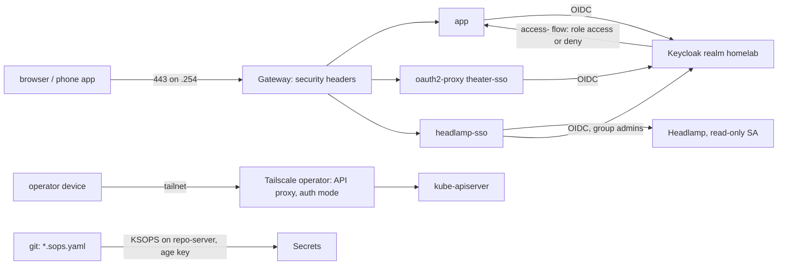

# Design: access-identity (as-is)

## Overview

Identity has one source (Keycloak); web UIs are public behind it, and the
cluster APIs have one path (the tailnet); secrets have one store (SOPS in git, age key off-cluster
plus the `sops-age` Secret).

## Components

| Path | Role |
| --- | --- |
| `platform/keycloak/realm/` | `sessions.conf`, `platform.conf`, `clients.conf`, `access.conf`, `apply.sh` |
| `platform/keycloak/realm-settings.yaml` | PostSync Job `keycloak-realm-settings`: apply and read back |
| `apps/theater/sso.yaml`, `platform/headlamp/resources/sso.yaml` | oauth2-proxy in front of apps without OIDC |
| `platform/tailscale-operator/` | Operator chart, API proxy RBAC, ProxyClass `restricted`, Connector `home-exit` |
| `bootstrap/tailscale/policy.hujson`, `.github/workflows/tailscale-policy.yaml` | Tailnet policy in git, tested on PR, applied on merge |
| `platform/headlamp/` | Headlamp chart values, HTTPRoute, RBAC, network policy |
| `platform/agent-access/rbac.yaml` | Read-only ServiceAccount for agents |
| `.sops.yaml`, `*/secrets/*.sops.yaml` | SOPS rules and sealed Secrets, one `.example` template each |
| `ci/secret-rotation.tsv`, `scripts/ci/secret_rotation.py`, `.github/workflows/secret-age.yaml` | Rotation classes, coverage and age checks |
| `scripts/leak-check.sh`, `secrets-check.sh`, `placeholder-check.sh` | Pre-commit and CI secret checks |
| `infrastructure/gateway/`, `.zap/rules.tsv`, `.github/workflows/dast.yaml` | Header filters, ZAP waivers, weekly DAST |
| `infrastructure/namespaces/namespaces.yaml` | Pod Security labels per namespace |

## Decisions

| Decision | Where |
| --- | --- |
| Long sessions for user apps, 12 h for platform tools | [architecture.md](../../../docs/architecture.md#sessions) |
| Access enforced at Keycloak, per client, by group; users stay out of git | [architecture.md](../../../docs/architecture.md#per-app-access) |
| One oauth2-proxy routing by path; app form logins kept as break-glass | [theater.md](../../../docs/theater.md#why-it-is-like-this) |
| Tailscale operator in auth mode, no inbound port | [remote-access.md](../../../docs/remote-access.md#why-it-is-like-this) |
| UIs public behind SSO and group gating, cluster APIs on the tailnet | [decisions.md](../../../docs/decisions.md#uis-public-behind-sso-cluster-apis-on-the-tailnet) |
| SOPS with one age key; no secret store in the boot path | [secrets.md](../../../docs/secrets.md#why-it-is-like-this) |
| LAN addressing is public | [decisions.md](../../../docs/decisions.md#lan-addressing-is-public) |
| Trust boundaries and accepted risks | [threat-model.md](../../../docs/threat-model.md#why-it-is-like-this) |

## Error handling

| Failure | What happens |
| --- | --- |
| Realm value drifts or `apply.sh` fails | the PostSync Job fails, the `keycloak` sync fails |
| Keycloak down | new SSO logins fail; each app's local admin is the break-glass; Headlamp is unavailable, `kubectl` over the tailnet still works |
| Lost phone | sign the user out in Keycloak and in the app; remove the device from the tailnet ([remote-access.md](../../../docs/remote-access.md#revoke-a-device)) |
| Tailnet policy rejected | the workflow fails and posts to ntfy; the tailnet keeps the old policy |
| A credential leaks | rotate per [secrets.md](../../../docs/secrets.md#rotating-a-credential); postmortem required ([sre.md](../../../docs/sre.md#postmortems)) |
