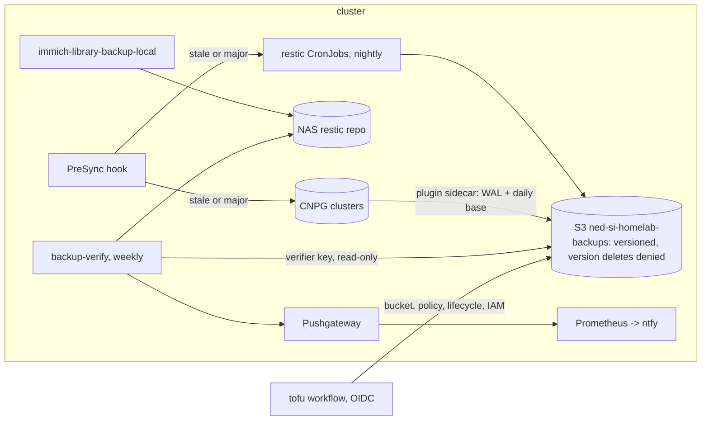

# Design: backups-dr (as-is)

## Overview

Three IAM users split the blast radius: the writer (restic jobs), `cnpg`
(only `cnpg/`) and the verifier (reads, plus `*/locks/` and `_lock-test/`).
The bucket policy sits above all of them and the account's admins.

## Components

| Path | Role |
| --- | --- |
| `apps/*/backup*.yaml`, `apps/immich/resources/backup*.yaml`, `platform/kube-prometheus-stack/routes/grafana-backup.yaml` | restic backup and prune CronJobs per app |
| `apps/*/cnpg-backup.yaml`, `platform/keycloak/backup.yaml` | ObjectStore `cnpg-backup` and ScheduledBackups |
| `platform/barman-cloud-plugin/` | The plugin and PrometheusRule `cnpg-backups` |
| `components/presync-backup/` | PreSync hook that applies the 24 h freshness rule |
| `platform/backup-verify/` | Restore tests (`files`, `mariadb`, `postgres`), the lock test, Pushgateway, alerts |
| `bootstrap/aws-backup/` | Bucket, lifecycle per repository, bucket policy, IAM users (OpenTofu) |
| `ci/active-cronjobs.txt` | Which CronJobs may run unsuspended |
| `scripts/dump-databases.sh` (`task backup:dump`), `task talos:etcd-snapshot` | Local dumps and etcd snapshots on the operator's machine |

Restore procedures:
[How to restore](../../../docs/backups.md#how-to-restore),
[Restore a Postgres cluster from S3](../../../docs/backups.md#restore-a-postgres-cluster-from-s3),
[When a restore test fails](../../../docs/backups.md#when-a-restore-test-fails),
[When the lock test fails](../../../docs/backups.md#when-the-lock-test-fails),
[etcd snapshot and restore](../../../docs/runbooks/cold-start.md#etcd-snapshot-and-restore),
[Immich rollback](../../../docs/runbooks/immich-upgrade.md#rollback).

## Decisions

| Decision | Where |
| --- | --- |
| restic to S3, plus a NAS copy for Immich; VolSync rejected | [backups.md](../../../docs/backups.md#why-it-is-like-this) |
| Restore tests in the cluster, results through a Pushgateway | [backups.md](../../../docs/backups.md#why-it-is-like-this) |
| Backup CronJobs run only once reviewed (cited as ADR 0008) | [backups.md](../../../docs/backups.md#why-it-is-like-this) |
| Barman Cloud plugin, a separate IAM user scoped to `cnpg/` | [backups.md](../../../docs/backups.md#why-it-is-like-this) |
| Postgres majors wait for `serverName` | [backups.md](../../../docs/backups.md#why-it-is-like-this) |
| Versioning plus a deny-version-deletion policy, not Object Lock | [backups.md](../../../docs/backups.md#why-it-is-like-this) |
| Database majors fix forward; PreSync backup makes that possible | [decisions.md](../../../docs/decisions.md#database-majors-fix-forward) |
| No prune where a deletion is an outage; data PVs `Retain` | [decisions.md](../../../docs/decisions.md#no-prune-where-a-deletion-is-an-outage) |
| The media library is not backed up | [backups.md](../../../docs/backups.md#why-it-is-like-this) |

## Error handling

| Failure | What happens |
| --- | --- |
| A backup Job fails | `KubeJobFailed` of a `*-backup-*` Job pages |
| PreSync backup fails | the sync fails; no database change lands without a backup |
| A restore test fails | `BackupVerifyFailed` pages; treat as data at risk until a restore passes |
| Lock statement removed | `BackupLockBroken` pages; the `tofu` workflow re-applies the policy |
| Lock test inconclusive | only the run time is pushed; `BackupLockCheckStale` after 8 days |

Known gaps (sample restores, torn SQLite copies, no ZFS snapshots for media,
full restore time not measured):
[backups.md](../../../docs/backups.md#known-gaps).
