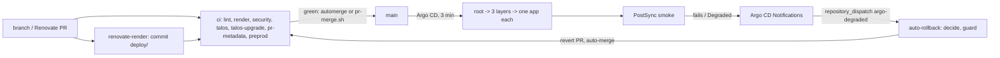

# Design: gitops-delivery (as-is)

## Overview

One branch, one gate, one deploy path. Every step that decides (render
check, policies, merge, revert) is a script with fixed inputs, run in CI.

## Components

| Path | Role |
| --- | --- |
| `bootstrap/root-app.yaml`, `clusters/homelab/` | The root, three AppProjects with enumerated kinds, the layers, one Application file per app |
| `scripts/render-deploy.sh`, `deploy/` | Pre-rendered manifests, one file per object; `*/secrets` and upstream charts stay unrendered |
| `.github/workflows/ci.yaml` | The jobs and the aggregate `ci` check |
| `scripts/ci/repo_policy.py` | Repository invariants: root profiles, finalizers, PVC sync options, CronJob guards, image digest, variant and bulky base, K8s version, bootstrap chart versions |
| `policies/kyverno/` | CI policies over `deploy/`, with their own tests |
| `scripts/ci/kind-preprod.sh`, `ci/kind-workloads.txt` | Server-side dry run and a real boot on kind |
| `.github/renovate.json5` | Automerge, caps with reasons, variant keeps, digest grouping |
| `.github/workflows/renovate-render.yaml`, `scripts/ci/commit-render.sh` | Re-render on Renovate branches |
| `components/postsync-smoke` | Deploy-time probe Job per user-facing app |
| `.github/workflows/auto-rollback.yaml`, `scripts/ci/auto-rollback-{decide,guard,act}.sh` | Revert decision, outage guard, revert PR |
| `scripts/pr-merge.sh` | Squash merge on green `ci` |
| `.github/workflows/codeql.yaml`, `scorecard.yaml`, `dast.yaml` | SAST, OpenSSF Scorecard, weekly DAST |

Branch protection lives in the GitHub settings, not in a file; read it with
`gh api repos/ned-si/homelab/branches/main/protection`.

## Decisions

| Decision | Where |
| --- | --- |
| `main` is production; rollback is a revert | [decisions.md](../../../docs/decisions.md#main-is-production) |
| Adopt at parity, change afterwards | [decisions.md](../../../docs/decisions.md#adopt-at-parity-change-afterwards) |
| No prune where a deletion is an outage | [decisions.md](../../../docs/decisions.md#no-prune-where-a-deletion-is-an-outage) |
| Argo CD manages its own release; Talos and bootstrap Secrets stay by hand | [decisions.md](../../../docs/decisions.md#hand-installed-only-where-git-cannot-reach) |
| Squash merge through `pr-merge.sh` | [decisions.md](../../../docs/decisions.md#squash-merge) |
| No human gates; Code-Review an accepted Scorecard gap | [decisions.md](../../../docs/decisions.md#no-human-gates) |
| Deterministic first | [decisions.md](../../../docs/decisions.md#deterministic-first) |
| Database majors fix forward | [decisions.md](../../../docs/decisions.md#database-majors-fix-forward) |
| Automatic rollback with an outage guard, no GitHub issues | [decisions.md](../../../docs/decisions.md#automatic-rollback) |
| Four test layers | [testing.md](../../../docs/testing.md#why-it-is-like-this) |

## Error handling

| Failure | What happens |
| --- | --- |
| `deploy/` stale | `render` fails; Renovate branches are re-rendered by `renovate-render` |
| Smoke hook fails | sync fails, auto-rollback opens the revert, the revert runs the hook again |
| The revert also fails | nothing more is reverted (a revert is never reverted); `ArgoCDAppStillDegraded` pages |
| Outage (3+ apps, node, NAS) | revert held back; the decision is written to the run summary |
| `cilium`, `democratic-csi` or Argo CD itself broken | no automatic revert; a person acts |
| Database schema migrated by the bad deploy | the revert PR says so; restore from backup ([backups-dr](../backups-dr/design.md)) |
