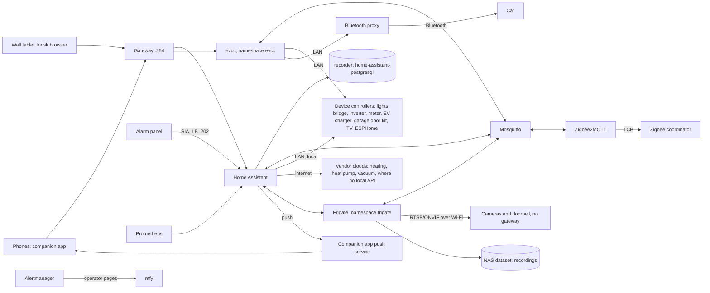

# Design: home-automation

## Overview

Home Assistant stays one pod in namespace `home` (no `hostNetwork`,
devices added by IP, Keycloak login), as in
[docs/home-automation.md](../../../docs/home-automation.md). Around it:

Each device keeps its own controller. Home Assistant reads, automates
and shows; it is never the only path for the lamps, the heating, the
doorbell, the garage door or the vacuum (Requirement 11), nor for the
alarm (Requirement 7). Nothing in the picture is a paid service
(Requirement 1.5).

## Feasibility research (2026-11-04)

What the current sources say per category. Models are unknown until the
operator's label photos (Requirement 1); the inventory file holds the
per-device findings, the table below only the options.

| Category | Options | Local or cloud | Notes |
| --- | --- | --- | --- |
| Lights | The lights' vendor bridge, local integration by IP | Local | The bridge keeps scenes, schedules and switch bindings without Home Assistant; switches show up as event entities for extra automations |
| Outdoor lights and motion | Outdoor fixtures or outdoor motion sensors on the lights' bridge; or a Zigbee relay behind an existing fixture's switch and a Zigbee outdoor motion sensor bound to it | Local | The binding works without Home Assistant (Requirement 16.2); work on fixed wiring is done by an electrician where Swiss rules require one |
| Heating | The heating vendor's official integration (often cloud); a local RF option where the system has one (the radio on the Zigbee Pi, shared over TCP like the Zigbee coordinator); non-smart heaters through a rated plug | Cloud or local, the model decides | [HomeKit Device](https://www.home-assistant.io/integrations/homekit_controller/) needs mDNS discovery, which this pod network does not have, so it is not used. Plug-in electric heaters keep their own thermostat dial and regulate themselves; the plug only enables or disables them (away, window open), with `power_on_behavior: on`, a rating of at least the heater's load (Swiss sockets: 10 A), and no `generic_thermostat`. A heater without its own thermostat is not automated (Requirement 11.2) |
| Room climate | Combined sensors with an NDIR CO2 cell, temperature and humidity, mains (USB) powered, through Zigbee2MQTT or ESPHome; battery Zigbee temperature and humidity sensors for spaces without CO2 and the server corner | Local | NDIR cells draw too much for batteries; mains Zigbee devices also route, which extends the mesh outdoors. Models are picked against the [Zigbee2MQTT device list](https://www.zigbee2mqtt.io/supported-devices/) or ESPHome. The server-corner sensor feeds a homelab alert ([Server corner](#server-corner)) |
| Garage door | The opener kit's local integration: its own local API, ESPHome or MQTT, wired in parallel with the wall button | Local | Model from the label photo; a cloud-only kit is read at most, never used for control ([Garage door](#garage-door)) |
| Solar inverter | The inverter vendor's local integration (Modbus TCP or HTTP) when it has one; its cloud otherwise | Local for most current inverters | Brand and model from the label photo; [Energy](https://www.home-assistant.io/docs/energy/) takes production, grid and battery sensors |
| Grid meter | The inverter's own meter; the utility meter's customer interface, if the grid operator enables it, read by an ESPHome or P1-style reader; otherwise a three-phase meter with current clamps and a local API | Local | evcc needs grid power at least every 10 seconds (Requirement 20.3); clamps in the distribution board are electrician's work |
| Heat pump | The vendor's cloud integration, or a local interface (the vendor's Modbus gateway, or ESPHome on the unit's service port) | Cloud by default | Some vendor clouds cap requests (one major heat-pump vendor at 200 per day per application, source in the inventory file); Requirement 4.3 keeps polling under half |
| EV charger and car | The charger's local integration, read-only (power, energy, vehicle connected); [evcc](https://docs.evcc.io/) for control | Local: the car over a Bluetooth proxy on the LAN | Where the charger cannot set the current, evcc sets it through the car, and reads its charge state, over Bluetooth; the car vendor's API is paid per use and is not used (sources in the inventory file), see [Solar-surplus charging](#solar-surplus-charging) |
| TV and streamer (optional) | The TV vendor's local integration; for the streamer, if the household uses it, [Android TV Remote](https://www.home-assistant.io/integrations/androidtv_remote/) and [Cast](https://www.home-assistant.io/integrations/cast/) with its known-hosts option | Local | Added by IP, no discovery needed. Without broadcast from the pod, Wake-on-LAN does not reach the TV; the TV's own integration switches it on where it can, and other sources on its HDMI switch may wake it through CEC. Skipped with the reason if it does not work (Requirement 17) |
| Robot vacuum | The vendor's integration, a community one pinned in the `custom-components` init container (exists) | Cloud | Read, start, dock; the robot's own schedule and app work without it |
| Mailbox | A Zigbee contact or vibration sensor on the flap; an outdoor-rated mains Zigbee router (repeater) near it if the link is weak; ESPHome in deep sleep on the nearest access point if Zigbee still does not reach | Local | A metal mailbox blocks radio: the radio sits outside the metal. A mains Zigbee device near the mailbox (a plug, a nearby room sensor, an outdoor router) extends the mesh |
| Appliances | The vendors' integrations, mostly cloud community ones, pinned in the `custom-components` init container | Cloud | Read and start only; nothing safety-related depends on them |
| Smoke alarms | Zigbee models through Zigbee2MQTT; gateway models through their cloud, or none | Local if Zigbee | Low priority. The alarms sound on their own; Home Assistant only adds the critical notification |
| Plants | Zigbee moisture sensors through Zigbee2MQTT; BLE sensors with light and conductivity through an ESPHome [Bluetooth proxy](https://esphome.io/components/bluetooth_proxy/); [Plant Monitor](https://github.com/Olen/homeassistant-plant) with [OpenPlantbook](https://github.com/Olen/home-assistant-openplantbook) thresholds | Local (OpenPlantbook only fetches species data) | Many Zigbee soil sensors have no light sensor; light needs BLE or a Zigbee model with lux. OpenPlantbook needs an account ([credentials](#credentials)) |
| Watering plug | Zigbee smart plug | Local | Run time limited by the watering device's timer or the plug's countdown (Requirement 5.3) |
| Cameras and doorbell | Outdoor Wi-Fi RTSP/ONVIF cameras on mains power; a doorbell with a speaker and a microphone ([ONVIF](https://www.home-assistant.io/integrations/onvif/)), recorded by [Frigate](https://docs.frigate.video/) and shown through the [Frigate integration](https://github.com/blakeblackshear/frigate-hass-integration); the doorbell's press through its local integration or an ONVIF event | Local | Cloud-only cameras do not fit; replacements are bought for RTSP, ONVIF and a detection sub-stream ([Frigate hardware](https://docs.frigate.video/frigate/hardware)). Frigate does not see the doorbell's button |
| Alarm | [SIA Alarm Systems](https://www.home-assistant.io/integrations/sia/) (SIA DC-09 over IP, local) when the panel can report to a second receiver; else the vendor's integration, or none | Local with SIA | The brand is still unknown; the label photos decide. SIA is receive-only: state and sensors, no arming. The panel sends to the receiver below |
| Wall tablet | Any tablet with a current browser engine; [Fully Kiosk Browser](https://www.home-assistant.io/integrations/fully_kiosk/) for kiosk mode, screen and motion control | Local | The companion app needs Android 6+ ([requirements](https://companion.home-assistant.io/docs/getting_started/)); the frontend needs a recent WebView, which is what an old tablet usually lacks |
| Phones | Companion app, Keycloak login through `hass-oidc-auth` (already working) | Push through the app's push service | 500 pushes per device per day ([rate limits](https://companion.home-assistant.io/docs/notifications/notification-details)) |
| Blinds, air conditioning (later) | Zigbee blind motors; air-to-air units with a local Wi-Fi integration | Local | Deferred; Requirement 12 |

### SIA receiver

The SIA integration listens on a port and the panel sends to it. Home
Assistant has no `hostNetwork`, and the Gateway on `.254` carries HTTP(S)
only, so the receiver gets its own Service:

- Service `home-assistant-sia`, type LoadBalancer, pinned with
  `lbipam.cilium.io/ips: "192.168.1.202"` (next free address in `pool-2`),
  one TCP port, the SIA integration's listening port, to the Home
  Assistant pod. A row in the LoadBalancer table of
  [docs/networking.md](../../../docs/networking.md#loadbalancer-ips).
- No router port forward: the panel is on the LAN, on a fixed address.
- The `home` ingress allow-list admits LAN sources on that port only. It
  cannot narrow to the panel's address: L2 announcements need
  `externalTrafficPolicy: Cluster` (docs/networking.md), and a node that
  forwards to the pod on another node can replace the source with its own
  address. The panel's account ID and AES key, entered in the UI
  ([credentials](#credentials)), authenticate its messages.

### Frigate on this cluster

- The RK3588 NPU and video decoder are not usable from Talos. Frigate's
  Rockchip build needs Rockchip's BSP kernel (5.10 or 6.1) with the
  `rknpu` and `rkvdec2` drivers
  ([installation](https://docs.frigate.video/frigate/installation#rockchip-platform)).
  Talos runs a mainline kernel. Mainline has its own NPU driver, `rocket`,
  since Linux 6.18 ([kernel docs](https://github.com/torvalds/linux/blob/master/Documentation/accel/rocket/index.rst)),
  driven through Mesa's Teflon TFLite delegate, which Frigate does not use
  ([discussion](https://github.com/blakeblackshear/frigate/discussions/18311)).
- So Frigate here runs the standard arm64 image: recording copies the
  camera streams without decoding them; only the low-resolution detection
  streams are decoded on the CPU, and detection starts on the CPU detector
  (which Frigate does not recommend for production,
  [detectors](https://docs.frigate.video/configuration/object_detectors)).
- Frigate is pinned to the worker (`nodeSelector`
  `kubernetes.io/hostname: homelab-w-1`): the control planes take
  workloads too, and CPU detection next to etcd would compete with it.
- The trial (task 19) measures it with the first two cameras. The
  threshold to add an accelerator: mean inference above 50 ms, skipped
  detections at 5 fps on the detection streams, or Frigate's CPU above 2
  cores sustained on the worker. The accelerator is a USB one (a Coral
  USB, or what Frigate's hardware page recommends then for USB on arm64),
  in the Turing Pi's USB port on the worker node (confirmed first with
  `talosctl -n 192.168.1.240 get devices` or `dmesg`), handed to the pod by
  [generic-device-plugin](https://github.com/squat/generic-device-plugin)
  ([Talos device plugins](https://docs.siderolabs.com/kubernetes-guides/advanced-guides/device-plugins)),
  so the Frigate pod needs no `privileged`. The plugin itself is a
  privileged DaemonSet and gets its own Kyverno PolicyException.
- Frigate runs as root inside its container today
  ([discussion](https://github.com/blakeblackshear/frigate/discussions/22837));
  a non-root setup exists as a community recipe
  ([discussion](https://github.com/blakeblackshear/frigate/discussions/18375)).
  Frigate gets its own app and namespace `frigate`, so `home` can move to
  `restricted` Pod Security (#724) whatever Frigate needs: the non-root
  recipe first, else `baseline` with a Kyverno PolicyException that names
  the reason.
- Config: the Secret's `config.yml` is mounted with `subPath` at
  `/config/config.yml`, read-only, over the PVC `frigate-data` at
  `/config` (event database). Frigate has no switch for UI editing; the
  read-only file is what turns it off. A `subPath` mount does not follow
  Secret changes, so a config change restarts the pod.
- Upgrades: on a read-only file Frigate skips its config migration
  (`frigate/util/config.py` checks write access and logs that it cannot
  migrate). A Renovate rule for the Frigate image: patches automerge;
  minors and majors carry the `no-automerge` label, and their PR updates
  the Secret's `config.yml`, including its `version:`, from the release
  notes.
- MQTT: Mosquitto refuses anonymous clients. User `frigate` (key in
  `apps/secrets/mosquitto-users.sops.yaml`, ACL block `user frigate` /
  `topic readwrite frigate/#` in `apps/home/config/mosquitto/acl`), the
  same password as `FRIGATE_MQTT_PASSWORD` in the Frigate Secret, used in
  the config as `{FRIGATE_MQTT_PASSWORD}`. The `frigate` and `home`
  allow-lists admit Frigate to `mosquitto.home:1883` and Home Assistant to
  `frigate:5000`.

### Storage for recordings

Recording without re-encoding stores the camera's main stream as is. At
about 4 Mbit/s and 30% motion, one camera writes about 13 GB per day,
about 90 GB for 7 days of motion. Alerts kept 30 days and detections kept
14 days come on top: the quota is set in task 18 from the camera count in
the inventory file, plus 30% for them; default 1 TB. A new NAS dataset,
`homelab/k8s/nfs/frigate`, mounted over NFS like the media share
(`homelab/k8s/nfs/media`), `Retain`, excluded from restic. The NAS pool
has the room; the quota keeps a camera that streams noise from filling it.
When less than about an hour of recording space is left, Frigate deletes
the oldest recordings first, whatever the retention
([recording docs](https://docs.frigate.video/configuration/record)), so a
full quota shortens the history and never stops recording.

### Wi-Fi for cameras and devices

Cameras and the doorbell use Wi-Fi and mains power: Ethernet cabling to
the camera positions is not practical. The house has a Wi-Fi mesh of
access points; some units have a wired backhaul, others a wireless one
(details in the inventory file).

- Load: Frigate pulls each camera's record stream all the time and keeps
  only what retention asks for; with the detection stream, a camera sends
  about 4-6 Mbit/s around the clock. Even ten cameras are about
  50 Mbit/s, small next to the mesh's capacity. The risks are signal strength and
  airtime, not total bandwidth.
- Wireless backhaul: a mesh unit on a wireless backhaul sends every frame
  over the air twice, to the unit and on to the next one. On a dual-band
  unit both hops share the 5 GHz radio, so its clients get about half the
  throughput. Camera positions served by a unit with a wired backhaul, or
  by the unit at the router, come first.
- Acceptance per position, before a camera is bought for it: the phone
  shows at least -65 dBm on 5 GHz there, then the camera passes the
  24-hour stream test (Requirement 6.7). A position that fails gets, in
  order: the main stream lowered to 2 Mbit/s H.265, the camera or the unit
  moved, or a wired backhaul for that unit (Ethernet or powerline,
  purchase).
- 2.4 GHz is shared with Zigbee. The mesh's 2.4 GHz channel is fixed at 1
  or 6 instead of automatic, and Zigbee runs on 25 (or 15 or 20 after a
  scan), away from it. Zigbee2MQTT's default, 11, overlaps Wi-Fi channel 1.
  The channel is set in task 2, before pairing: changing it later can mean
  re-pairing devices.

Isolation the mesh can offer:

- Its guest network gives clients internet and no LAN. Cameras need the
  opposite: the NVR on the LAN and no internet. Not used for cameras.
- Its IoT network is a separate SSID on the same LAN, for 2.4 GHz-only
  devices: compatibility, not isolation.
- In access point mode it tags no VLAN on any SSID (source in the
  inventory file). A camera VLAN is not wanted anyway (Non-goals).
- A router's DMZ setting is not isolation: it forwards every inbound port
  from the internet to one LAN host, which exposes that host. It is not
  used.

So cameras and the doorbell are isolated on the device (Requirement 6.5):
a fixed address in `192.168.1.21`-`.49`, no gateway and no DNS server, so
they cannot reach the internet even if a cloud feature turns itself back
on; cloud, P2P and UPnP off; no port forward. Frigate and Home Assistant
reach them on the same subnet. Setup in the vendor app happens once,
before the gateway is removed; firmware is then updated by hand from a
downloaded file. A camera's clock can drift without NTP: Frigate stamps
recordings with its own time. This keeps cameras off the internet while
their firmware behaves; it does not contain a compromised camera, which
could set its own gateway. No separate network is planned for that: the
homelab already treats the LAN as untrusted (Keycloak in front of every
UI, network policies per app), and a compromised camera reaches nothing
there that a phone on the LAN could not.

Other Wi-Fi devices (TV, streamer, vacuum, charger, meter, room sensors on
ESPHome) stay on the main LAN with internet where their integration needs
it, on fixed addresses where Home Assistant adds them by IP.

### Solar-surplus charging

- evcc runs as its own app, `evcc` in namespace `evcc`, one replica, arm64
  image (checked in task 17), config from the SOPS Secret
  `apps/secrets/evcc-config.sops.yaml`, state on the PVC `evcc-data`
  (`iscsi-retain`, restic).
- Inputs: solar production from the inverter, grid power from the
  inverter's meter or the utility meter's customer interface, at least
  every 10 seconds; if neither gives it, a three-phase meter with current
  clamps and a local API (purchase, electrician). The charger's own
  integration gives power and "vehicle connected".
- Control: where the charger cannot set the current, evcc sets it through
  the car over a local Bluetooth proxy: a small board (an ESP32 or a
  Linux board) in the car's Bluetooth range where it parks, on Wi-Fi,
  answering evcc over HTTP on the LAN. Start, stop, current and the
  charge state all go over Bluetooth, through evcc's Bluetooth vehicle
  template, so no vehicle cloud API is needed. The car vendor's API is
  paid per use above a monthly credit, and cloud command proxies are paid
  services; neither is used (Requirement 1.5; sources in the inventory
  file).
- On three phases at 6 A, the lowest charging power is about 4.1 kW, so
  solar-only charging starts above that surplus; "minimum plus solar"
  charges at that floor and adds the surplus.
- Home Assistant: evcc publishes to MQTT (user `evcc`, ACL
  `topic readwrite evcc/#`, password in `mosquitto-users` and in evcc's
  Secret, a `ci/secret-rotation.tsv` row); Home Assistant shows the
  sessions and sets the mode through MQTT entities.
- UI: `charge.lilalala.com` on the shared Gateway, behind an oauth2-proxy
  built like `apps/theater/sso.yaml`: `proxy_clients` entry
  `evcc:household` in `platform/keycloak/realm/platform.conf`, redirect
  URI `https://charge.lilalala.com/oauth2/callback` in `clients.conf`,
  `access.conf` line `evcc=admins household`, proxy `allowedGroups:
  [admins, household]`, the client secret as `EVCC_CLIENT_SECRET` in the
  Keycloak realm Secret and in the proxy's Secret (one value, a
  `ci/secret-rotation.tsv` row). The whole household may open it, though
  the operator is its only expected user. Task 17 starts after
  household-access-groups task 1 has merged (the `household` group
  exists).
- Templates: the evcc templates used (charger, vehicle, meters) need no
  sponsor token, which is a paid sponsorship. Task 17 records, for each,
  the evcc docs' template page and "no sponsor token". If a needed
  template requires one, the operator decides in chat between a one-time
  sponsorship (a purchase, Requirement 1.4) and not using it.
- Bluetooth proxy: the proxy's key gets the most limited role the car
  offers that still allows charging commands and the charge state (the
  role and its source in the inventory file); a full owner key is used
  only if the car offers no such role, and the PR says so. The board has
  a fixed address in `192.168.1.21`-`.49` with no gateway and no DNS
  server, as the cameras have (it needs no internet). Where its firmware
  can turn off endpoints other than charging and state, they are off.
  Accepted residual: a LAN host can start or stop charging.
- Home Assistant only, or evcc's own UI too: Home Assistant shows the mode,
  the power and the sessions through MQTT, which covers the daily use.
  evcc's UI adds what Home Assistant does not show well (charge plans by
  a target time, the session log, its own diagnostics) and keeps working
  when Home Assistant is down. The cost is one route and one oauth2-proxy
  client. Both are kept.
- Fallback: with evcc down, the car charges when plugged in at the last
  current evcc gave it or the one set in its app (Requirement 20.6).

### Outdoor lighting

The current outdoor lights are replaced, not automated as they are
(Requirement 16.1). Positions and counts are in the inventory file.

- Fixtures: outdoor fixtures on the lights' bridge at every existing
  powered point; a Zigbee relay behind a fixture only where the household
  keeps one. The fixtures of one outdoor area are replaced as one set, so
  they match and share one bridge group.
- Each new point of the inventory file, where the power is already in
  place, gets a bridge fixture like the others.
- Motion: outdoor motion sensors on the bridge, bound to their group
  (Requirement 16.2); camera detections only add a trigger at night.
- Order: area by area, in the order of the inventory file, each one
  purchase the operator approves. Work on fixed wiring is the
  electrician's.
- Fallback: wall switches and the bridge (Requirement 11.1, lamps).

### Garage door

- The opener kit is wired in parallel with the opener's wall button, so
  the button and the remotes work with or without it (Requirement 21.2).
  Its integration and whether it needs a separate door-position sensor
  come from the label photo; a Zigbee contact on the door is the fallback
  for the state.
- Home Assistant opens and closes, notifies when the door stays open
  (Requirement 21.3), and never closes it by automation: a door that
  closes on its own when nobody watches is a safety risk.
- The wall tablet's user sees the state without the control; the tablet
  is shared and at hand for anyone in the house (Requirement 21.4).
- Opening is the first control here that gives physical access, and Home
  Assistant is public. The operator decided (2026-11-05) that access is
  the gate: any authenticated user with the control opens and closes from
  anywhere, with no `home` zone check (Requirement 21.5). The defaults
  that remain: OTP on the login of the users who get the control (a new
  issue against household-access-groups if their group lacks it) and one
  household notification on every open, naming the user.

### Server corner

- A battery Zigbee temperature and humidity sensor where the cluster and
  the NAS stand, named generically (`sensor.homelab_rack_temperature`,
  `sensor.homelab_rack_humidity`).
- Prometheus already scrapes Home Assistant's `/api/prometheus` (the
  Grafana "Home" dashboard), with `prometheus: namespace: hass` and the
  `sensor` domain included (`apps/home/config/configuration.yaml`), so the
  sensor needs no config change. Two rules in
  `platform/kube-prometheus-stack/routes/homelab-rack-alerts.yaml`:
  - `HomelabRackHot`:
    `hass_sensor_temperature_celsius{entity="sensor.homelab_rack_temperature"} > 35`,
    `for: 15m`, `action: human`, with the runbook
    `docs/runbooks/alerts/HomelabRackHot.md` (check the space's airflow,
    then the nodes' temperatures);
  - `HomelabRackWarm`: the same series `> 30`, `for: 30m`, an INFO event
    on the dashboards.

  Unit tests in `tests/prometheus/`, and a line in
  `tests/alertmanager/routes.txt`.
- When Home Assistant is down the series goes stale and neither rule
  fires; the Home Assistant probe already pages.

### Public data

For the future public website (its own roadmap item): what the house may
show, and how.

- Only aggregated, delayed values that say nothing about who is home:
  for example the solar production of each past day, the month's
  self-consumption share, the yearly CO2 saved. Never live power, grid
  import, consumption by hour, charging sessions, camera, door, presence,
  lights or the alarm: live or hourly values show when the house is empty
  and the household's routine.
- Pushed, not pulled: once a day, after midnight, a job in the cluster
  reads yesterday's totals from the recorder and publishes a small static
  file to wherever the website is built. The website never calls Home
  Assistant: no new route, no Home Assistant token on a public server, no
  query a visitor can shape. If the job fails, the site shows the last
  day it has.
- The job holds a read-only database role on the recorder's statistics
  tables and a write credential for that one file only; no Home Assistant
  token.
- The values and their delay are listed in the website's spec and checked
  there against this section.

### Matter and Thread

The Matter server needs the host network with IPv6 link-local multicast on
the same LAN as the devices
([OS requirements](https://github.com/home-assistant-libs/python-matter-server/blob/main/docs/os_requirements.md)).
Home Assistant here has no `hostNetwork` on purpose. Matter and Thread
devices are not bought (Requirement 12.1); if one is ever needed, a Matter
server with `hostNetwork` on one node is a new issue with its own
PolicyException.

### Cluster egress

The `home`, `frigate` and `evcc` allow-lists (#709) limit egress to the
device range, the NAS, Mosquitto and the vendor clouds the feasibility
table lists.

### Fallback when Home Assistant or the cluster is down

Must keep working (Requirement 11.1, tested):

| Function | Keeps working because |
| --- | --- |
| Lamps, indoor and outdoor | The bridge holds lights, scenes, schedules, switch and motion bindings; the vendor app works on the LAN; direct Zigbee bindings for anything else a person needs (Requirement 2.4) |
| Heating, basic functions | The controller's own schedule and controls; Home Assistant only overrides with an end time. Plug-in heaters keep their thermostat dial and power on after a power cut |
| Doorbell | Its own chime; its vendor app shows and talks to the visitor on the LAN |
| Garage door | The wall button and remotes; the kit is in parallel |
| Robot vacuum | Its own schedule and app |

May stop until Home Assistant is back (Requirement 11.3), with what still
holds:

| Function | What still holds |
| --- | --- |
| Alarm | Not affected: the panel is autonomous (Requirement 7) |
| Cameras | Each camera records to its own card |
| Car charging | The car charges at its last current or its app's setting (Requirement 20.6) |
| Watering | The device's timer or the plug's countdown; the plug starts off after a power cut |
| Notifications, plants, mailbox, dashboards, TV | Nothing; they resume when Home Assistant is back |
| Wall tablet | Shows "disconnected"; the vendor apps on the phones still work |

Home Assistant down is already an operator page (blackbox probe and SLO).

### Fallback test

Weekday daytime, by the operator or a run whose brief allows live writes.
The Application `home` and the layer `apps` both run `selfHeal`, so a
`kubectl scale` or an `argocd app set` alone is reverted within seconds;
automated sync is turned off in git, as in the
[Keycloak OTP runbook](../../../docs/runbooks/keycloak-otp.md):

1. A PR removes `automated:` from `clusters/homelab/apps/home.yaml`
   (render, merge with `scripts/pr-merge.sh`).
2. `scripts/maintenance-silence.sh home 30m "fallback test, PR #<n>"`.
3. `kubectl -n home scale deploy/home-assistant --replicas=0`.
4. The checks of Requirement 11.1 for what the phase added, for 10 minutes.
5. `kubectl -n home scale deploy/home-assistant --replicas=1`; the
   entities match the devices within 5 minutes (Requirement 11.4).
6. A PR restores `automated:` (revert of step 1); Argo CD shows `home`
   Synced and Healthy.
7. `scripts/maintenance-silence.sh --expire <id>`.

The result and the 10 minutes of downtime against the error budget go in
the task's PR. The evcc fallback (Requirement 20.6) is tested the same way
on `clusters/homelab/apps/evcc.yaml` and `deploy/evcc`, once, in task 17.

### Notifications

- Household notifications use the companion app's `notify` actions,
  through one script per purpose (`notify_security`, `notify_plants`,
  `notify_house`, `notify_admins`) whose members are set in the UI (they
  name phones).
- Critical notifications only for the alarm, and for smoke and water leaks
  if such sensors are added.
- Cooldowns: one per camera per 5 minutes, one per doorbell press per 30
  seconds, one per plant per day, one CO2 reminder per room per 2 hours,
  one mail notification per day, one per garage-door opening left open,
  one weekly digest for batteries, silent sensors and vacuum consumables.
- ntfy stays the operator's pager for the platform, and Alertmanager
  routes no house event. Home Assistant's ntfy integration would be set up
  in the UI and stored in `.storage`, where no repo check sees it, so the
  control is the network: the `home` egress allow-list (#709) has no
  `ntfy.sh`. A repo-policy rule over `apps/home/config/` is only a second,
  YAML-only guard.

### Identity and access

- Phones: the companion app with Keycloak, as today. Household members
  get normal users; `HomeAssistantAdmins` gets admin with OTP.
- Wall tablet: a local, non-admin user (`wall`), logged in once through
  `https://home.lilalala.com/?skip_oidc_redirect=true` with a generated
  password from the operator's password manager. Not a Keycloak account:
  a shared device cannot answer OTP, and the refresh token keeps it logged
  in. `trusted_networks` is not used: the companion app docs advise against
  it, and requests through the Gateway and NAT loopback do not keep a
  reliable client address.
- Wall tablet replacement, only if the trial fails. Selection rule: the
  Android System WebView updates through Play, the screen is 10" or more,
  and power can be permanent. Classes, the first is the default:
  1. A current Android 10-11" tablet with Play services (about 150-300).
  2. A Fire tablet with Fully Kiosk sideloaded (about 100-150): cheaper,
     slower WebView.
  3. A wall-mount Android panel with PoE or USB-C power (about 250-450):
     cleaner install, pricier.
- The tablet user has no alarm or garage-door controls; Home Assistant
  never arms or disarms the panel (Requirement 7.3), and the garage door
  opens only from the phones (Requirement 21.4).

### Credentials

Vendor cloud logins, the SIA account ID and AES key, OpenPlantbook and
similar API credentials are entered in the Home Assistant UI and stored in
`/config/.storage` on `home-assistant-config` (backed up), never in git.
Each one is recorded in the operator's password manager with the
integration it belongs to. `ci/secret-rotation.tsv` lists only sealed
files, so these have no row there; a credential that moves into a SOPS
file gets one. The car's Bluetooth key pairing lives on the proxy board,
with the limited role of [Solar-surplus charging](#solar-surplus-charging);
the proxy's address and evcc's settings are in evcc's Secret, with a row
for `evcc-config.sops.yaml`.

### Dashboards

- Built in the UI (sections view), stored in `/config/.storage` on
  `home-assistant-config` and kept by its backup. Not in git: they name
  rooms and devices.
- Main Home dashboard (default for everyone): the tiles of Requirement
  8.1; each tile navigates to its dashboard.
- Area dashboards: Lights (indoor and outdoor), Climate and energy (rooms,
  heating, the built-in Energy dashboard, the car), Plants, Security
  (cameras, doorbell, garage door, alarm, doors), Media (vacuum, the TV
  if integrated).
  Wall tablet: large tiles, landscape, no admin controls, the doorbell's
  live view on a press. System: admin only (updates, batteries,
  integrations in error).
- The Grafana "Home" dashboard keeps the long-term metrics from
  `/api/prometheus`.

### Backups

| Data | Where | Backup |
| --- | --- | --- |
| Home Assistant config, dashboards, users | PVC `home-assistant-config` | restic `home/configs`, nightly (exists) |
| History and statistics | `home-assistant-postgresql` | CNPG WAL and daily base backup, nightly `pg_dump` (exists) |
| Zigbee network key, coordinator backup, devices | PVC `zigbee2mqtt-data` | restic, added with #728 |
| evcc config | SOPS Secret `evcc-config` in git (`apps/secrets/`) | git |
| evcc sessions and settings | PVC `evcc-data` (`iscsi-retain`) | restic, added in task 17 |
| Frigate config | SOPS Secret `frigate-config` in git (`apps/secrets/`), generic camera names | git |
| Frigate event database | PVC `frigate-data` (`iscsi-retain`) | None: of little use without the recordings |
| Recordings | NAS dataset `homelab/k8s/nfs/frigate` | None (local only, by design) |
| Lights bridge | The bridge | None in the homelab; the vendor app and account hold it |

## Phases

Each phase ends with the [fallback test](#fallback-test) of Requirement
11.1.

1. **Current hardware, no purchase.** Inventory and feasibility (task 1);
   Zigbee online on its chosen channel (#728, task 2); lights and
   automations; heating; energy from what the inverter, meter and heat pump
   allow; plants with the existing sensors; notifications; the main Home
   and area dashboards; the existing tablet on trial; the alarm through SIA
   if the panel supports it; the TV, if it integrates (optional); the
   robot vacuum; the garage door with the kit the operator already has.
2. **Small purchases.** The watering plug, plant sensors with light and a
   Bluetooth proxy where needed, door and window contacts (window-open
   heating rule), a smart plug for the tablet's charging, room climate
   sensors and the server-corner sensor with its alert, the mailbox sensor
   (and an outdoor Zigbee router if needed), the outdoor lighting
   replacement and motion sensors, a meter reader or a three-phase meter
   if grid power is missing, the car's Bluetooth proxy and evcc, a local
   heating or heat pump interface if the cloud is not good enough, a new
   tablet if the trial fails.
3. **Cameras.** The Wi-Fi check of each outdoor position, Frigate with the
   CPU trial on the first two cameras, the other cameras and the doorbell
   one by one after each passes its stream test, then an accelerator if
   the trial says so. The current cloud cameras are retired once the new
   ones record. A second doorbell at a second entrance, if the operator
   wants one, comes last.
4. **Later (deferred issues).** Motorised blinds (Zigbee motors),
   air conditioning (an air-to-air unit with a local integration),
   anything from the suggestions the operator picks.

## Purchases

Rough prices in CHF, street prices in late 2026, for planning only. Nothing
is bought without the operator's approval in chat.

| Item | Phase | Rough cost | Needed when |
| --- | --- | --- | --- |
| Network Zigbee coordinator (Ethernet, PoE) | 1 | 40-60 | Only if the Raspberry Pi path for the existing coordinator is not wanted |
| Fully Kiosk PLUS licence | 1 | ~8 | For the tablet trial: the Home Assistant integration needs Remote Administration, a PLUS feature |
| Zigbee smart plug with metering, for the watering device | 2 | 15-25 | Always |
| Zigbee smart plug, for the tablet's charging | 2 | 15-25 | Always |
| Plant sensors with light (BLE or Zigbee), each | 2 | 15-30 | For plants where light matters |
| ESP32 board for the Bluetooth proxy | 2 | 10-20 | If BLE plant sensors are chosen |
| Door and window contacts, each | 2 | 10-20 | For the window-open heating rule |
| Room climate sensor with NDIR CO2, mains, each | 2 | 40-90 | Every living room, bedroom and office |
| Temperature and humidity sensor (Zigbee, battery), each | 2 | 10-20 | Other rooms |
| Mailbox sensor (Zigbee contact or vibration) | 2 | 10-25 | Always |
| Outdoor-rated Zigbee router (repeater, mains) | 2 | 20-50 | Only if the link quality at the mailbox needs it |
| Server-corner temperature and humidity sensor (Zigbee, battery) | 2 | 10-20 | Always |
| Outdoor motion sensor (bridge or Zigbee), each | 2 | 30-60 | Each outdoor area |
| Outdoor fixture on the bridge, each | 2 | 50-150 | Each existing outdoor point and each new one; electrician extra |
| Zigbee relay for a fixture that stays, each | 2 | 20-40 | Only where the household keeps a fixture |
| Meter reader for the grid meter's customer interface | 2 | 20-40 | If the grid operator enables the interface |
| Three-phase grid meter with clamps and a local API | 2 | 150-250, plus 150-300 electrician | Only if neither the inverter nor the utility meter gives grid power every 10 seconds |
| Bluetooth proxy board for the car (ESP32 or small Linux board) | 2 | 10-80 | Always, for charge control and the charge state |
| Heating RF dongle | 2 | 30-60 | On the Zigbee Pi, over TCP; only if the heating system has a supported local radio and local control is wanted; dropped if its integration cannot use a network port |
| Heat pump local interface | 2 | 30-200 | Only if the cloud quota or outages bite |
| Wall tablet and mount | 2 | 100-450 | Only if the existing tablet fails the trial; classes in [Identity and access](#identity-and-access) |
| Outdoor Wi-Fi cameras (mains, 5 GHz, RTSP/ONVIF), each, with a storage card | 3 | 70-175 | Count from the inventory file |
| Wi-Fi video doorbell with two-way talk (bell wiring or plug-in supply), no subscription | 3 | 100-200 | Always |
| Second video doorbell at a second entrance | 3 | 100-200 | Only if the operator wants one there |
| Wired backhaul for one mesh unit (Ethernet run or powerline pair) | 3 | 40-150 | Only if a camera position fails the Wi-Fi check |
| USB detection accelerator | 3 | 60-120 | Only if the CPU trial fails its threshold |
| Blind motors, each window | 4 | 100-300 | Next year |

Phase 1 costs about 8 (the kiosk licence, a one-time purchase), plus 40-60
if the network coordinator replaces the Pi; the garage door kit is already
bought. Phase 2's fixed items (two plugs, the mailbox sensor, the
server-corner sensor, the Bluetooth proxy) cost about 60-175; the
per-room, per-plant, per-window and per-outdoor-light items and the
conditional ones (Zigbee router, grid meter, heating or heat pump
interface, tablet) come on top, priced in task 1 from the inventory. Phase
3 costs about 100-470 plus the cameras, and 100-200 more for a second
doorbell.

## What the operator provides

Photos of every label (the sticker with brand, model and serial area; the
serial itself can be covered), per category. They go to the inventory
file, never to the repo.

| Category | Photos and facts |
| --- | --- |
| Lights | The bridge's label (round or square), every switch, dimmer and motion sensor, any light that is not on the bridge |
| Outdoor lights | Each outdoor fixture and its current motion sensor, how it is switched today, and the powered points without a fixture |
| Garage door | The opener's label, the kit's label and how it connects (Wi-Fi, Zigbee, wired to the button), whether it reports the door position |
| Heating | The thermostat or controller (front and label), the radiator valves or zone units, the heat source, the app the household uses for it; electric heaters' wattage if they are plug-in |
| Rooms | The list of rooms to monitor, and which have a socket where a sensor can sit |
| Solar | The inverter's label, any battery or meter connected to it, the monitoring app |
| Grid meter | The meter's label and the grid operator's name (for the customer interface); the distribution board's location and whether Wi-Fi reaches it |
| Heat pump | Indoor and outdoor unit labels, the controller and any Wi-Fi adapter, the app used |
| EV | The charger's label (phases, maximum current), whether the car stays in its Bluetooth range when parked |
| Plants | The existing plant sensors' label, the watering device (label, mains or battery, its own timer), how many plants and roughly where |
| Cameras | The current cameras' labels; the wanted outdoor positions, power nearby, the phone's Wi-Fi signal (5 GHz, dBm) at each |
| Doorbell | The current bell's wiring and transformer label, the chime; power and Wi-Fi at the second entrance if a second unit is wanted |
| Mailbox | Its material and its distance to the nearest mains socket or access point |
| Alarm | The panel or hub label, a sensor label, the app's name, whether a monitoring company is contracted, whether the installer or user menu allows a second receiver (SIA) |
| Smoke alarms | One label (low priority) |
| Wall tablet | The tablet's model and Android version (Settings, About), the wanted wall spot and the power outlet there |

## What the operator decides

Each question has a default; work follows the default until the operator
answers in chat.

| Question | Default |
| --- | --- |
| Phase order: cameras earlier than phase 3? | No: lights, heating, energy and plants first |
| Zigbee coordinator: the Raspberry Pi with the existing USB coordinator, or a network coordinator? | The Pi (no purchase) |
| Recording: retention, continuous recording, off-site copy of alert clips | Motion 7 days, alerts 30, detections 14; no continuous recording, no off-site copy |
| Doorbell: a second unit at a second entrance, or the one doorbell moved there? | One doorbell at the house door; the second entrance decided once it is installed |
| Frigate detector: CPU trial first, or buy the accelerator upfront? | CPU trial first |
| Alarm: is a monitoring company contracted, and does the panel allow a second receiver? | Read-only in Home Assistant whatever the answer |
| Heating: thermostat and valve system, or plug-in electric heaters? Local control worth a purchase? | Whatever the label photos show; cloud integration, no purchase |
| Heat pump: air-to-water or air-to-air, which app? | Cloud integration within half its quota |
| Outdoor fixtures: which models, in which order? | Bridge fixtures, area by area in the inventory file's order ([Outdoor lighting](#outdoor-lighting)) |
| Grid meter: buy the three-phase meter now, or only if the inverter and utility meter cannot? | Only if they cannot |
| Server corner: page above 35 °C for 15 minutes? | Yes, and an INFO event above 30 °C |
| Garage door: open only from a phone in the `home` zone? | No (operator, 2026-11-05): any authenticated user with the control, from anywhere; OTP login and a notification on every open ([Garage door](#garage-door)) |
| Notifications: which household member gets which group? | Security and alarm: every household member with the companion app; plants: whoever waters; house (doorbell, mail, CO2): every member; admins: the operator |
| Presence: the companion app's location for each household member, with their consent | On for each member who agrees |
| Wall tablet: trial the existing one, where on the wall, power there? | Trial the existing tablet first |
| Suggestions: which ones become issues? | None until picked |
| Blinds, air conditioning: deferred issues now or later? | Opened as deferred issues when the spec closes |

Answered by the operator on 2026-11-05, now in the requirements: no paid
cloud service for anything; no network segmentation; cameras outdoors
only; the TV optional, no preference for the streamer; the car through a
local Bluetooth proxy; evcc at `charge.lilalala.com` for the household;
the outdoor lights replaced; a doorbell with camera and two-way talk; the
garage door in scope; what must work without Home Assistant narrowed to
the doorbell, the garage door, the vacuum, the lamps and basic heating;
CO2 sensors in living rooms, bedrooms and offices, temperature and
humidity in every other indoor space and the server corner.

## Decided defaults

Each is one line to change later; the operator can overrule any of them in
chat.

| Topic | Default | Reason |
| --- | --- | --- |
| Radio for new devices | Zigbee through Zigbee2MQTT; no Matter or Thread | Local, no IP address, works with the pod network; Matter needs `hostNetwork` |
| Zigbee channel | 25 (or 15 or 20 after a scan), with the mesh's 2.4 GHz channel fixed at 1 or 6 | Keeps Zigbee and Wi-Fi apart; set before pairing |
| Lights | Stay on their bridge; Home Assistant on top | The bridge is the fallback; no re-pairing to Zigbee2MQTT |
| Outdoor lights | Replaced by fixtures on the bridge; motion sensors bound directly to their lights; camera detections only add | The current ones are poor; lamps must work without Home Assistant |
| Garage door | The operator's kit in parallel with the wall button, local control, never closed by automation, no control on the wall tablet, opened from anywhere by an authenticated user with the control (OTP login, a notification on every open) | The door must work without Home Assistant; an unattended close is a safety risk |
| Server corner | One sensor, a page above 35 °C for 15 minutes, INFO above 30 °C | Heat is the hardware risk a person can act on |
| Heating | The official integration for the model, cloud if that is all it offers; the controller keeps the schedule | Works with no purchase; local radio is a phase 2 option |
| Heat pump | Cloud integration, polled within half its quota | No purchase; a local interface if it is not enough |
| Room climate | NDIR CO2 sensors on mains in living rooms, bedrooms and offices; reminder above 1200 ppm | Real CO2, not an estimate; mains Zigbee devices strengthen the mesh |
| EV charging | evcc in the cluster, solar only by default, the car over a local Bluetooth proxy, its own UI for the household as well as Home Assistant | Purpose-built for surplus charging; no paid vehicle API |
| Alarm | Read-only, through SIA if the panel supports it, on LoadBalancer `.202`; arming and disarming stay on the panel | The alarm must not depend on the homelab |
| Cameras | Outdoor only, Wi-Fi and mains, 5 GHz, RTSP/ONVIF, storage card, no gateway or DNS, cloud off | Cabling is not practical; off the internet without new network gear |
| Doorbell | Wi-Fi, mains, camera, speaker and microphone, local press event, no subscription | A press must reach the phones without a cloud |
| NVR | Frigate in its own namespace on the worker, CPU detection on trial, USB accelerator if needed | No new host to run; the NPU is out of reach on Talos |
| Recording | Motion 7 days, alerts 30 days, detections 14 days, quota from the camera count (default 1 TB), no off-site copy | Enough to look back over a week; privacy; storage bounded |
| Live view | Through Home Assistant (HLS/MSE); no WebRTC port at first, so no talk-back through Home Assistant: two-way talk is the doorbell vendor's app on the LAN | No extra LoadBalancer IP or UDP port; a few seconds of latency is fine |
| TV | Optional: the TV's local integration by IP if it works; the streamer only if the household uses it | The remotes and the vendor app are enough for the household |
| Dashboards | In Home Assistant's storage, backed up, not in git | They name rooms and devices |
| Automations, scripts, scenes | UI-managed, in `automations.yaml`, `scripts.yaml` and `scenes.yaml` on `home-assistant-config`, backed up, not in git; PRs describe the rule, not the entity IDs | They name rooms and devices |
| NVR UI | No route; `kubectl port-forward` through the tailnet API proxy | Camera footage is too sensitive for a public route, even behind SSO; the household sees cameras through Home Assistant |
| NVR config | SOPS Secret with generic camera names, mounted read-only; Frigate minors and majors not automerged | Camera names, zones and addresses describe the house; the read-only file skips Frigate's migration |
| Notifications | Companion app, per-purpose scripts, cooldowns; ntfy for the operator only | Requirement 10 |
| Wall tablet | Trial the existing tablet with Fully Kiosk Browser (PLUS licence) and a local non-admin user | No purchase until it fails |
| Presence | Companion app location (the `home` zone); no indoor presence | Already in the app; location stays in Home Assistant |
| Device addresses | Fixed, on the device, in `192.168.1.21`-`.49` | The router cannot reserve addresses |
| Blinds, AC | Deferred issues; Zigbee motors and local-integration units when bought | Nothing to integrate yet |
| Paid services | None, ever; one-time licences (the kiosk browser) are purchases | Operator rule, Requirement 1.5 |
| Public data | Daily aggregates only, pushed as a static file | [Public data](#public-data) |

## Suggestions

Uses the operator did not list, to pick from (each one is a new issue if
wanted, not part of this spec):

- Window open turns the zone's heating down (in Requirement 3.3 once
  contacts exist).
- Away mode: heating down, lights off, robot vacuum runs, cameras notify
  (the vacuum part is Requirement 18.2).
- Presence simulation while on holiday (in Requirement 2.2).
- The heat pump's hot water on solar surplus, through evcc or the heat
  pump's SG-Ready input if it has one.
- The doorbell's live view on the TV through the streamer.
- Two-way talk from the wall tablet and from away, through WebRTC with
  Frigate's go2rtc (a UDP port and its own LoadBalancer address).
- Frost or heat warnings for outdoor plants from the weather forecast.
- A weekly digest of low batteries and silent devices (in Requirement 5.4).
- Waste collection days as reminders from a calendar.
- Guest mode for the wall tablet and the lights.
- A local voice assistant (Assist with local speech-to-text): heavy on the
  RK1 CPUs, so a research issue first.
