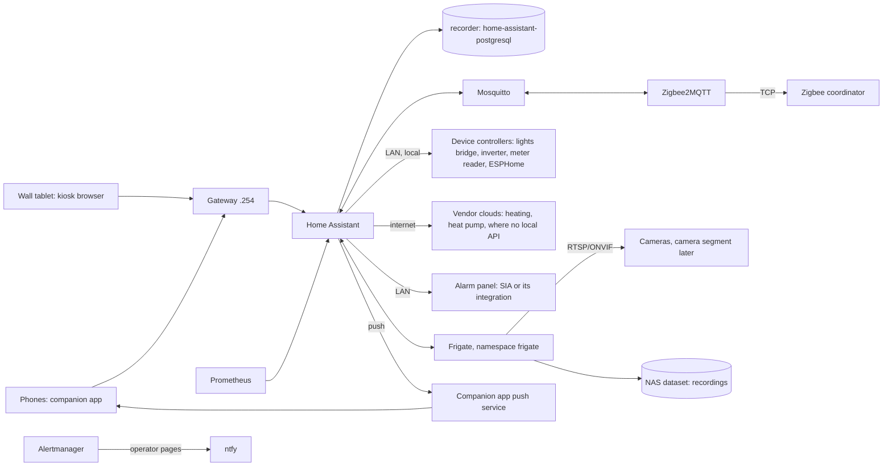

# Design: home-automation

## Overview

Home Assistant stays one pod in namespace `home` (no `hostNetwork`,
devices added by IP, Keycloak login), as in
[docs/home-automation.md](../../../docs/home-automation.md). Around it:

Each device keeps its own controller. Home Assistant reads, automates
and shows; it is never the only path for lights, heating or the alarm
(Requirement 11).

## Feasibility research (2026-11-04)

What the current sources say per category. Models are unknown until the
operator's label photos (Requirement 1); the inventory file holds the
per-device findings, the table below only the options.

| Category | Options | Local or cloud | Notes |
| --- | --- | --- | --- |
| Lights | Philips Hue integration through the bridge ([Hue](https://www.home-assistant.io/integrations/hue/)) | Local | The bridge keeps scenes, schedules and switch bindings without Home Assistant; switches show up as event entities for extra automations |
| Heating, Honeywell family | evohome / Total Connect Comfort EU ([evohome](https://www.home-assistant.io/integrations/evohome/)), Lyric ([lyric](https://www.home-assistant.io/integrations/lyric/)), HomeKit Device pairing when the thermostat supports HomeKit ([homekit_controller](https://www.home-assistant.io/integrations/homekit_controller/)), or the 868 MHz RAMSES II radio through an RF dongle ([ramses_rf](https://github.com/ramses-rf/ramses_rf)) | Cloud for evohome and Lyric; local for HomeKit and RAMSES | The model decides. Non-smart electric heaters: a Zigbee plug rated for the heater's load (Swiss sockets: 10 A) and a `generic_thermostat` |
| Solar inverter | The inverter vendor's local integration (Modbus TCP or HTTP) when it has one; its cloud otherwise | Local for most current inverters | Brand and model from the label photo; [Energy](https://www.home-assistant.io/docs/energy/) takes production, grid and battery sensors |
| Grid meter | The meter's customer interface, if the grid operator enables it, read by an ESPHome or P1-style reader; otherwise the inverter's own meter | Local | Gives true grid import and export |
| Heat pump | The vendor's cloud integration, or a local interface (the vendor's Modbus gateway, or ESPHome on the unit's service port) | Cloud by default | Some vendor clouds cap requests (one major heat-pump vendor at 200 per day per application); Requirement 4.3 keeps polling under half |
| Plants | Zigbee moisture sensors through Zigbee2MQTT; BLE sensors with light and conductivity through an ESPHome [Bluetooth proxy](https://esphome.io/components/bluetooth_proxy/); [Plant Monitor](https://github.com/Olen/homeassistant-plant) with [OpenPlantbook](https://github.com/Olen/home-assistant-openplantbook) thresholds | Local (OpenPlantbook only fetches species data) | Many Zigbee soil sensors have no light sensor; light needs BLE or a Zigbee model with lux |
| Watering plug | Zigbee smart plug | Local | Run time limited by the watering device's timer or the plug's countdown (Requirement 5.3) |
| Cameras | RTSP/ONVIF cameras ([ONVIF](https://www.home-assistant.io/integrations/onvif/)), recorded by [Frigate](https://docs.frigate.video/) and shown through the [Frigate integration](https://github.com/blakeblackshear/frigate-hass-integration) | Local | Cloud-only cameras do not fit; replacements are bought for RTSP, ONVIF and a detection sub-stream ([Frigate hardware](https://docs.frigate.video/frigate/hardware)) |
| Alarm | [SIA Alarm Systems](https://www.home-assistant.io/integrations/sia/) (SIA DC-09 over IP, local) when the panel can report to a second receiver; else the vendor's integration, or none | Local with SIA | The brand is still unknown; the label photos decide. SIA is receive-only: state and sensors, no arming |
| Wall tablet | Any tablet with a current browser engine; [Fully Kiosk Browser](https://www.home-assistant.io/integrations/fully_kiosk/) for kiosk mode, screen and motion control | Local | The companion app needs Android 6+ ([requirements](https://companion.home-assistant.io/docs/getting_started/)); the frontend needs a recent WebView, which is what an old tablet usually lacks |
| Phones | Companion app, Keycloak login through `hass-oidc-auth` (already working) | Push through the app's push service | 500 pushes per device per day ([rate limits](https://companion.home-assistant.io/docs/notifications/notification-details)) |
| Blinds, air conditioning (later) | Zigbee blind motors; air-to-air units with a local Wi-Fi integration | Local | Deferred; Requirement 12 |

### Frigate on this cluster

- The RK3588 NPU and video decoder are not usable from Talos. Frigate's
  Rockchip build needs Rockchip's BSP kernel (5.10 or 6.1) with the
  `rknpu` and `rkvdec2` drivers
  ([installation](https://docs.frigate.video/frigate/installation#rockchip-platform)).
  Talos runs a mainline kernel. Mainline has its own NPU driver, `rocket`,
  since Linux 6.18 ([kernel docs](https://github.com/torvalds/linux/blob/master/Documentation/accel/rocket/index.rst)),
  driven through Mesa's Teflon TFLite delegate, which Frigate does not use
  ([discussion](https://github.com/blakeblackshear/frigate/discussions/18311)).
- So Frigate here runs the standard arm64 image: recording copies the
  camera streams without decoding them; only the low-resolution detection
  streams are decoded on the CPU, and detection starts on the CPU detector
  (which Frigate does not recommend for production,
  [detectors](https://docs.frigate.video/configuration/object_detectors)).
- The trial (task 11) measures it with the first two cameras. The
  threshold to add an accelerator: mean inference above 50 ms, or skipped
  detections, at 5 fps on the detection streams. The accelerator is a USB
  one (a Coral USB, or what Frigate's hardware page recommends then for
  USB on arm64), in the Turing Pi's USB port on the worker node, handed to
  the pod by [generic-device-plugin](https://github.com/squat/generic-device-plugin)
  ([Talos device plugins](https://docs.siderolabs.com/kubernetes-guides/advanced-guides/device-plugins)),
  so the pod needs no `privileged`.
- Frigate runs as root inside its container today
  ([discussion](https://github.com/blakeblackshear/frigate/discussions/22837));
  a non-root setup exists as a community recipe
  ([discussion](https://github.com/blakeblackshear/frigate/discussions/18375)).
  Frigate gets its own app and namespace `frigate`, so `home` can move to
  `restricted` Pod Security (#724) whatever Frigate needs: the non-root
  recipe first, else `baseline` with a Kyverno PolicyException that names
  the reason.

### Storage for recordings

Recording without re-encoding stores the camera's main stream as is. At
about 4 Mbit/s per camera, 6 cameras recording around 30% of the day
(motion) write about 80 GB per day: about 550 GB for 7 days of motion, plus
the alerts and detections kept longer. Default: a new NAS dataset with a
1 TB quota, mounted over NFS like the media share, `Retain`, excluded from
restic. The NAS pool has the room; the quota keeps a camera that streams
noise from filling it.

### Matter and Thread

The Matter server needs the host network with IPv6 link-local multicast on
the same LAN as the devices
([OS requirements](https://github.com/home-assistant-libs/python-matter-server/blob/main/docs/os_requirements.md)).
Home Assistant here has no `hostNetwork` on purpose. Matter and Thread
devices are not bought (Requirement 12.1); if one is ever needed, a Matter
server with `hostNetwork` on one node is a new issue with its own
PolicyException.

### Network segmentation

- Today the LAN is flat: the ISP router has no VLANs, and the Deco access
  points tag no VLAN on their guest or IoT networks in access point mode
  ([TP-Link community](https://community.tp-link.com/en/home/threads/topic/864176)).
- Default: cameras are wired (PoE) and go on their own segment once a
  VLAN-capable router and a managed PoE switch are in place. That network
  change (router, VLANs, firewall rules, DHCP and DNS, the nodes' route to
  the camera segment) is its own spec in `area/networking`, opened when the
  operator approves the purchase. Until then the cameras run with their
  cloud, P2P and UPnP features off and no port forward, on fixed addresses
  in `192.168.1.21`-`.49` (outside the DHCP pool and the LB pools).
- Wi-Fi IoT devices stay on the main LAN until the access points can tag
  an IoT SSID; Zigbee devices need no IP at all, which is one more reason
  to prefer Zigbee.
- In the cluster, the `home` and `frigate` allow-lists (#709) limit egress
  to the device range, the NAS and the vendor clouds the feasibility table
  lists.

### Fallback when Home Assistant or the cluster is down

| Function | Keeps working because |
| --- | --- |
| Lights | The bridge holds lights, scenes, schedules and switch bindings; the vendor app works on the LAN |
| Zigbee switches and plugs | Direct Zigbee bindings for anything a person needs (Requirement 2.4) |
| Heating | The controller's own schedule; Home Assistant only overrides with an end time |
| Alarm | The panel is autonomous: keypad, app, sirens, monitoring |
| Cameras | Each camera records to its own card |
| Watering | The device's timer or the plug's countdown; the plug starts off after a power cut |
| Wall tablet | Shows "disconnected"; the vendor apps on the phones still work |

Home Assistant down is already an operator page (blackbox probe and SLO).

### Notifications

- Household notifications use the companion app's `notify` actions,
  through one script per purpose (`notify_security`, `notify_plants`,
  `notify_house`, `notify_admins`) whose members are set in the UI (they
  name phones).
- Critical notifications only for the alarm, smoke and water leaks.
- Cooldowns: one per camera per 5 minutes, one per plant per day, one
  weekly digest for batteries and silent sensors.
- ntfy stays the operator's pager for the platform. Home Assistant has no
  ntfy integration configured, and Alertmanager routes no house event.

### Identity and access

- Phones: the companion app with Keycloak, as today. Household members
  get normal users; `HomeAssistantAdmins` gets admin with OTP.
- Wall tablet: a local, non-admin user (`wall`), logged in once through
  `https://home.lilalala.com/?skip_oidc_redirect=true` with a generated
  password from the operator's password manager. Not a Keycloak account:
  a shared device cannot answer OTP, and the refresh token keeps it logged
  in. `trusted_networks` is not used: the companion app docs advise against
  it, and requests through the Gateway and NAT loopback do not keep a
  reliable client address.
- The alarm entity requires its code to disarm, so the tablet cannot
  disarm without it (Requirement 7.3).

### Dashboards

- Built in the UI (sections view), stored in `/config/.storage` on
  `home-assistant-config` and kept by its backup. Not in git: they name
  rooms and devices.
- Main Home dashboard (default for everyone): alarm, people home, open
  doors and windows, lights on, heating mode and indoor temperature, power
  now (solar, grid, house), plants needing water, last camera event,
  weather; each tile navigates to its dashboard.
- Area dashboards: Lights, Climate and energy (with the built-in Energy
  dashboard), Plants, Security. Wall tablet: large tiles, landscape, no
  admin controls. System: admin only (updates, batteries, integrations in
  error).
- The Grafana "Home" dashboard keeps the long-term metrics from
  `/api/prometheus`.

### Backups

| Data | Where | Backup |
| --- | --- | --- |
| Home Assistant config, dashboards, users | PVC `home-assistant-config` | restic `home/configs`, nightly (exists) |
| History and statistics | `home-assistant-postgresql` | CNPG WAL and daily base backup, nightly `pg_dump` (exists) |
| Zigbee network key, coordinator backup, devices | PVC `zigbee2mqtt-data` | restic, added with #728 |
| Frigate config | git (`apps/frigate/`) | git |
| Frigate event database | PVC `frigate-config` (`iscsi-retain`) | restic, nightly |
| Recordings | NAS dataset | None (local only, by design) |
| Lights bridge | The bridge | None in the homelab; the vendor app and account hold it |

## Phases

Each phase ends with the fallback test of Requirement 11.1.

1. **Current hardware, no purchase.** Inventory and feasibility (task 1);
   Zigbee online (#728, task 2); lights and automations; heating; energy
   from what the inverter, meter and heat pump allow; plants with the
   existing sensors; notifications; the main Home and area dashboards;
   the existing tablet on trial; the alarm through SIA if the panel
   supports it.
2. **Small purchases.** The watering plug, plant sensors with light and a
   Bluetooth proxy where needed, door and window contacts (window-open
   heating rule), water leak sensors, a smart plug for the tablet's
   charging, a meter reader, a local heating or heat pump interface if the
   cloud is not good enough, a new tablet if the trial fails.
3. **Cameras.** Network segmentation (its own networking spec), PoE
   cameras and a PoE switch, Frigate with the CPU trial, then an
   accelerator if the trial says so. The current cloud cameras are retired
   once the new ones record.
4. **Later (deferred issues).** Motorised blinds (Zigbee motors),
   air conditioning (an air-to-air unit with a local integration),
   anything from the suggestions the operator picks.

## Purchases

Rough prices in CHF, street prices in late 2026, for planning only. Nothing
is bought without the operator's approval in chat.

| Item | Phase | Rough cost | Needed when |
| --- | --- | --- | --- |
| Network Zigbee coordinator (Ethernet, PoE) | 1 | 40-60 | Only if the Raspberry Pi path for the existing coordinator is not wanted |
| Zigbee smart plug with metering, for the watering device | 2 | 15-25 | Always |
| Zigbee smart plug, for the tablet's charging | 2 | 15-25 | Always |
| Plant sensors with light (BLE or Zigbee), each | 2 | 15-30 | For plants where light matters |
| ESP32 board for the Bluetooth proxy | 2 | 10-20 | If BLE plant sensors are chosen |
| Door and window contacts, each | 2 | 10-20 | For the window-open heating rule |
| Water leak sensors, each | 2 | 10-20 | Suggested |
| Meter reader for the grid meter's customer interface | 2 | 20-40 | If the grid operator enables the interface |
| Heating RF dongle (RAMSES II, 868 MHz) | 2 | 30-60 | Only if the heating is an evohome-family system and local control is wanted |
| Heat pump local interface | 2 | 30-200 | Only if the cloud quota or outages bite |
| Wall tablet 10-11", mount, kiosk licence | 2 | 180-350 | Only if the existing tablet fails the trial |
| VLAN-capable router or firewall | 3 | 150-400 | For the camera segment (networking spec) |
| Managed PoE switch, 8 ports | 3 | 80-180 | For wired cameras |
| PoE cameras, each (5-6) | 3 | 60-150 | 350-900 in total |
| PoE video doorbell | 3 | 100-150 | Suggested |
| USB detection accelerator | 3 | 60-120 | Only if the CPU trial fails its threshold |
| Blind motors, each window | 4 | 100-300 | Next year |

Phase 1 costs nothing; phase 2 about 100-400 without a tablet; phase 3
about 700-1,750.

## What the operator provides

Photos of every label (the sticker with brand, model and serial area; the
serial itself can be covered), per category. They go to the inventory
file, never to the repo.

| Category | Photos and facts |
| --- | --- |
| Lights | The bridge's label (round or square), every switch, dimmer and motion sensor, any light that is not on the bridge |
| Heating | The thermostat or controller (front and label), the radiator valves or zone units, the heat source, the app the household uses for it; electric heaters' wattage if they are plug-in |
| Solar | The inverter's label, any battery, the monitoring app |
| Grid meter | The meter's label and the grid operator's name (for the customer interface) |
| Heat pump | Indoor and outdoor unit labels, the controller and any Wi-Fi adapter, the app used |
| Plants | The existing plant sensors' label, the watering device (label, mains or battery, its own timer), how many plants and roughly where |
| Cameras | The current cameras' labels; the wanted positions (indoor or outdoor), whether an Ethernet cable can reach each, power nearby |
| Alarm | The panel or hub label, a sensor label, the app's name, whether a monitoring company is contracted, whether the installer or user menu allows a second receiver (SIA) |
| Wall tablet | The tablet's model and Android version (Settings, About), the wanted wall spot and the power outlet there |
| Network | Where Ethernet runs today, and whether a new router or firewall is acceptable |

## Decided defaults

Each is one line to change later; the operator can overrule any of them in
chat.

| Topic | Default | Reason |
| --- | --- | --- |
| Radio for new devices | Zigbee through Zigbee2MQTT; no Matter or Thread | Local, no IP address, works with the pod network; Matter needs `hostNetwork` |
| Lights | Stay on their bridge; Home Assistant on top | The bridge is the fallback; no re-pairing to Zigbee2MQTT |
| Heating | The official integration for the model, cloud if that is all it offers; the controller keeps the schedule | Works with no purchase; local radio is a phase 2 option |
| Heat pump | Cloud integration, polled within half its quota | No purchase; a local interface if it is not enough |
| Alarm | Read-only through SIA if the panel supports it; arming stays on the panel | The alarm must not depend on the homelab |
| Cameras | Wired PoE, RTSP/ONVIF, cloud off, on a camera segment once it exists | Local, reliable, no vendor cloud |
| NVR | Frigate in its own namespace on the cluster, CPU detection on trial, USB accelerator if needed | No new host to run; the NPU is out of reach on Talos |
| Recording | Motion 7 days, alerts 30 days, detections 14 days, 1 TB quota, no off-site copy | Enough to look back over a week; privacy; storage bounded |
| Live view | Through Home Assistant (HLS/MSE); no WebRTC port at first | No extra LoadBalancer IP or UDP port; a few seconds of latency is fine |
| Dashboards | In Home Assistant's storage, backed up, not in git | They name rooms and devices |
| Notifications | Companion app, per-purpose scripts, cooldowns; ntfy for the operator only | Requirement 10 |
| Wall tablet | Trial the existing tablet with Fully Kiosk Browser and a local non-admin user | No purchase until it fails |
| Presence | Companion app location (the `home` zone) | Already in the app; location stays in Home Assistant |
| Device addresses | Fixed, on the device, in `192.168.1.21`-`.49` | The router cannot reserve addresses |
| Blinds and AC | Deferred issues; Zigbee motors and local-integration units when bought | Nothing to integrate yet |

## Suggestions

Uses the operator did not list, to pick from (each one is a new issue if
wanted, not part of this spec):

- Window open turns the zone's heating down (in Requirement 3.3 once
  contacts exist).
- Water leak sensors under the sinks and the washing machine, with a
  critical notification.
- Smoke and CO alarms in Home Assistant when they are Zigbee models.
- Washing machine and dryer done, from a metering plug's power drop.
- Run the dishwasher, the car charging or the hot water on solar surplus.
- Indoor air: CO2 and humidity sensors with a ventilation reminder and a
  mould-risk warning in the bathroom.
- Away mode: heating down, lights off, robot vacuum runs, cameras notify.
- Presence simulation while on holiday (in Requirement 2.2).
- A video doorbell with a snapshot to the phones.
- Frost or heat warnings for balcony plants from the weather forecast.
- A weekly digest of low batteries and silent devices (in Requirement 5.4).
- Waste collection days as reminders from a calendar.
- Guest mode for the wall tablet and the lights.
- A local voice assistant (Assist with local speech-to-text): heavy on the
  RK1 CPUs, so a research issue first.
