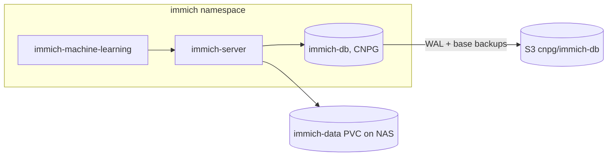

# Design: Immich 3 migration

## Overview

Two independent moving parts, changed in a fixed order:

1. **Database**: `immich-db` (CNPG) goes from `cloudnative-pgvecto.rs:16.5-v0.3.0` to the
   VectorChord CNPG image Immich documents for 3.x.
2. **Application**: Immich server, machine learning and chart go from 2.7.5 to the latest
   3.x, through any intermediate version Immich's release notes require.

The library on the NAS is not part of the change. Everything lands as git PRs; Argo CD
applies them.

## Architecture

Only the boxes `immich-db`, `immich-server` and `immich-machine-learning` change.

## Decisions

| Decision | Choice | Alternatives rejected |
| --- | --- | --- |
| Order | Database first, then application (unless Immich's notes say otherwise) | Application first: 3.x refuses to start without VectorChord |
| Database path | In-place image switch on the same CNPG cluster, following Immich's pgvecto.rs → VectorChord procedure | New cluster + dump/restore: slower, more moving parts, only kept as the rollback path |
| Rollback | Restore from the pre-migration backup on the old image, then Immich 2.7.5 | Reverting the image PR: the data on disk is already migrated, so the old image may not start |
| Timing | Daytime, operator's go | Night: preferred normally, overridden because nobody uses Immich now |
| Renovate | Lift the app cap, keep the database image disabled and digest-pinned | Let Renovate manage the database image: its upgrades can be one-way |

## Components and interfaces

- `apps/immich/`: chart version and values (server, ML image tags, any new env vars).
- The `immich-db` Cluster manifest: `imageName`, `postgresql.shared_preload_libraries`.
- `.github/renovate.json5`: the Immich cap and the database-image rule.
- `scripts/ci/repo_policy.py`, rule `immich-db-image`: the allowed database image.
- `scripts/maintenance-silence.sh`: silences namespace `immich` for the window.

## Verification

Read through the Immich API with the admin key (never printed):
- counts: `/api/server/statistics` (images, videos), people and albums endpoints;
- originals: 20 random assets, `/api/assets/<id>/original` returns 200;
- search: one smart-search query returns results;
- phone app: `/api/server/version` and `/api/server/features`;
- cluster: CNPG Ready, `\dx` lists the vector extensions, ContinuousArchiving=True.

## Error handling

| Failure | Response |
| --- | --- |
| Database won't start on the new image | Stop; restore from the base backup on the old image |
| Server migrations fail or hang | Read logs; fix forward if understood within 30 min, otherwise roll back |
| Counts below baseline | Stop, roll back, investigate before retrying |
| Auto-revert PR opens | Close it; roll back deliberately if needed |

## Open questions (answered by reading the official docs at the start of the run)

1. Exact VectorChord image and version, and the matching pgvector version.
   - The immich-charts README recommends CloudNativePG with `tensorchord/cloudnative-vectorchord`.
     Chosen: `ghcr.io/tensorchord/cloudnative-vectorchord:16.15-1.1.1` (PostgreSQL 16.15, same
     major as today, so no `pg_upgrade`; VectorChord 1.1.1; pgvector from the CNPG `system-bookworm`
     base). Immich accepts `vchord >=0.3 <2` (2.7.5 and 3.3.3 alike) and pgvector `>=0.7 <0.9`.
   - That image has no pgvecto.rs, so Immich's "automatic" path (both extensions loaded at once) is
     not possible. The docs' **manual** path applies (docs.immich.app/administration/postgres-standalone,
     "Migrating from pgvecto.rs"): while pgvecto.rs is still installed, drop `clip_index` and
     `face_index` and turn both `embedding` columns into `real[]`; switch the image; `CREATE EXTENSION
     vchord CASCADE`; turn the columns back into `vector(768)` / `vector(512)`; start Immich, which
     builds the new indexes.
   - Collation is `C` in every database, so the base OS change (bullseye glibc 2.31 -> bookworm 2.36)
     does not affect index order.
   - Upstream's own example uses PostgreSQL 18 with an image-volume extension; rejected for now, it
     would add a major upgrade to an already one-way change.
2. Whether an intermediate 2.x release is required before 3.x.
   - No. 2.7.5 is the last 2.x and is above the 1.133.0 floor for VectorChord. Target: v3.3.3.
     No later 3.x release lists a breaking change that applies here (3.1.0: iOS 14 dropped).
3. Breaking configuration changes in 3.x (env vars, Helm values, ML model settings).
   - ML: `MACHINE_LEARNING_PRELOAD__CLIP` removed; use `..._CLIP__TEXTUAL` and `..._CLIP__VISUAL`.
   - OAuth: `issuerUrl` must be a valid URL; insecure (http) OAuth requests off by default.
   - Metrics: names use dots instead of underscores (check dashboards and alerts).
   - API: many endpoint/DTO changes (third-party tools; check the usage exporter).
   - Chart: the HTTP repo is gone, the chart is now `oci://ghcr.io/immich-app/immich-charts/immich`
     (0.13.4). 0.10 moved values under `controllers.main.containers.main`, removed the
     `postgres`/`redis` keys (rendering fails if present), mounts the library as `data` at `/data`
     and makes the server RollingUpdate. Overrides needed: library at `/usr/src/app/upload` (all DB
     paths use it; a new location triggers an automatic path rewrite in the DB), Recreate strategy
     (RWO volumes).
