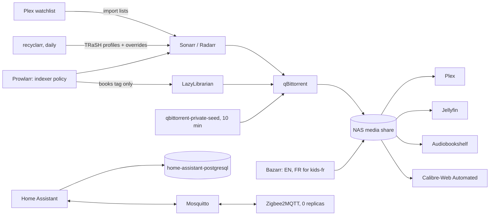

# Design: media-home (as-is)

## Overview

Media files live on the NAS share `192.168.1.228:/mnt/homelab/k8s/nfs`, mounted
inline; app state is on iSCSI volumes; the *arr apps use CNPG databases.

## Components

| Path | Role |
| --- | --- |
| `apps/theater/{sonarr,radarr,lidarr,prowlarr}.yaml` | *arr apps with exportarr sidecars, waiting for their database |
| `apps/theater/recyclarr.yaml` | TRaSH profiles and the score overrides |
| `apps/theater/bazarr.yaml` | Bazarr and its PostSync `bazarr-settings` |
| `apps/theater/arr-import-lists.yaml` | PostSync `arr-import-lists` (Plex Watchlist) |
| `apps/theater/qbittorrent.yaml`, `qbittorrent-private.yaml` | qBittorrent on `192.168.1.200`, the private-seed CronJob |
| `apps/theater/sso.yaml`, `httproute.yaml` | `theater-sso` and the path routing on `theater.lilalala.com` |
| `apps/theater/{plex,jellyfin}.yaml` | Players, off SSO |
| `apps/theater/lazylibrarian.yaml`, `apps/books/` | Book acquisition and the two book apps |
| `apps/home/` | Home Assistant, its config and HTTP store, Mosquitto, Zigbee2MQTT, database, backups, ServiceMonitor |
| `scripts/check-indexers.sh` | Read-only indexer policy check against Prowlarr |
| `platform/kube-prometheus-stack/routes/arr-alerts.yaml` | `ArrIndexersFailing` |

Runbooks: [arr-qbittorrent](../../../docs/runbooks/arr-qbittorrent.md),
[subtitles](../../../docs/runbooks/subtitles.md).

## Decisions

| Decision | Where |
| --- | --- |
| One oauth2-proxy routing by path; app form logins kept as break-glass | [theater.md](../../../docs/theater.md#why-it-is-like-this) |
| TRaSH profiles by `trash_id`, deviations as score overrides, two profiles only | [theater.md](../../../docs/theater.md#why-it-is-like-this) |
| Private trackers automatic for freeleech only; private torrents force-started | [theater.md](../../../docs/theater.md#why-it-is-like-this) |
| Bazarr settings through the API, SQLite not CNPG | [theater.md](../../../docs/theater.md#why-it-is-like-this) |
| One `books` namespace; the library as an inline NFS volume narrowed by `subPath` | [books.md](../../../docs/books.md#why-it-is-like-this) |
| Zigbee coordinator on a Pi over TCP, recorder on CNPG, no `hostNetwork`, hass-oidc-auth | [home-automation.md](../../../docs/home-automation.md#why-it-is-like-this) |
| The media library is not backed up | [backups.md](../../../docs/backups.md#why-it-is-like-this) |

## Error handling

| Failure | What happens |
| --- | --- |
| *arr cannot reach qBittorrent | [arr-qbittorrent runbook](../../../docs/runbooks/arr-qbittorrent.md) |
| An indexer breaks the policy | `scripts/check-indexers.sh` prints `FAIL`; fix it in Prowlarr |
| Indexers fail for 6 h (login, cookie, locked account) | `ArrIndexersFailing` pages |
| Keycloak down | theater apps: port-forward and the local form login; Home Assistant: `?skip_oidc_redirect=true` |
| A PostSync settings Job fails | the `theater` sync fails; auto-rollback applies ([gitops-delivery](../gitops-delivery/design.md)) |
