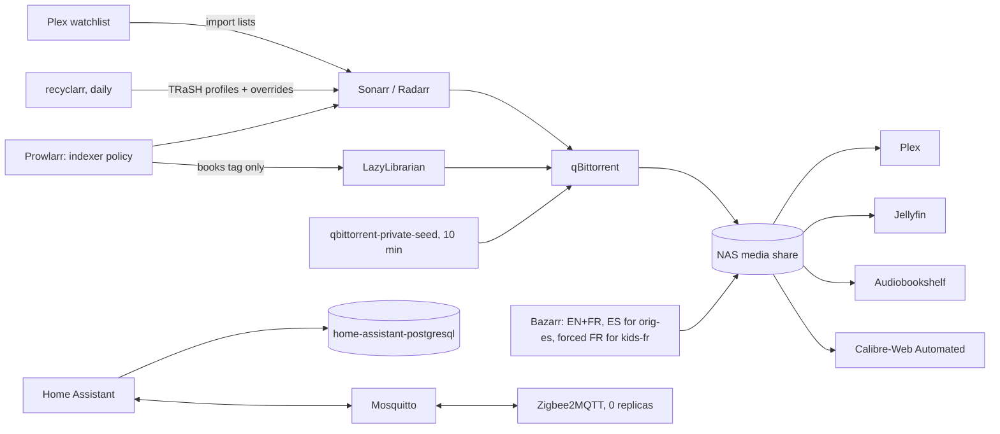

# Design: media-home (as-is)

## Overview

Media files live on the NAS share `192.168.1.228:/mnt/homelab/k8s/nfs`, mounted
inline; app state is on iSCSI volumes; the *arr apps use CNPG databases.

## Components

| Path | Role |
| --- | --- |
| `apps/theater/{sonarr,radarr,lidarr,prowlarr}.yaml` | *arr apps with exportarr sidecars, waiting for their database |
| `apps/theater/recyclarr.yaml` | TRaSH profiles and the score overrides |
| `apps/theater/bazarr.yaml` | Bazarr, its PostSync `bazarr-settings` and the CronJob `bazarr-nightly` |
| `apps/theater/arr-import-lists.yaml` | PostSync `arr-import-lists` (Plex Watchlist) |
| `apps/theater/qbittorrent.yaml`, `qbittorrent-private.yaml` | qBittorrent on `192.168.1.200`, the private-seed CronJob |
| `apps/theater/sso.yaml`, `httproute.yaml` | `theater-sso` and the path routing on `theater.lilalala.com` |
| `apps/theater/{plex,jellyfin}.yaml` | Players, off SSO |
| `apps/theater/lazylibrarian.yaml`, `apps/books/` | Book acquisition and the two book apps |
| `apps/home/` | Home Assistant, its config and HTTP store, Mosquitto, Zigbee2MQTT, database, backups, ServiceMonitor |
| `scripts/check-indexers.sh` | Read-only indexer policy check against Prowlarr |
| `platform/kube-prometheus-stack/routes/arr-alerts.yaml` | `ArrIndexersFailing` |

Runbooks: [arr-qbittorrent](../../../docs/runbooks/arr-qbittorrent.md),
[subtitles](../../../docs/runbooks/subtitles.md).

## Decisions

| Decision | Where |
| --- | --- |
| One oauth2-proxy routing by path; app form logins kept as break-glass | [theater.md](../../../docs/theater.md#why-it-is-like-this) |
| TRaSH profiles by `trash_id`, deviations as score overrides, two profiles only | [theater.md](../../../docs/theater.md#why-it-is-like-this) |
| Private trackers automatic for freeleech only; private torrents force-started | [theater.md](../../../docs/theater.md#why-it-is-like-this) |
| Bazarr settings through the API, SQLite not CNPG | [theater.md](../../../docs/theater.md#why-it-is-like-this) |
| One `books` namespace; the library as an inline NFS volume narrowed by `subPath` | [books.md](../../../docs/books.md#why-it-is-like-this) |
| Zigbee coordinator on a Pi over TCP, recorder on CNPG, no `hostNetwork`, hass-oidc-auth | [home-automation.md](../../../docs/home-automation.md#why-it-is-like-this) |
| The media library is not backed up | [backups.md](../../../docs/backups.md#why-it-is-like-this) |

## Subtitles (Requirement 6)

One script, `settings.py` in the ConfigMap `bazarr-config`, runs as the
PostSync Job `bazarr-settings` (`MODE=sync`) and the CronJob `bazarr-nightly`
(`MODE=nightly`, 22:30 UTC).

| Step | sync | nightly |
| --- | --- | --- |
| Auto tagging rules in Sonarr and Radarr: `kids-fr` (quality profile `HD-Kids-FR`), `orig-es` (original language Spanish), `kids-fr-es` (both) | yes | |
| Bazarr settings: languages, profiles, providers, embedded subtitles, interval search off | yes | |
| Profile of every series and movie, computed from Sonarr and Radarr | yes | yes |
| Start the wanted searches (series, movies) | | yes |

| Profile | ID | Languages | Tag |
| --- | --- | --- | --- |
| `en-fr` | 1 | en, fr | none (default) |
| `kids-fr-es` | 2 | en, fr, fr forced, es | `kids-fr-es` |
| `kids-fr` | 3 | en, fr, fr forced | `kids-fr` |
| `en-fr-es` | 4 | en, fr, es | `orig-es` |

- Bazarr gives a tagged title the first profile, by ID, whose tag it carries,
  at every hourly sync. `kids-fr-es` has the lowest tagged ID because its
  titles also carry `kids-fr` and `orig-es`.
- The *arr apps apply auto tags at their next refresh of a title, not when a
  rule is saved. The script computes each profile from the quality profile
  and the original language itself, so existing titles are right at once and
  the tags only serve Bazarr between runs.
- Embedded subtitles count (`use_embedded_subs`); PGS and VobSub are ignored
  (`ignore_pgs_subs`, `ignore_vobsub_subs`), so a bitmap-only language gets a
  text download.
- Providers without an account: Gestdown (Addic7ed's catalogue), TVSubtitles,
  YIFY Subtitles, Subtitulamos.tv (en, es; series), Subtis (es; films),
  Sous-Titres.eu and Subsynchro (fr). Podnapisi is no longer in Bazarr 1.6;
  Addic7ed itself needs an account and a captcha solver; Subscene closed;
  OpenSubtitles.com needs an account (none exists). Bazarr pauses a provider that
  answers "too many requests" (1 h by default) and adaptive searching retries a
  title without results after 3 weeks, then weekly.
- Coverage metrics: the Deployment `subtitle-exporter` (theater, stdlib
  Python) reads Bazarr's API every 15 minutes with the key in Secret `bazarr`
  and serves `subtitles_required` and `subtitles_missing` per kind, language
  and forced flag; the Usage dashboard shows `1 - missing / required`.

## Error handling

| Failure | What happens |
| --- | --- |
| *arr cannot reach qBittorrent | [arr-qbittorrent runbook](../../../docs/runbooks/arr-qbittorrent.md) |
| An indexer breaks the policy | `scripts/check-indexers.sh` prints `FAIL`; fix it in Prowlarr |
| Indexers fail for 6 h (login, cookie, locked account) | `ArrIndexersFailing` pages |
| Keycloak down | theater apps: port-forward and the local form login; Home Assistant: `?skip_oidc_redirect=true` |
| A PostSync settings Job fails | the `theater` sync fails; auto-rollback applies ([gitops-delivery](../gitops-delivery/design.md)) |
| `bazarr-nightly` fails | `KubeJobFailed` (INFO); the next night retries; coverage stays flat on the Usage dashboard |
| A provider rate-limits or goes down | Bazarr throttles it and searches the others |
