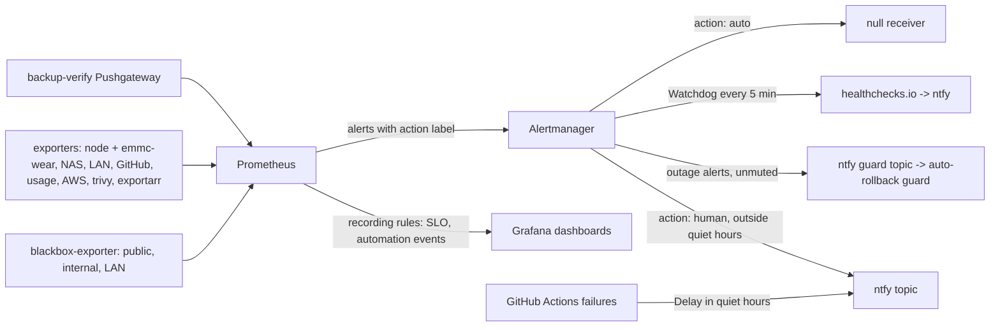

# Design: observability-alerting (as-is)

## Overview

Prometheus, Alertmanager and Grafana come from kube-prometheus-stack in
`monitoring`. Grafana logs in through Keycloak.

## Components

| Path | Role |
| --- | --- |
| `platform/kube-prometheus-stack/values.yaml` | Routes, receivers, `quiet-hours` time interval, inhibit rules, `emmc-wear` sidecar, storage |
| `platform/kube-prometheus-stack/routes/` | PrometheusRules: `slo.yaml`, `alerts.yaml`, `argocd-alerts.yaml`, `outage-alerts.yaml`, `nas-alerts.yaml`, `lan-alerts.yaml`, `arr-alerts.yaml`, `automation.yaml` |
| `platform/kube-prometheus-stack/dashboards/` | Overview, Security, Usage, CI-CD, Automation, Nodes, Storage, LAN, Network, Data protection, AWS, Home |
| `platform/blackbox-exporter/probes/` | Public hostnames (`blackbox-public`, label `app`), internal endpoints, LAN pings |
| `platform/github-exporter/` | Workflow, PR and Renovate metrics; `automation_event_timestamp_seconds` |
| `platform/{truenas,usage,aws}-exporter/`, `platform/lan-inventory/` | NAS, app usage, AWS cost and S3, LAN devices |
| `platform/trivy-operator/`, `platform/vuln-enrich/` | CVEs in running images, ranked by KEV, EPSS and exposure |
| `scripts/maintenance-silence.sh` | Bounded silences through `amtool` in the Alertmanager pod |
| `scripts/ci/alertmanager-test.sh`, `tests/alertmanager/` | Class check and notification-count scenarios |
| `scripts/ci/promtool-check.sh`, `tests/prometheus/` | Rule unit tests |
| `scripts/status.sh` | One-screen read-only view without Grafana |
| `docs/postmortems/` | Blameless postmortems from `template.md` |

## Decisions

| Decision | Where |
| --- | --- |
| One availability SLO at 99.5%, budget exhaustion changes the work not the deploys | [sre.md](../../../docs/sre.md#why-it-is-like-this) |
| Page when a person has to act, not when something broke | [sre.md](../../../docs/sre.md#why-it-is-like-this) |
| Triggers as thresholds, AI drafts text only | [sre.md](../../../docs/sre.md#who-writes-what), [decisions.md](../../../docs/decisions.md#deterministic-first) |
| Hosted ntfy.sh plus an external heartbeat | [observability.md](../../../docs/observability.md#why-it-is-like-this) |
| No service mesh; Hubble from Cilium | [decisions.md](../../../docs/decisions.md#no-service-mesh) |
| Failures are alerts, not GitHub issues | [decisions.md](../../../docs/decisions.md#automatic-rollback) |

## Error handling

| Failure | What happens |
| --- | --- |
| Alertmanager cannot deliver | `AlertmanagerNotificationsFailing` (and the heartbeat stops if it is down) |
| The cluster or the WAN is down | healthchecks.io misses the ping and notifies ntfy itself |
| An exporter or probe goes silent | the matching `...Absent` / `...Stale` alert pages ("monitoring went blind") |
| A planned change would page | `maintenance-silence.sh` before it starts; `Watchdog` is never silenced |

Postmortem triggers (25% of a monthly budget in one event, an exhausted
budget, data loss, an exposed credential, automation that made things worse):
[sre.md](../../../docs/sre.md#postmortems).
