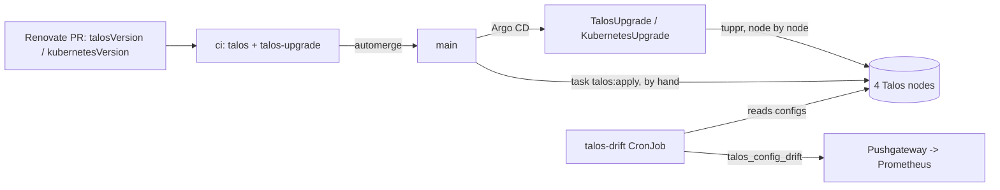

# Design: platform-talos (as-is)

## Overview

Two paths reach a node. Versions are automated: Renovate, the CI rehearsal,
then tuppr. Configuration is applied by hand with `task talos:apply` after a
merge, and the daily drift check pages until it is.

## Components

| Path | Role |
| --- | --- |
| `talos/talconfig.yaml` | Cluster, pinned versions, Image Factory schematic (`turingrk1` overlay, `iscsi-tools`, `tailscale`), the four nodes, their static IPs and tailnet names |
| `talos/patches/` | `sysctls.yaml`, `kube-proxy.yaml`, `controlplane-metrics.yaml`, `kubelet-image-gc.yaml`; `talosctl/` for documents talhelper cannot parse yet |
| `talos/talsecret.sops.yaml` | Cluster CAs and tokens, SOPS-sealed, created once |
| `talos/talenv.sops.yaml` | Variables talhelper substitutes: the Tailscale OAuth secret of the `tailscale` extension (placeholder without the age key) |
| `scripts/talos-genconfig.sh` | `task talos:genconfig`: talhelper, then the talosctl patches |
| `scripts/ci/talos-validate.sh` | CI job `talos`: offline validation and invariants |
| `scripts/ci/talos-upgrade-rehearsal.sh` | CI job `talos-upgrade`: QEMU cluster upgraded from main's versions |
| `platform/tuppr/` | tuppr values, `TalosUpgrade/cluster`, `KubernetesUpgrade/kubernetes` with CEL health checks |
| `platform/talos-drift/` | Daily drift CronJob, its script and `TalosConfigDrift` / `TalosDriftCheckStale` |
| `platform/kube-prometheus-stack/values.yaml` | `emmc-wear` sidecar, etcd scrape, the ntfy route for the tuppr alerts |
| `Taskfile.yml` `talos:*` | genconfig, apply, upgrade, upgrade-k8s, etcd-snapshot |

Runbooks: [node-replacement](../../../docs/runbooks/node-replacement.md),
[node-power-cycle](../../../docs/runbooks/node-power-cycle.md),
[cold-start](../../../docs/runbooks/cold-start.md) (etcd snapshot and restore).

## Decisions

Recorded in the docs; not repeated here.

| Decision | Where |
| --- | --- |
| Talos as a new cluster, not an in-place conversion | [decisions.md](../../../docs/decisions.md#talos-built-as-a-new-cluster) |
| Talos config and bootstrap Secrets are the only hand-applied layer | [decisions.md](../../../docs/decisions.md#hand-installed-only-where-git-cannot-reach) |
| Drift detected in the cluster; no cluster credentials in GitHub; drift alerts, never auto-applies | [decisions.md](../../../docs/decisions.md#drift-detection-without-cluster-credentials-in-github) |
| talhelper rather than the OpenTofu Talos provider | [talos.md](../../../docs/talos.md#why-it-is-like-this) |
| eMMC only, no NVMe until the wear trend says otherwise | [talos.md](../../../docs/talos.md#why-it-is-like-this) |
| Image GC from 70% to 60% | [talos.md](../../../docs/talos.md#why-it-is-like-this) |
| Workload isolation off (democratic-csi needs host `iscsid`) | [talos.md](../../../docs/talos.md#why-it-is-like-this) |
| Drift check holds an `os:admin` certificate, like tuppr | [talos.md](../../../docs/talos.md#why-it-is-like-this) |

## Error handling

| Failure | What happens |
| --- | --- |
| Rehearsal fails in CI | `ci` is red, the Renovate PR does not merge |
| Image Factory lacks the new installer | tuppr parks (`PrePullFailed`) before touching a node and retries |
| A node does not boot the new image | Talos falls back to the previous image (A/B) |
| A run fails | phase `Failed`, terminal; `TalosUpgradeFailed` or `KubernetesUpgradeFailed` pages; retry with the `reset` annotation |
| A health check stays red | tuppr waits (`TupprUpgradeBlocked`, Grafana only); after 1 h `TalosUpgradeStuck` pages |
| Kubernetes minor misbehaves | Fix forward; a minor cannot go back ([cheatsheet](../../../docs/talos-cheatsheet.md#talos-and-kubernetes-upgrades)) |
| Merged config not applied | `TalosConfigDrift` pages until `task talos:apply` |

Auto-rollback never reverts the `tuppr` Application.
