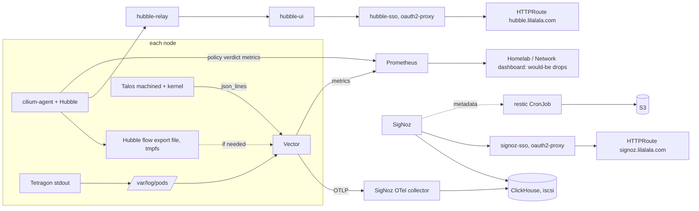

# Design: wave 3 network visibility and logs (Hubble, policy audit, SigNoz trial)

## Overview

Three parts, in this order:

1. **Hubble relay and UI**: Cilium chart values (infrastructure layer), plus a small
   platform app `hubble-access` with the oauth2-proxy, the HTTPRoute on the shared Gateway
   and the CiliumNetworkPolicies.
2. **Network policy audit**: the `network-policies` Application joins the infrastructure
   layer with every switch false; allow-lists are regenerated from observed flows for every
   namespace; would-be drops are measured from Cilium's own policy evaluation and shown on
   the Network dashboard.
3. **Logs**: a Vector DaemonSet collects pod and Talos logs, parses them, and ships OTLP to
   SigNoz (ClickHouse), whose UI is on the shared Gateway behind Keycloak. A 14-day trial with
   fixed thresholds decides whether SigNoz stays.

## Decisions

| Decision | Choice | Alternatives rejected |
| --- | --- | --- |
| Relay and UI | `hubble.relay.enabled` and `hubble.ui.enabled` in `infrastructure/cilium/values.yaml`, resources set, chart image digests kept (`useDigest`) | A separate Hubble UI chart: the Cilium chart already ships it, versioned with the agent |
| Relay certificates | The chart's certgen (`hubble.tls.auto.method: cronJob`), reusing `cilium-ca`; the one-shot Job as an Argo CD PostSync hook, the CronJob every four months (task 2b) | The helm method with `ignoreDifferences` (first choice, #515): Argo renders without `lookup`, so a new Secret is signed by a throw-away CA; cert-manager: Cilium is installed before its CRDs |
| UI access | Namespace `hubble` (PSA restricted): oauth2-proxy `hubble-sso` (upstream `http://hubble-ui.kube-system.svc:80`), HTTPRoute `hubble.lilalala.com` on the shared Gateway with the #465 headers, CNP ingress from `reserved:ingress` only; Keycloak client `hubble` in `proxy_clients` (`hubble:admins`), `platform_clients`, `access.conf`. First shipped as a Tailscale Ingress (#519); moved by the operator decision of 2026-10-16 (every UI public behind Keycloak) | A tailnet-only Ingress: no more secure than SSO plus group gating, and a second way in to maintain |
| Relay exposure | CNP in `kube-system` selecting only `hubble-relay` (ingress from `hubble-ui`, and Vector if it reads flows from the relay) and `hubble-ui` (ingress from `hubble-sso`), default-deny ingress on those two pods only, shipped by `hubble-access` | No policy: anyone in the cluster could read every flow |
| Policy delivery | Existing `network-policies` Application, infrastructure layer, sync wave 30, `prune: true`, `selfHeal: false` (unchanged, see its header); switches false | Shipping allow-lists with each app: reverting a policy would revert the app |
| Scope | Every namespace with workloads except `kube-system` and `democratic-csi`; new files per namespace (`70-keycloak.yaml`, `75-monitoring.yaml`, `80-backup-verify.yaml`, ...), `90-enforcement.yaml` gets a switch pair per namespace | The six application namespaces only: Keycloak and monitoring carry the most valuable flows |
| Granularity | Namespace as the boundary, per workload where a workload must not reach its neighbours (theater qBittorrent, as today; Tailscale proxies by `tailscale.com/parent-resource`) | Per workload everywhere: upstream chart labels change on upgrades |
| Derivation | `scripts/netpol-observe.sh <namespace> [--days N]`: reads Hubble flows (relay for live, the flow-log metric below for history), groups by (direction, peer identity or namespace and `app.kubernetes.io/name`, port, protocol), prints a table with counts and first/last seen; the author turns rows into rules, one comment per rule | Generating YAML automatically: Cilium's rule grammar has choices (entities, CIDR, labels) a script should not make; Cilium "policy editor": not reproducible |
| Would-be drops, primary | Hubble `policy` metrics handler on the agents (`policy:sourceContext=namespace|reserved-identity;destinationContext=namespace|reserved-identity`), using the match type of the synthesized allow-all rule that Cilium adds when only non-default-deny policies select an endpoint (open question 1) | Cluster-wide `policyAuditMode`: it stops enforcing every policy, including Headlamp's and Argo CD's, and restarts every agent (see `90-enforcement.yaml`); per-endpoint audit mode: imperative, lost on pod restart |
| Would-be drops, fallback | Hubble flow export (`hubble.export.static`, field mask, only flows of the policed namespaces, file on `/var/run/cilium/hubble`, 10 MiB x 2) read by Vector; `log_to_metric` counts flows whose `ingress_allowed_by`/`egress_allowed_by` names no allow-list policy, labelled by namespace, direction and peer app | Writing a policy evaluator: re-implements Cilium |
| Exit criteria for wave 4 | `netpol:would_drop:increase7d{namespace, direction} == 0` is "ready to enforce" | Time-based ("a week of watching"): says nothing about the traffic |
| Vector placement | Namespace `logging`, PSA `enforce: privileged` with the reason (hostPath `/var/log/pods` read-only, host network listener for Talos); container read-only root, all capabilities dropped except `DAC_READ_SEARCH` (open question 4) | `monitoring` (already privileged): mixes a host-reading agent with Prometheus |
| Talos logs | `talos/patches/logging.yaml`: `machine.logging.destinations` `tcp://127.0.0.1:<port>/`, `json_lines`; a `KmsgLogConfig` document in `talos/patches/talosctl/` for kernel logs to `tcp://127.0.0.1:<port2>/`. Vector listens on the host network, `127.0.0.1` only | A LoadBalancer IP: Talos sends before Cilium is up, and logs would cross the LAN; UDP: silent loss |
| Parsing | VRL: `parse_json`, then `parse_logfmt`, else keep `message` and set `parse_failed=true`; Kubernetes metadata as resource attributes; Talos fields mapped to `service.name`, `host.name`, severity | Per-app parsers: the structured-logs principle says fix the source app's format instead |
| Sink | Vector `opentelemetry` sink, OTLP/HTTP to `signoz-otel-collector.signoz.svc:4318`, memory buffer 64 MiB, `when_full: block` for pods (kubelet keeps the files) and `drop_newest` for Talos (counted) | A disk buffer: eMMC writes |
| SigNoz install | Official `signoz` chart, namespace `signoz`, platform layer; ClickHouse single replica (limit 6 GiB), Keeper/ZooKeeper single replica (0.5 GiB), collector (1 GiB), SigNoz (1 GiB); chart and images digest-pinned in values with Renovate comments | Docker Compose or a hand-written manifest set: no upgrade path |
| ClickHouse volume | 50 GiB on `iscsi` (reclaim Delete): the data is disposable by decision, so a removed trial leaves no orphan zvol | `iscsi-retain`: keeps a volume no one restores |
| UI access | oauth2-proxy `signoz-sso` (Keycloak client `signoz`, group `admins`, platform client), HTTPRoute `signoz.lilalala.com` on the shared Gateway with the #465 headers; SigNoz's own login behind it (one admin, password in SOPS, copy in the password manager); no `skip_auth_routes` | A tailnet-only Ingress: superseded by the operator decision of 2026-10-16 |
| SigNoz login (Requirement 8) | Keycloak gate always, then SigNoz's own login: the Community Edition Google method on an authenticated domain if the operator's Google account is on a Workspace domain he controls (that domain only, `Enforce SSO`, default role VIEWER, client in SOPS); otherwise the local admin password. Self-registration closed after setup. The admin's email is the operator's real address either way (answer 11) | OIDC or SAML against Keycloak: Enterprise licence only; a `gmail.com` authenticated domain: never matches (the `hd` check) and would mean "any Gmail user"; oauth2-proxy alone: SigNoz has no trusted-header login; Google as a Keycloak identity provider: a realm-wide change for every UI, its own spec |
| Metadata backup | Nightly restic CronJob of the SigNoz metadata volume to the S3 repository, guarded like `routes/grafana-backup.yaml` (best-effort copy of a live SQLite file unless SigNoz offers a consistent export, open question 6) | ClickHouse `BACKUP ... TO S3`: backs up the disposable part |
| Paging | Only "logs went blind": `LogPipelineDiscarding` (Vector `component_discarded_events_total` rising for 1 h) and `SigNozCollectorAbsent` (no collector target for 1 h), `action: human`, warning | SigNoz alert rules: a second paging path with no promtool tests |
| Trial evaluation | Recording rules `signoz_trial:clickhouse_memory_p95_bytes`, `:clickhouse_restarts`, `:volume_growth_bytes_per_day`, `:volume_projection_ratio`, `:parse_failed_ratio`, `:discarded_events`, `:sources_present`, and `signoz_trial:pass` (1 when all hold); a panel on Homelab / Nodes or Storage | A judgement at the end: not deterministic |
| Volume labels (Requirement 9) | Mount option `context=system_u:object_r:ephemeral_t:s0` on both iSCSI StorageClasses (Talos docs, SELinux, "CSI volumes"), replaced by Argo (`Force=true,Replace=true`: the field is immutable); git-managed PVs edited one application per PR; the others through `scripts/pv-selinux-label.sh`; ClickHouse first. Root cause, measured on 2026-10-17: Talos is permissive, democratic-csi mounts xfs without a label (`unlabeled_t`), so every ClickHouse file operation logged an AVC with five companion records, about 1,300 per second on homelab-cp-1, which SigNoz then stored, which caused more merges | Dropping the records in Vector: hides the cause and keeps the cost on the node; `selinux=0`: gives up wave 5's enforcing mode; relabelling with `chcon -R` inside each volume: the xattr labels would persist, but it needs a privileged relabel job per volume with the app stopped, and `context=` is the mechanism Talos documents |
| libmount in the CSI node plugin (Requirement 9.9) | A ConfigMap with exactly `SELINUX=permissive` and `SELINUXTYPE=targeted`, mounted read-only with `subPath` at `/etc/selinux/config` in the democratic-csi node driver container. Found on 2026-10-17 with a scratch StorageClass: democratic-csi passed `context=` to `mount -t xfs`, and libmount dropped it (`LIBMOUNT_DEBUG`: fs options `context=...,nouuid` became `nouuid`), because libselinux's `is_selinux_enabled()` also requires `/etc/selinux/config` and the image has none. With the file, a loop xfs mount in that container showed `context=system_u:object_r:ephemeral_t:s0`. The file is inert without a `context=` option, so it lands before the StorageClass change | Kubelet's own SELinux mounts (`CSIDriver.spec.seLinuxMount`): its `context=` goes through the same libmount; a custom driver image: a fork to maintain |
| Audit counter (Requirement 9) | `log_to_metric` on Talos events with `service == "auditd"`, tags `node` and `type` (the `type=` of the record); alert `AuditAVCRateHigh` (`action: auto`, warning) | Filtering BPF or AVC records: the operator wants the churn visible, not removed |
| Fallback | Loki single binary on S3 with Vector's `loki` sink, its own spec; this spec only records the decision and removes SigNoz | Keeping a failed SigNoz "for now" |

## Components and interfaces

- `infrastructure/cilium/values.yaml`, `clusters/homelab/infrastructure/cilium.yaml`
  (ignoreDifferences); Hubble `policy` metric (and, if needed, the static flow export).
- `clusters/homelab/platform/hubble-access.yaml`, `platform/hubble-access/`
  (oauth2-proxy Deployment and alpha config, Ingress, CNPs for `hubble` and `kube-system`);
  `ci/expected-ingresses.txt`.
- `clusters/homelab/infrastructure/kustomization.yaml` (add `network-policies.yaml`),
  `infrastructure/network-policies/*.yaml` (regenerated and new files),
  `90-enforcement.yaml` (switches for the new namespaces, all false).
- `scripts/netpol-observe.sh` (read-only) and its bash test with a fake `hubble`.
- `platform/kube-prometheus-stack/routes/netpol.yaml` (recording rules),
  `dashboards/homelab-network.json` (row "Network policy (not enforced)").
- `clusters/homelab/platform/vector.yaml`, `platform/vector/` (chart values, VRL,
  PodMonitor); `talos/patches/logging.yaml`, `talos/patches/talosctl/kmsg-log.yaml`,
  `talos/talconfig.yaml`.
- `clusters/homelab/platform/signoz.yaml`, `platform/signoz/` (values, `signoz-sso`,
  Ingress, CNPs, metadata backup CronJob, `rules.yaml` with the trial rules and the two
  alerts); `platform/secrets/signoz-admin.sops.yaml` (+ `.example`),
  `platform/secrets/hubble-sso.sops.yaml`, `platform/secrets/signoz-sso.sops.yaml`
  (+ `.example`); `ci/active-cronjobs.txt`, `ci/guard-modes.txt`.
- `platform/keycloak/realm/{platform.conf,access.conf,clients.conf}`: clients `hubble`
  and `signoz`.
- `infrastructure/namespaces/namespaces.yaml`: `hubble`, `logging`, `signoz`.
- `clusters/homelab/bootstrap/project-platform.yaml`: the Vector and SigNoz chart repos.
- `.github/renovate.json5`: annotated chart versions and image digests (existing managers).
- Docs: `docs/networking.md` (Hubble, policy audit, would-be drops, ready to enforce),
  the Gateway route table (two new admin UIs), `docs/observability.md` (Logs section,
  trial dates and thresholds), `docs/backups.md`, `docs/talos.md` (logging patch),
  `docs/runbooks/alerts.md` sections.

## Verification

- CI: render, kubeconform with the new CRD schemas, kind preprod dry run, repo policy
  (digests, expected Ingresses, CronJob guard), promtool tests for every new rule,
  Alertmanager routes, `talos-validate.sh` for the patches, the bash test of
  `netpol-observe.sh`.
- Live, read-only, after each merge: relay `hubble status` healthy through a port-forward;
  the UI loads at `https://hubble.lilalala.com` after a Keycloak login as a member of
  `admins`, and is refused for a non-member; `cilium-dbg endpoint list` shows policy
  enforcement `Disabled` for every allow-listed endpoint (nothing enforced by the new
  files); Headlamp's policies still enforced; would-be-drop series present per namespace;
  Vector Ready on 4 nodes, events reaching SigNoz from each source; SigNoz UI loads from
  the phone; the metadata backup Job succeeds once.

## Error handling

| Failure | Response |
| --- | --- |
| Enabling relay or UI rolls the agents | Silence `kube-system` first (`scripts/maintenance-silence.sh kube-system 30m "<PR>"`), land it alone, watch `cilium status` on each node |
| An allow-list rule would allow more than observed | Narrow it to the observed peer and port; a broader rule needs a comment with the reason |
| Neither the policy metric nor flow logs give would-be drops | Stop Requirement 3, record the finding here, keep the allow-lists unenforced; do not turn on cluster-wide audit mode |
| ClickHouse does not start on the RK3588 | Trial failed on arm64: remove SigNoz, record it, go to the Loki fallback spec |
| Talos log patch rejected by `talosctl validate` | Fix in the PR; never apply by hand |
| Vector discards events | Raise the buffer once within the memory budget, then reduce noisy sources at the source app |
| A trial threshold fails mid-trial | Keep collecting until the end date unless the node is at risk (OOM, disk); the gate is decided once, at the end |

## Open questions (answered at the start of the run)

1. With only non-default-deny policies selecting an endpoint, does Cilium 1.20 report flows
   allowed by the synthesized allow-all rule with a distinct policy match type in the
   Hubble `policy` metric (or an empty `*_allowed_by` in flows)? This picks the primary or
   the fallback would-be-drop method.
2. Does enabling `hubble.relay` and `hubble.ui` change `cilium-config` in a way that
   restarts the agents?
3. Does the Cilium 1.20 chart generate a relay client certificate (Secret name) and does it
   pin relay and UI images by digest by default?
4. Can Vector read `/var/log/pods` on Talos as a non-root user with `DAC_READ_SEARCH`, or
   does it need uid 0; and does the Talos `machine.logging` sender reach a host-network
   listener on `127.0.0.1`?
5. Does ClickHouse in the pinned SigNoz chart start on the RK3588 (ARMv8.2-A, LSE, RCpc)?
   Check with `clickhouse local --version` in a one-off pod on a node, before the chart PR.
6. Where does the pinned SigNoz version keep its metadata (SQLite on a volume or
   PostgreSQL), and does it offer a consistent export?
7. Which SigNoz components pass Pod Security `restricted` (server-side dry run)?
8. Does the tailnet policy (`bootstrap/tailscale/policy.hujson`) already let the
   operator's devices reach new `tag:k8s` Ingress hosts on 443?
9. Is the Seafile decommission (#505) merged? If so, `seafile` gets no allow-list and
   `40-seafile.yaml` is removed.
10. Does the exit node (#503) run as a Connector pod in `tailscale`, and which egress does
    it need?
11. (Added for Requirement 8) Which SSO methods does SigNoz v0.146.0 offer without a
    licence, and can one of them log in a Google account?

## Answers

1. Yes, the primary method works. `pkg/policy/repository.go` (v1.20.3): when only
   non-default-deny rules select an endpoint in a direction, policy is *enabled* for that
   direction and Cilium appends a wildcard-allow rule (labels `LabelsAllowAnyIngress` /
   `LabelsAllowAnyEgress`) in the last tier. Policy verdict events are therefore emitted,
   and a flow that no allow-list rule matches is allowed by the wildcard entry (wildcard
   identity, wildcard port), which the datapath reports as match type `all`. Every
   allow-list rule names a peer (`fromEndpoints`, `toEntities`, CIDR) or a port, so its
   matches are `l3-only`, `l4-only` or `l3-l4`. Would-be drop = `hubble_policy_verdicts_total`
   with `match="all"` in a policed namespace. The handler (`pkg/hubble/metrics/policy`)
   skips verdicts whose source is the host, so kubelet probes never count. Consequence for
   the Verification section: `cilium-dbg endpoint list` shows enforcement `Enabled` (not
   `Disabled`) on allow-listed endpoints; "nothing enforced" is checked as "no
   `policy-verdict` with action `dropped` outside `headlamp`/`hubble`". Confirmed live
   after task 5 with `hubble observe --type policy-verdict`.
2. No. Rendering 1.20.3 with and without `hubble.relay.enabled`/`hubble.ui.enabled`
   gives an identical `cilium-config` and an identical `cilium` DaemonSet; only new objects
   appear (relay and UI Deployments, Services, ConfigMaps, RBAC, the Secret
   `hubble-relay-client-certs`). The agents do not roll. Adding a Hubble metric (task 5)
   does change `cilium-config` (`hubble-metrics`), and the chart does not roll the agents
   on it (`rollOutCiliumPods: false`): that task restarts the DaemonSet once, silenced.
3. The chart (helm method) generates `hubble-relay-client-certs`, signed by `cilium-ca`
   through `lookup`. Argo CD renders without `lookup`, so its copy would be signed by a
   fresh throw-away CA and the relay could not talk to the agents. Outcome: #515 seeded
   the Secret before the merge, but Argo had not yet labelled it and created its own copy
   (relay: `certificate signed by unknown authority`); a hand-signed replacement fixed
   it live. Task 2b (#521) replaces the mechanism with the chart's own
   `hubble.tls.auto.method: cronJob` (certgen reuses `cilium-ca`, re-issues both
   certificates on every `cilium` sync as a PostSync hook and every four months; no
   agent restart; no cert-manager, because the bootstrap installs Cilium before its CRDs
   exist), with relay metrics and the alerts `HubbleRelayPeersNotReady`,
   `HubbleRelayAbsent` and `HubbleCertRenewalStale`. Images are digest-pinned by default (`useDigest: true`): relay
   `quay.io/cilium/hubble-relay:v1.20.3@sha256:c6f8…`, UI `hubble-ui`/`hubble-ui-backend`
   `v0.13.6`. Relay has gRPC readiness, liveness and startup probes; the UI frontend has
   HTTP probes; neither sets resources (set in values).
4. Partly answered from the docs, confirmed in tasks 9 and 12: Kubernetes sets no ambient
   capabilities, so a non-root Vector with `DAC_READ_SEARCH` cannot use it; Vector runs as
   uid 0 with every capability dropped and a read-only root, which reads the root-owned
   files under `/var/log/pods`. The Talos logging guide uses a host-network listener on
   `127.0.0.1`, so the sender reaches it.
8. Yes. `bootstrap/tailscale/policy.hujson` grants `autogroup:member` → `tag:k8s` on
   `tcp:443`, and every Ingress proxy carries `tag:k8s`; no policy change is needed.
9. Yes, #505 merged and `40-seafile.yaml` is gone. `90-enforcement.yaml` still has a
   `seafile` switch: task 4 removes it (the namespace has no workloads left).
5. Yes. `clickhouse/clickhouse-server:25.12.5` (the image of SigNoz chart 0.146.0,
   ClickHouse subchart 24.1.18 with the Altinity operator 0.21.2) ran `clickhouse local`
   on homelab-w-1 as uid 101 with every capability dropped: version `25.12.5.44`, a
   10-million-row aggregate correct, exit 0.
6. SQLite: the `signoz` StatefulSet keeps users, dashboards, saved views and alert rules in
   `/var/lib/signoz/` on its own 1 GiB PVC (`signoz-db`); the PostgreSQL subchart is off by
   default. No consistent export is documented: the backup copies the file with SQLite's
   online backup (`sqlite3 .backup`) in the backup Job, not the live file.
7. None by default: the chart sets no pod or container security context on SigNoz, the
   collector, ClickHouse, ZooKeeper or the operator. Each needs values (non-root uid,
   dropped capabilities, seccomp, no privilege escalation) before `restricted` can be
   enforced; task 10 checks it with a server-side dry run and falls back to `baseline`
   per component with the reason in `namespaces.yaml`. The chart also ships a fixed
   default ClickHouse password: override it from SOPS.
10. Yes: Connector `home-exit` (two StatefulSet replicas, `tailscale.com/parent-resource:
    home-exit`, `parent-resource-type: connector`) in `tailscale`. Egress: the tailnet
    control plane and DERP (`world` 443, UDP 3478, UDP 41641) and, as an exit node, any
    `world` destination; nothing in the cluster or on the LAN.
11. Only Google, and only for Google Workspace accounts. The server has four login
    providers: email and password, Google (`pkg/authn/callbackauthn/googlecallbackauthn`),
    and OIDC and SAML under `ee/`, which fail with "a valid license is not available"
    without a licence (`/api/v1/version` reports `ee: Y` because the image is the
    enterprise build, not because a licence is active). The Google method is bound to an
    authenticated domain: it sends `hd=<domain>` and rejects an ID token whose `hd` claim
    differs from the domain. A personal Gmail account has no `hd` claim, so a `gmail.com`
    domain can never log anyone in; a Workspace domain admits every verified account of
    that Workspace just in time (as the default role), and narrowing it to groups needs a
    Workspace service account with domain-wide delegation. There is no per-user
    allowlist and no trusted-header login, so oauth2-proxy cannot replace SigNoz's login.
    The redirect URI is `https://signoz.lilalala.com/api/v1/complete/google`; a broken
    setup is bypassed with `/login?password=Y`. Sources:
    [SSO overview](https://signoz.io/docs/userguide/sso-authentication/),
    [Google Workspace guide](https://signoz.io/docs/manage/administrator-guide/sso/user-guides/sso-google/),
    the v0.146.0 source above.
