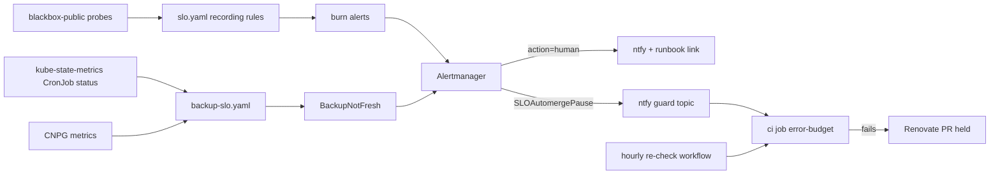

# Design: wave 3 reliability (runbooks and SLO refinements)

## Overview

Four independent parts, each its own pull request:

1. **Runbooks**: `docs/runbooks/alerts/<AlertName>.md`, `runbook_url` on every
   `action: human` rule, the URL in the ntfy message, and repo-policy rules that keep the
   runbooks and the promtool tests complete.
2. **Latency SLO**: recording rules and two alerts in `routes/slo.yaml`, beside the
   availability ones, fed by the same probes.
3. **Backup-freshness SLO**: recording rules and one alert in a new
   `routes/backup-slo.yaml`, from kube-state-metrics and the CNPG metrics.
4. **Automerge pause**: an `action: auto` alert routed to the guard topic, read by a new
   `ci` job for Renovate pull requests, the same channel the auto-rollback outage guard
   already uses.

Everything is PromQL, bash or Python with fixed inputs; nothing calls a model.

## Decisions

| Decision | Choice | Alternatives rejected |
| --- | --- | --- |
| Runbook layout | One page per alert, `docs/runbooks/alerts/<AlertName>.md`, with an index `docs/runbooks/alerts/README.md` ordered by the PAGE classes of `docs/sre.md` (the "Before you start" shell, and a table for the chart rules that page). Adopted from the open pull request #509 | One file with an anchor per alert: anchors depend on GitHub's slugging and a long page is hard to read on a phone; one file per class: the URL would also depend on the class |
| URL form | `https://github.com/ned-si/homelab/blob/main/docs/runbooks/alerts/<AlertName>.md` | Relative paths: a notification needs an absolute URL; a docs site: nothing hosts one |
| Shared alert names | One page per name; `SLOTargetProbeAbsent` (8 rules) shares one page | One page per rule: identical text eight times |
| Chart rules that page | A row per name in the index's chart table (the `ntfy` lines of `tests/alertmanager/routes.txt` that name no homelab rule), linking the homelab steps; the chart's own `runbook_url` stays on the rule | Copying chart rules to add annotations: forks the chart's rules |
| Link in the notification | Append `{{.commonAnnotations.runbook_url}}` as the last line of `X-Message`. ntfy templates only the title, message and priority (open question 1), so no `X-Click`. Every ntfy group has one alert name, so the common annotation is that alert's | Alertmanager templates: the receiver posts raw webhook JSON to ntfy, which formats it |
| CI check | `scripts/ci/repo_policy.py` rules `alert-runbooks` and `alert-tests` (the `Repository policy` step of the `render` job), unit-tested in `tests/test_repo_policy.py` | A separate pytest over the repository: a second place for repository invariants; a bash step: set logic is clearer in Python |
| Promtool coverage | Rule `alert-tests`: every homelab alert name is an `alertname` of some `alert_rule_test` in `tests/prometheus/*_test.yaml` | A per-file rule: alerts in the same group are often tested together |
| Latency SLI | A 30s recording rule `slo:probe_fast` per target: 1 when the probe succeeded within the app's threshold, else 0 (failed or slow counts as bad); then `slo:probe_slow:ratio_rate<w> = 1 - avg by (app) (avg_over_time(slo:probe_fast[w]))` for the availability windows | p95 of `probe_duration_seconds`: not a ratio, so no error budget and no burn rate; subqueries over raw probes: costlier on the 30-day window |
| Latency threshold | Static per-app series `slo:latency_threshold_seconds{app}` (one recording rule per app, like `slo:app:info`), values from the ladder by `scripts/slo-latency-thresholds.sh` against 14 days of data | A threshold per alert expression: duplicated eight times; a dynamic baseline: not reviewable, drifts with the regression it should catch |
| Latency alerts | Slow burn only (3x over 1d/2h, 1x over 3d/6h), `action: auto`; persistent after 1d, `action: human`; both `unless` an availability burn of the same app | A fast latency burn: latency at the probe is rarely an emergency, and a hard outage is the availability alert's job |
| Latency budget policy | Internal objective; the error-budget policy keeps acting on availability only | Two budgets driving the policy: the self-SLA is one number by decision |
| Backup freshness SLI | restic: `time() - kube_cronjob_status_last_successful_time < 26h` for each static target `slo:backup_target:info{namespace, cronjob}` (`routes/backup-slo-targets.yaml`, its own PrometheusRule so the promtool tests feed their own targets; repo-policy rule `backup-slo-targets` keeps it equal to the `-backup` entries of `ci/active-cronjobs.txt`); a target with no series is stale, so a deleted or never-successful CronJob counts. CNPG: `barman_cloud_cloudnative_pg_io_last_available_backup_timestamp` (the plugin's metric; `cnpg_collector_last_available_backup_timestamp` is 0 on every cluster with the Barman Cloud plugin) | Job-level metrics: a CronJob that never creates a Job leaves no Job series; a regex over live CronJobs: a deleted one would vanish instead of going stale |
| Freshness objective | 99% of the time over 30 days per target (about 7 h of staleness a month), as `avg_over_time(fresh[30d])` | 99.9%: one late night of the NAS would spend it |
| New page | `BackupNotFresh` for restic targets only, `for: 15m`, `severity: warning`, `action: human`; quiet while a failed Job of the same CronJob exists (`kube_job_owner` joined to `kube_job_failed > 0`, the condition of the chart's `KubeJobFailed`), and while kube-state-metrics reports no CronJob at all | Also for CNPG: `CNPGBaseBackupTooOld` already pages; an Alertmanager inhibit rule: `KubeJobFailed` carries `job_name`, not the CronJob's name, so no `equal` label can match them |
| Pause trigger | `SLOAutomergePause{app}` = `slo:error_budget_remaining:ratio_rate30d <= 0` and an availability burn of the app firing, `action: auto` | Budget at or below 0 alone: the state lasts until the 30-day window drops the outage, which would hold updates for weeks after the app is healthy again |
| Pause channel | Route `SLOAutomergePause` to `ntfy-guard` (unmuted, `send_resolved`, repeat 4h, inside the 12 h ntfy.sh cache); the CI script reads the newest message per app, `CRITICAL:`/`Warning:` = active, `Resolved:` = not, like `scripts/ci/auto-rollback-guard.sh` | Cluster credentials in GitHub: rejected by decision; github-exporter writing to GitHub: it is read-only by design |
| Pause gate | New job `error-budget` in `ci.yaml`, required through the existing `ci` aggregate job, runs `scripts/ci/error-budget-gate.sh` only for pull requests by `renovate[bot]`; skips (passes) with label `security` | A Renovate `prBlockedBy` setting: Renovate cannot read cluster state |
| Paths per app | `ci/slo-app-paths.txt`, `<app> <path-prefix>...`; repo-policy checks every SLO app has a line and every prefix exists | Deriving paths from namespaces: Keycloak lives under `platform/`, theater serves two apps |
| Resume | `.github/workflows/error-budget-recheck.yaml`, hourly, re-runs the failed `error-budget` job of open Renovate pull requests when the gate now passes (`gh run rerun --failed`) | Waiting for Renovate's next rebase: no rebase happens while main does not move |
| Fail mode | Fail open (gate passes) when the topic or the GitHub API cannot be read, with a warning in the job summary | Fail closed: a dead ntfy.sh would stop every update |

## Components and interfaces

- `docs/runbooks/alerts/<AlertName>.md` and `docs/runbooks/alerts/README.md`: new.
  Linked from `docs/sre.md` (Paging) and `docs/observability.md` (Notifications).
- `platform/backup-verify/alerts.yaml`, `platform/barman-cloud-plugin/monitoring.yaml`,
  `platform/kube-prometheus-stack/routes/{alerts,argocd-alerts,arr-alerts,lan-alerts,nas-alerts,outage-alerts,slo}.yaml`,
  `platform/talos-drift/rules.yaml`, `platform/vuln-enrich/rules.yaml`: `runbook_url` on
  every `action: human` rule.
- `platform/kube-prometheus-stack/values.yaml`: `X-Message` of the `ntfy` receiver; the
  `ntfy-guard` route matcher gains `SLOAutomergePause`. No inhibit rule for
  `BackupNotFresh`: its expression leaves out a CronJob with a failed Job (see Decisions).
- `platform/kube-prometheus-stack/routes/slo.yaml`: groups `homelab.slo.latency`,
  `homelab.slo.latency-long`, `homelab.slo.latency-thresholds`, the two latency alerts,
  `SLOAutomergePause`.
- `platform/kube-prometheus-stack/routes/backup-slo.yaml`: new `PrometheusRule`
  `homelab-backup-slo`, listed in `routes/kustomization.yaml`.
- `platform/kube-prometheus-stack/dashboards/homelab-overview.json` (latency SLO) and
  `homelab-data-protection.json` (freshness SLO).
- `scripts/ci/repo_policy.py` rules `alert-tests` and `alert-runbooks`, with
  `tests/test_repo_policy.py`. `tests/prometheus/slo_test.yaml`,
  `tests/prometheus/backup_slo_test.yaml`: new cases. `tests/alertmanager/routes.txt` and a
  scenario for the guard route and the inhibition.
- `scripts/slo-latency-thresholds.sh`: new, read-only, queries Prometheus through a
  port-forward, prints one line per app (`<app> <p95> <threshold>`).
- `scripts/ci/error-budget-gate.sh` with `tests/bash/test_error_budget_gate.sh` (fake `gh`
  and `curl`, as `tests/bash/test_auto_rollback.sh`); `ci/slo-app-paths.txt`;
  `scripts/ci/repo_policy.py` rule `slo-app-paths`.
- `.github/workflows/ci.yaml` (job `error-budget`), `.github/workflows/error-budget-recheck.yaml`
  (SHA-pinned actions, `permissions: actions: write, pull-requests: read`).
- `docs/sre.md`, `docs/observability.md`, `docs/backups.md` (RPO and freshness).

## Verification

- CI: repo policy (runbooks, promtool coverage), `scripts/ci/promtool-check.sh`,
  `scripts/ci/alertmanager-test.sh` (routes and the new scenario), the bash tests, repo
  policy.
- Live, read-only, after each merge: the new series exist
  (`slo:latency_budget_remaining:ratio_rate30d`, `slo:backup_freshness:ratio_rate30d`) with
  one value per app or target; no new alert fires on a healthy cluster; one test alert
  posted with `amtool alert add` outside quiet hours shows the runbook URL on the phone.
- Pause: the bash test covers active, resolved, unreadable topic, `security` label,
  non-Renovate author, a pull request touching two apps. A dry run of the gate against the
  live topic prints "no app paused".

## Error handling

| Failure | Response |
| --- | --- |
| An existing alert has no promtool test | Write the test in the runbook pull request; the CI rule lands with it |
| A runbook step cannot be verified read-only | Write it from the existing runbooks and docs, mark the expected output as "not rehearsed" |
| Latency thresholds put an app above budget on day one | Recompute with the script; if the p95 is unstable, take the next ladder step and record why in `slo.yaml` |
| `kube_cronjob_status_last_successful_time` missing for a CronJob | Use `kube_cronjob_status_last_schedule_time` with the last Job's success; record the fallback in `backup-slo.yaml` |
| The guard topic cannot carry the pause state | Drop Requirement 5 from this wave and record why in this file; no other channel without cluster credentials in GitHub |

## Open questions (answered at the start of the run)

1. Does ntfy's message templating (`X-Template: yes`) apply to `X-Click`? **No.** Inline
   templating covers the message, title and priority only
   (https://docs.ntfy.sh/publish/#message-templating). The URL is the last line of the
   message.
2. Do the tuppr chart's rules carry `runbook_url`? **No** (live PrometheusRule
   `system-upgrade/tuppr`, 8 alerts, none set). The kube-prometheus-stack rules that page
   (`etcdInsufficientMembers`, `etcdNoLeader`, `KubeJobFailed`) link
   runbooks.prometheus-operator.dev. The index's chart table covers all of them; the tuppr
   notifications carry no link (accepted).
3. Which restic backup CronJobs exist on `origin/main`, and does kube-state-metrics export
   `kube_cronjob_status_last_successful_time` for each? **18, all exported**, last success
   between 10 and 14 hours ago on 2026-10-16: `immich-library-backup`,
   `immich-library-backup-local`, `mealie-backup`, `paperless-backup`, `syncthing-backup`,
   `home-assistant-backup`, `grafana-backup`, `theater-postgres-backup`,
   `theater-config-backup-{sonarr,radarr,lidarr,prowlarr,plex,jellyfin,lazylibrarian,bazarr}`,
   `books-config-backup-{audiobookshelf,calibre-web}`. The `backup-verify-*` CronJobs are
   restore tests, not backups; `.+-backup.*` excludes them.
4. Current p95 probe duration per SLO app over 14 days (`max by (app)` of
   `quantile_over_time(0.95, probe_duration_seconds{job="blackbox-public"}[14d])`, 2026-10-16):
   archive 0.098 s, auth 0.073 s, cinema 0.074 s, cook 0.106 s, media 0.065 s, syncthing
   0.066 s, theater 0.069 s. Twice each is under 0.25 s, the first ladder step; task 5
   confirms it against the budget. Prometheus holds only 3.2 days of probe data (since
   the Talos cutover), not 14; the successful-but-slow share at 0.25 s is 0.02% to
   0.53%, inside the 1% budget. The availability budgets are all negative over the same
   window (the cutover outages), and a failed probe also spends the latency budget, so
   both read negative until those days leave the 30-day window. The latency alert's
   suppression matches the availability slow burn while it is pending or firing (not only
   firing), so the two cannot race at the same evaluation.
5. Does Renovate label `osvVulnerabilityAlerts` pull requests `security`? **Yes, by
   design**: Renovate builds the OSV package rules with the `vulnerabilityAlerts` config,
   so they get `labels: ['security']`. Not observed live: OSV covers only the crate, go,
   hackage, hex, maven, npm, nuget, packagist, pypi and rubygems datasources, and no such
   pull request has been opened here yet.
6. Is the Seafile decommission (#505) merged? **Yes** (1e29f8f). `drive` is no longer in
   `homelab.slo.apps` (auth, cinema, theater, media, archive, cook, syncthing): no page,
   path line or threshold for it.
7. Which homelab alerts lack a promtool test today? **None**: all 71 alert names of the 12
   PrometheusRule files have an `alert_rule_test`. `routes/automation.yaml` has recording
   rules only. Rule `alert-tests` keeps it that way.
