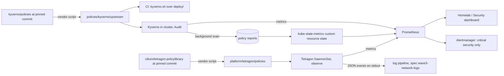

# Design: wave 3 runtime security (Kyverno audit, Tetragon observe)

## Overview

Three independent parts, each a set of pull requests:

1. **Admission and posture (Kyverno)**: upstream ValidatingPolicies vendored into
   `policies/kyverno/upstream/`, run by CI over `deploy/` and by Kyverno in the cluster, in
   Audit only. Background scans write policy reports; kube-state-metrics turns them into
   metrics for the Security dashboard.
2. **Runtime (Tetragon)**: upstream library TracingPolicies vendored into
   `platform/tetragon/policies/`, observe only. Metrics drive the dashboard and the few
   critical pages; JSON events go to stdout for the log pipeline.
3. **Identity (Keycloak)**: brute-force protection, OTP for platform clients and direct
   grants off, in `platform/keycloak/realm/`.

## Decisions

| Decision | Choice | Alternatives rejected |
| --- | --- | --- |
| Policy source | Vendor `pod-security-vpol/{baseline,restricted}` and a subset of `best-practices-vpol` from `kyverno/policies` at one commit, unchanged, with `policies/kyverno/upstream/SOURCE` (repo, commit, file list, sha256 per file). `scripts/kyverno-vendor.sh` re-vendors; `renovate-render` runs it when Renovate moves the commit (regex manager, `git-refs`) | The `kyverno-policies` chart (`policyType: ValidatingPolicy`): covers PSS only, and CI would read rendered chart output instead of the files the cluster runs |
| Best-practice subset | `disallow-latest-tag`, `require-pod-requests-limits`, `require-drop-all`, `require-drop-cap-net-raw`, `require-ro-rootfs`, `disallow-default-namespace`, `disallow-cri-sock-mount`, `restrict-node-port`, `restrict-service-external-ips`, `check-deprecated-apis` | `require-labels` and `restrict-image-registries` (need site config, i.e. a homelab rule), `disallow-helm-tiller` (no Tiller), `disallow-empty-ingress-host` (the Tailscale Ingresses use `defaultBackend` by design) |
| Homelab duplicates | Replaced by upstream after a side-by-side `kyverno apply` over `deploy/` shows the upstream finding set is equal or larger: `disallow-latest-tag`, `disallow-privileged`, `require-resources` replaced (equal sets). `require-probes` stays: upstream's misses six Deployments with one probe and errors on CronJobs | Keeping both: two answers to one question |
| CI vs cluster actions | The vendored files say `Audit`. CI keeps its blocking list by policy name in `scripts/ci/kyverno.sh` (the policies with `validationActions: [Deny]` in `policies/kyverno/` today, under their upstream names) | Editing `validationActions` in the vendored files: they would no longer be upstream |
| Admission path | Reports come from background scans. The admission webhook stays but can never block a pod: `failurePolicy: Ignore`, a 3 s timeout, kube-system, kyverno and argo excluded. Where Kyverno can generate a native ValidatingAdmissionPolicy from a vendored policy (open question 2), it does, in Audit, so that policy needs no webhook call at all | `failurePolicy: Fail`: a dead webhook would block every pod at a cold start; no admission controller: Kyverno needs it to serve policies |
| Controllers | Admission controller and reports controller, one replica each; background and cleanup controllers off | All four: RAM on the SBCs for features not used |
| Expected findings | `PolicyException` objects in `policies/kyverno/exceptions/` with `homelab/reason` annotations: democratic-csi node plugin (privileged, host paths), Cilium and Tetragon (kube-system and `tetragon`), node-exporter (host namespaces), theater inline NFS volumes until wave 4 | Namespace exclusions: they also hide new, unexpected findings in those namespaces |
| Report metrics | kube-state-metrics `customResourceState` on the report kind Kyverno writes (open question 1), exposing `summary.{pass,fail,warn,error,skip}` per report and namespace; plus Kyverno's `kyverno_policy_results_total` | Policy Reporter: one more component and UI for a count |
| Namespace and layer | `kyverno`, infrastructure layer, sync wave after `democratic-csi` and before `network-policies`; PSA `enforce: restricted` | Platform layer: the policies are cluster guardrails, like the CNI |
| Mapping files | `policies/kyverno/upstream/controls.yaml` and `platform/tetragon/policies/controls.yaml`: per policy, the framework IDs. `tests/test_security_controls.py` checks completeness and ID formats | Annotations in the policy files: would edit upstream files |
| Tetragon namespace | `tetragon`, PSA `enforce: privileged` with the reason in `namespaces.yaml` (eBPF, host PID, `/sys/kernel`); platform layer; chart from `helm.cilium.io` (added to the platform AppProject) | `kube-system`: Talos exempts it from PSA, which hides the privilege instead of stating it |
| Tetragon policies | From `examples/policylibrary`: `privileges/privileges-raise.yaml`, `modules.yaml`, `bpf.yaml`, `library.yaml`; process exec and exit from the default sensor (no policy needed) | `sshd.yaml` (no SSH on Talos or in the images); `egress.yaml` (Hubble already records every flow); `privileges/privileges-setuid-root.yaml` (the same setuid hooks as `privileges-raise.yaml`). `privileges-raise` maps to T1068 and, per hook in `controls.yaml` `hooks`, `create_user_ns` and `security_capset` to T1611 |
| Event export | `export-stdout` container, JSON; export allowlist: process exec in non-system namespaces and every policy event; export file on `/var/run/cilium/tetragon` (tmpfs), 10 MiB, 2 backups | Export to a hostPath on `/var`: the eMMC |
| Metric labels | `tetragon.prometheus.metricsLabelFilter: namespace,workload,binary` | Pod labels: one series per pod restart |
| Detection to page | PromQL on `increase(tetragon_policy_events_total[5m]) > 0` per policy and hook, minus allowlisted `namespace`/`workload`/`binary` tuples, one alert per technique: `RuntimeEscapeToHost` (T1611: unprivileged user namespace, capset raising capabilities), `RuntimePrivilegeEscalation` (T1068: uid/gid to 0 from a non-root process), `RuntimeKernelModuleLoad` (T1547.006), `RuntimeUnexpectedBPF` (T1014) | Alerts from logs: the log store is on trial and not a paging path |
| Not paged | Exec of shells or package managers in a container (T1609, T1059.004), `/tmp` execution and deleted binaries (T1620), `LD_PRELOAD`-style loading (T1574.006): Security dashboard panels only. `backup-verify` and the CNPG instance manager exec into pods by design | Paging on exec: a weekly restore test would page |
| Keycloak values | `failureFactor 10`, `waitIncrementSeconds 60`, `maxFailureWaitSeconds 900`, `maxDeltaTimeSeconds 43200`, `permanentLockout false`, `quickLoginCheckMilliSeconds 1000` | Permanent lockout: one operator, so an attacker could lock out the only admin |
| OTP for platform clients | The `browser-loa` level-1 subflow's OTP step goes from "Condition - user configured" to required for clients in `platform_clients`; Keycloak's "Configure OTP" required action covers users without one | OTP for every client: the household apps and TV logins stay password plus SSO session |

## Framework mapping (initial; the run checks each ID against the source)

| Control | CIS Kubernetes Benchmark | NIST SP 800-190 | NSA/CISA Kubernetes Hardening | NIST CSF 2.0 |
| --- | --- | --- | --- | --- |
| PSS baseline and restricted policies | 5.2.x (admission of privileged, host namespaces, privilege escalation, root, capabilities, seccomp) | 4.4.3 insecure container runtime configurations | Pod security: non-root, immutable filesystem, pod security enforcement | PR.PS-01 |
| `require-ro-rootfs`, `require-drop-all`, `require-drop-cap-net-raw` | 5.2.x (capabilities) | 4.4.3 | Pod security: immutable container filesystems | PR.PS-01 |
| `require-pod-requests-limits`, `require-probes` | 5.7.x general policies | 4.4.1 / 4.4.3 | Pod security: resource policies | PR.IR-04 (capacity) |
| `disallow-latest-tag`, `check-deprecated-apis` | 5.7.x | 4.1.x image vulnerabilities, 4.3.x orchestrator | Upgrading and application security practices | ID.AM-08, PR.PS-02 |
| `disallow-default-namespace` | 5.7.4 | 4.3.4 mixing of workload sensitivity levels | Namespaces | PR.AA-05 |
| `restrict-node-port`, `restrict-service-external-ips` | 5.7.x | 4.3.3 inter-container network traffic, 4.4.2 unbounded network access | Network separation and hardening | PR.IR-01 |
| `disallow-cri-sock-mount` | 5.2.x (host path) | 4.4.3 | Pod security | PR.PS-01 |
| Tetragon detections | n/a (runtime) | 4.4.4 app vulnerabilities, 4.4.5 rogue containers | Logging and threat detection | DE.CM-09, DE.AE-02 |
| Keycloak brute force and OTP | n/a | n/a | Authentication and authorization | PR.AA-03 (authentication) |

CIS sections 1 to 4 (control plane, etcd, kubelet files) are managed by Talos and not
re-implemented here; `docs/threat-model.md` states that.

## Components and interfaces

- `clusters/homelab/infrastructure/kyverno.yaml` (Application), `infrastructure/kyverno/values.yaml`,
  `infrastructure/kyverno/kustomization.yaml` (renders `policies/kyverno/upstream/**` and
  `policies/kyverno/exceptions/**`); `project-infrastructure.yaml`: the chart repo and the
  kinds `policies.kyverno.io/ValidatingPolicy`, `kyverno.io/*` CRDs, webhook configurations.
- `infrastructure/namespaces/namespaces.yaml`: `kyverno` (restricted), `tetragon`
  (privileged, with reason).
- `policies/kyverno/upstream/` (vendored files, `SOURCE`, `controls.yaml`),
  `policies/kyverno/exceptions/`, `scripts/kyverno-vendor.sh`, `scripts/ci/kyverno.sh`
  (blocking list by name), `policies/kyverno/tests/` (updated for the upstream names).
- `platform/kube-prometheus-stack/values.yaml`: kube-state-metrics `customResourceState`
  and RBAC for the report kind; the Kyverno and Tetragon ServiceMonitors or PodMonitors.
- `platform/kube-prometheus-stack/dashboards/homelab-security.json`: rows "Admission
  policy (Kyverno, audit)" and "Runtime (Tetragon, observe)"; the "Data sources this
  dashboard does not have" panel updated.
- `clusters/homelab/platform/tetragon.yaml`, `platform/tetragon/values.yaml`,
  `platform/tetragon/policies/` (vendored, `SOURCE`, `controls.yaml`),
  `platform/tetragon/rules.yaml` (`PrometheusRule` `homelab-runtime`, the allowlists).
- `platform/keycloak/realm/{platform.conf,access.conf,clients.conf,apply.sh}`, the PostSync
  read-back, `tests/bash/test_keycloak_realm.sh`.
- `.github/renovate.json5`: regex managers for the two vendored commits; the
  `renovate-render` workflow runs both vendor scripts.
- Tests: `tests/test_security_controls.py`, a check in the same file that no TracingPolicy
  has an enforcement action, `tests/prometheus/runtime_test.yaml`,
  `tests/prometheus/kyverno_test.yaml`, `tests/alertmanager/routes.txt`.
- Docs: `docs/threat-model.md` (controls per boundary), `docs/observability.md`,
  `docs/testing.md` (CI and cluster share the policy files), `docs/architecture.md`
  (identity), `docs/runbooks/alerts.md` sections.

## Verification

- CI: `scripts/ci/kyverno.sh` over `deploy/` with the vendored set (same blocking outcome
  as before for the formerly-Deny policies), the vendor check (`SOURCE` sha256 match),
  pytest, promtool, Alertmanager routes, the Keycloak bash test, kind preprod dry run with
  the Kyverno CRDs.
- Live, read-only, after each merge: Kyverno pods Ready; `kubectl get validatingpolicies`
  lists the vendored set; reports exist in every namespace and are under 1 h old; the
  Security dashboard rows have data; a pod created in a scratch namespace while the
  Kyverno admission Deployment is scaled to 0 in kind preprod still starts (cold-start
  test, CI only); Tetragon Ready on 4 nodes, every TracingPolicy loaded (state `enabled`),
  `tetragon_events_total` rising; no runtime alert fires on a quiet cluster for 24 h.
- Keycloak: the PostSync read-back passes; a platform-client login asks for OTP; the
  login matrix of #468 still holds.

## Error handling

| Failure | Response |
| --- | --- |
| An upstream policy errors in CI or the cluster (CEL not supported by this Kyverno) | Leave it out of the vendored list with the reason in `SOURCE`; never patch it |
| Reports controller over its memory limit | Raise the limit once within the node budget; else lengthen the background interval to 2 h and record it |
| A library TracingPolicy fails to load on arm64 or Talos | Leave it out with the reason in `SOURCE`; the mapped technique is listed as a gap in `docs/threat-model.md` |
| A runtime alert fires on a known-good actor | Add the tuple to the allowlist in `rules.yaml` with a promtool case; never silence by hand |
| Tetragon raises node CPU above 10% sustained | Narrow the export allowlist first, then the default sensor's process events |
| OTP requirement locks the operator out | Master-realm admin is the break-glass (unchanged); revert the PR |

## Open questions (answered at the start of the run)

1. Which report API does Kyverno 1.19 write by default (`wgpolicyk8s.io/v1alpha2`
   PolicyReport or `openreports.io` Report)? The kube-state-metrics config targets that one.
   **Answer:** `wgpolicyk8s.io/v1alpha2` `PolicyReport` and `ClusterPolicyReport`. Chart
   3.9.1 (Kyverno v1.19.1) has `openreports.enabled: false` by default.
2. Which vendored ValidatingPolicies can Kyverno turn into native
   ValidatingAdmissionPolicies, and does `kyverno apply` evaluate their pod-controller
   autogen over the Deployments in `deploy/`?
   **Answer:** none. A ValidatingAdmissionPolicy is generated only for a policy with
   `spec.autogen.validatingAdmissionPolicy.enabled: true`, and no vendored file sets it, so
   every policy goes through the fail-open webhook. The CLI does evaluate pod-controller
   autogen: results come out for Deployments, StatefulSets, Jobs and CronJobs.
   Two CLI gaps: policies reading `namespaceObject` need a values file with the namespaces
   (`scripts/ci/kyverno.sh` generates it), and `restrict-nodeport` errors on Services
   without `spec.type`, which the API server defaults (listed as a CLI gap in the script).
   Upstream `require-probes` errors on every CronJob and accepts one probe of three: not
   vendored, the homelab `require-probes` stays.
3. Do `privileges-raise.yaml`, `modules.yaml` and `bpf.yaml` load on arm64 (syscall
   prefixes) and on the Talos 1.14 kernel (BTF, LSM hooks)?
   **Answer:** checked live at task 6.
4. Which Tetragon metric carries policy events with the policy name in this release
   (`tetragon_policy_events_total` or another), and its labels?
   **Answer:** checked against the running agent at task 6 (chart 1.7.1; its
   `metricsLabelFilter` accepts `namespace,workload,pod,binary`).
5. Which clients need direct access grants today, if any (`clients.conf`, `apply.sh`)?
   **Answer:** none. `apply.sh` creates both client kinds with
   `directAccessGrantsEnabled=false`.
6. The count of restricted-PSS findings per namespace on `deploy/` today, as the wave 4
   baseline (recorded in `docs/threat-model.md`).
   **Answer (2026-10-16, `deploy/` only; Helm-chart workloads are not in `deploy/`):**
   65 restricted results on 23 workloads: theater 33 (9), paperless 6 (2), books 5 (3),
   immich 4 (2), keycloak 3 (1), mealie 3 (1), monitoring 3 (1), syncthing 3 (1),
   kube-system 3 (1), backup-verify 1 (1), system-upgrade 1 (1). Baseline: one workload,
   `monitoring/lan-inventory` (host network, added capabilities).
