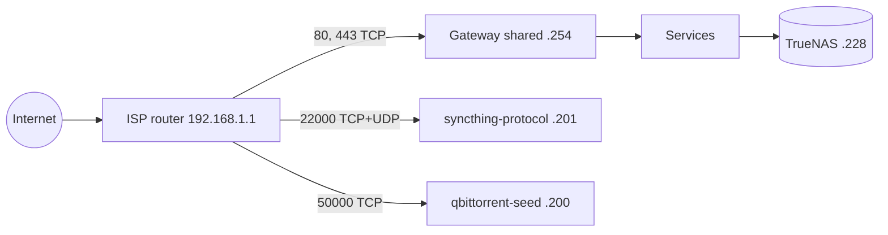

# homelab

[](https://github.com/ned-si/homelab/actions/workflows/ci.yaml?query=branch%3Amain)
[](https://github.com/ned-si/homelab/actions/workflows/dast.yaml)
[](https://scorecard.dev/viewer/?uri=github.com/ned-si/homelab)
[](.github/renovate.json5)
[](https://github.com/ned-si/homelab/commits/main)
[](LICENSE)

This is the README of an extremely over-engineered homelab. Four small arm64
boards on one motherboard run what a household needs (photos, films,
documents, recipes), with more automation, policy and monitoring than a few
photo albums will ever deserve. Fair enough: that is rather the point.

The goals, roughly in order of how easy they are to justify:

1. Run the services I actually need.
2. Run almost by itself, upgrades included. Renovate opens the pull requests,
   CI is the only gate, green CI merges, and a merge that degrades an app is
   reverted automatically. I should only hear about it when a person has to
   act.
3. Apply current best practices for modern platform and infrastructure
   deployments (GitOps, DevSecOps, SRE), at a scale where nobody can complain
   that they slow things down.
4. Show what spec-driven development with AI can do today. Most of this
   repository was planned, written and checked by AI agents working from
   briefs, skills and specs, with me deciding what gets built.
5. Share all of it, as inspiration, as an implementation example, or as a
   bag of ideas on how things can be done and automated now. There is no need
   to copy it all: pick one piece, make it yours, and iterate.

Is it reasonable for a home? No. Is it a very good playground? Indeed.

## What's inside

- GitOps: Argo CD deploys `main`, one root Application, three layers, one
  Application per app ([architecture](docs/architecture.md),
  [decisions](docs/decisions.md)).
- Autonomous operation: Renovate automerge, automatic rollback, Talos and
  Kubernetes upgrades rehearsed in CI and rolled out by tuppr
  ([talos](docs/talos.md), [rollback](docs/decisions.md#automatic-rollback)).
- DevSecOps: signed commits, everything pinned, SOPS secrets, layered CI,
  DAST, a threat model ([testing](docs/testing.md), [secrets](docs/secrets.md),
  [threat model](docs/threat-model.md)).
- SRE: SLOs, paging only when a person has to act, dashboards for the rest,
  postmortems ([sre](docs/sre.md), [observability](docs/observability.md)).
- Data: WAL archiving, nightly backups, a version-locked bucket and restore
  tests ([backups](docs/backups.md)).
- Network: one shared Gateway, Let's Encrypt certificates, Cloudflare DNS
  ([networking](docs/networking.md)).

## At a glance

- Hardware: 4x Turing RK1 (Rockchip RK3588, arm64, 32 GB) on a Turing Pi 2
  board. 3 control planes and 1 worker.
- OS and Kubernetes: Talos Linux, Kubernetes, containerd.
  API on the VIP `192.168.1.11`, held by Talos on the control planes.
- GitOps: Argo CD. CNI: Cilium, which also serves the shared
  Gateway on `192.168.1.254`.
- Storage: TrueNAS CORE NAS at `192.168.1.228`. iSCSI block volumes through
  democratic-csi (StorageClasses `iscsi`, default, and `iscsi-retain`) and an
  NFS share for media. Data volumes use reclaim policy `Retain`.
- Public names: `<name>.lilalala.com`, TLS from Let's Encrypt, DNS records
  managed by external-dns in Cloudflare.

## Start here

- First install of a cluster: [docs/bootstrap.md](docs/bootstrap.md).
- Power loss or move: [docs/runbooks/cold-start.md](docs/runbooks/cold-start.md).
- A failed or reinstalled node: [docs/runbooks/node-replacement.md](docs/runbooks/node-replacement.md).
- How it fits together: [docs/architecture.md](docs/architecture.md),
  [docs/networking.md](docs/networking.md), [docs/decisions.md](docs/decisions.md).
- Data: [docs/backups.md](docs/backups.md), [docs/secrets.md](docs/secrets.md).
- Monitoring: [docs/observability.md](docs/observability.md).
- Tests, from pre-commit to deploy-time smoke tests: [docs/testing.md](docs/testing.md).
- Operating Talos nodes: [docs/talos-cheatsheet.md](docs/talos-cheatsheet.md).
- App runbooks: [docs/runbooks/](docs/runbooks).
- How this repo is built: specs and steering in [.kiro/specs/](.kiro/specs)
  and [.kiro/steering/](.kiro/steering).

## Services

| Service | Purpose | Namespace | Public hostname | Keycloak SSO |
| --- | --- | --- | --- | --- |
| Immich | Photos and videos | `immich` | `media` | Yes |
| Plex | Media server | `theater` | `theater` | No |
| Sonarr, Radarr, Lidarr, Prowlarr | Media management | `theater` | `theater` under `/arr/<app>` | No |
| qBittorrent | Downloads | `theater` | none (LAN only; seeding port on `.200`) | No |
| Jellyfin | Media server | `theater` | `cinema` | No |
| Paperless-ngx | Document archive | `paperless` | `archive` | Yes |
| Mealie | Recipes | `mealie` | `cook` | Yes |
| Home Assistant, Mosquitto, Zigbee2MQTT | Home automation ([docs/home-automation.md](docs/home-automation.md)) | `home` | `home` | Yes (Home Assistant) |
| Syncthing | Device sync | `syncthing` | `syncthing` (UI); sync on `.201` | No |
| Keycloak | Single sign-on, realm `homelab` | `keycloak` | `auth` | - |
| Grafana, Prometheus, Alertmanager | Monitoring | `monitoring` | `grafana` | Yes (Grafana) |
| Argo CD | GitOps controller | `argo` | `argo` | Yes |

Hostnames are prefixes of `lilalala.com`. Plex and Jellyfin stay off SSO so
their TV apps can sign in.

## Platform

| Component | Role | Managed by |
| --- | --- | --- |
| Argo CD | App-of-apps: `root` -> `layer-infrastructure`, `layer-platform`, `layer-apps` -> one Application per app | Itself: Application `argocd` (release `argocd`, chart argo-cd) in namespace `argo`, values in [`bootstrap/argocd-values.yaml`](bootstrap/argocd-values.yaml); installed by hand once on a fresh cluster |
| Cilium | CNI, kube-proxy replacement, L2-announced LoadBalancer IP pools, Gateway API | Argo CD (release name `cilium`), values in [`infrastructure/cilium/values.yaml`](infrastructure/cilium/values.yaml); installed by hand once on a fresh cluster |
| Talos | OS, kubelet, etcd, control plane, Kubernetes API VIP `192.168.1.11` | Machine configs rendered from [`talos/`](talos) by talhelper, applied with `task talos:*` ([docs/talos.md](docs/talos.md)) |
| Cilium Gateway | Shared Gateway `gateway/shared` for every public hostname, on `192.168.1.254` | Argo CD |
| cert-manager | Certificates, ClusterIssuer `letsencrypt`, DNS-01 via Cloudflare | Argo CD |
| external-dns | Cloudflare records for every Ingress and HTTPRoute, upsert only | Argo CD |
| CloudNativePG | PostgreSQL for Immich, Keycloak, Mealie, Sonarr, Radarr, Lidarr and Prowlarr | Argo CD |
| democratic-csi | iSCSI volumes on TrueNAS | Argo CD (release name `iscsi`), values in [`infrastructure/democratic-csi/values-iscsi.yaml`](infrastructure/democratic-csi/values-iscsi.yaml); driver config sealed in [`infrastructure/secrets/`](infrastructure/secrets) |
| kube-prometheus-stack | Prometheus, Alertmanager, Grafana | Argo CD |

The public WAN IP is set in one place only: `--default-targets` in
[`infrastructure/external-dns/values.yaml`](infrastructure/external-dns/values.yaml).
Ingresses carry no target annotation. When the ISP changes it, follow
[docs/runbooks/wan-ip-change.md](docs/runbooks/wan-ip-change.md).

Chart versions live next to each Application in
[`clusters/homelab/`](clusters/homelab), and in [`ci/helm-releases.yaml`](ci/helm-releases.yaml) for the releases
installed with the Helm CLI.

## Networking



| Address | Use |
| --- | --- |
| `192.168.1.0/24` | Home LAN |
| `192.168.1.1` | ISP router: gateway, DHCP, DNS forwarder |
| `192.168.1.50`-`.199` | DHCP pool |
| `192.168.1.11` | Kubernetes API VIP (held by Talos on a control plane), port 6443 |
| `192.168.1.247` | `homelab-cp-1` |
| `192.168.1.238` | `homelab-cp-2` |
| `192.168.1.239` | `homelab-cp-3` |
| `192.168.1.240` | `homelab-w-1` (worker) |
| `192.168.1.228` | TrueNAS CORE (iSCSI, NFS) |
| `192.168.1.20` | Raspberry Pi, Zigbee coordinator over ser2net, static on the Pi ([docs/home-automation.md](docs/home-automation.md#zigbee)) |
| `192.168.1.200`-`.227` | Cilium pool `pool-2` (LoadBalancer Services) |
| `192.168.1.200` | `theater/qbittorrent-seed`, pinned |
| `192.168.1.201` | `syncthing/syncthing-protocol`, pinned |
| `192.168.1.254` | Cilium pool `pool-1`: `gateway/cilium-gateway-shared`, pinned |

Nodes use static addresses outside the DHCP pool. Pinned LoadBalancer IPs use
the `lbipam.cilium.io/ips` annotation so the router port forwards stay valid.

## Repository layout

| Path | Contents |
| --- | --- |
| [`clusters/homelab/`](clusters/homelab) | Argo CD objects only: `root.yaml` -> three layers (`infrastructure`, `platform`, `apps`) -> one Application per app |
| [`infrastructure/`](infrastructure) | Namespaces, Cilium pools, cert-manager, external-dns, the shared Gateway, democratic-csi |
| [`platform/`](platform) | CloudNativePG, kube-prometheus-stack, Keycloak |
| [`apps/`](apps) | Immich, Mealie, Paperless, Syncthing, the theater stack |
| `*/secrets/` | SOPS-encrypted Secrets (age), decrypted by KSOPS in Argo CD |
| [`deploy/`](deploy) | Rendered manifests Argo CD reads (`scripts/render-deploy.sh`; CI fails if stale) |
| [`bootstrap/`](bootstrap) | `root-app.yaml` (the root Application, applied once by hand), values for the `argocd` Helm release, OpenTofu for a fresh install |
| [`talos/`](talos) | talhelper config for the Talos nodes (machine configs, Image Factory schematic, patches); [docs/talos.md](docs/talos.md) |
| [`ci/`](ci) | Helm CLI release list, vendored CRD schemas, pinned CI Python requirements |
| [`scripts/`](scripts) | CI entry points (`scripts/ci/`), read-only cluster smoke suite (`smoke.sh`), guarded merge (`pr-merge.sh`), Trivy gate |
| [`tests/`](tests) | pytest and bash tests for the scripts |
| [`docs/`](docs) | Architecture, networking, bootstrap, backups, secrets, observability, decisions, runbooks, [roadmap](docs/roadmap.md) |
| [`.github/workflows/ci.yaml`](.github/workflows/ci.yaml) | CI |

Every Application tracks `main` and syncs automatically with self-heal. App
leaves prune. The root, the layers,
`namespaces`, `cilium`, `democratic-csi` and the leaves that ship CRDs do not. Every PVC, CNPG Cluster, StatefulSet and Namespace
carries `argocd.argoproj.io/sync-options: Delete=false,Prune=false`, and no
Application has a cascading finalizer. The photo library PVC `immich/immich-data`
is in no Application at all.

## CI

Every pull request and every push to `main` runs
[`.github/workflows/ci.yaml`](.github/workflows/ci.yaml): five parallel jobs,
one step per check. Inside a job every check runs even when an earlier one
fails, and the job fails if any check failed.

- `lint`: `yamllint`, `actionlint`, `shellcheck`, `tofu fmt` and
  `tofu validate`.
- `render`: unit tests (pytest and bash), a render of every Application and
  Helm release, `kubeconform` (strict schema validation against the cluster's
  Kubernetes version and the vendored CRD schemas) and `repo-policy` (pinned actions,
  repository invariants, secrets, leak and placeholder checks, `deploy/`
  matches its sources, kube-linter).
- `security`: `gitleaks` on the new commits, and the Trivy config scan.
  CRITICAL fails; HIGH fails only when it increases against the merge base.
  Waivers in [`.trivyignore.yaml`](.trivyignore.yaml) are scoped and expire.
- `talos`: generates the Talos machine configs from
  [`talos/talconfig.yaml`](talos/talconfig.yaml) with throwaway secrets,
  `talosctl validate --mode metal` on each, and checks the invariants in
  [`scripts/ci/talos-validate.sh`](scripts/ci/talos-validate.sh).
- `pr-metadata` (pull requests only): Conventional Commits, titles under 70
  characters, every commit signed and verified.

A last job, `ci`, needs all five and fails unless each one passed
(`pr-metadata` may be skipped on a push). `ci` is the only required check,
for branch protection and for `scripts/pr-merge.sh`.

Every action is pinned to a commit SHA and every tool to a version and checksum.

## How changes reach the cluster

1. Branch from `main`, commit signed Conventional Commits.
2. Open a pull request. CI must be green.
3. Squash-merge with `scripts/pr-merge.sh <pr-number>`. It refuses unless
   every required check is green, the title and commits pass, every commit is
   verified, the branch is up to date with `main` and no merge freeze is set.
4. That is the deployment. Every Application tracks `main`, so Argo CD
   applies the merge within its sync interval (3 minutes), Argo CD's own
   release included. Rollback is a revert pull request, opened automatically
   when a merge degrades its Application
   ([docs/decisions.md](docs/decisions.md#automatic-rollback)).

Check what is deployed:

```sh
kubectl -n argo get applications \
  -o custom-columns=NAME:.metadata.name,SYNC:.status.sync.status,HEALTH:.status.health.status,REVISION:.status.sync.revision
```

Expected output: every Application is `Synced` and `Healthy`.
Single-source Applications show the SHA of the latest commit on `main`.
Multi-source ones (the Helm charts) leave `REVISION` empty.

## Status and roadmap

- Ingress: the shared Cilium Gateway serves every public hostname on
  `192.168.1.254`; there is no ingress controller.
- Backups: nightly restic jobs copy files and dumps to S3 (and the photo
  library to the NAS); every Postgres cluster archives WAL and takes daily base
  backups to S3 through the Barman Cloud plugin (point-in-time, 30 days); etcd
  relies on snapshots taken by hand.
  Data PVs are on reclaim policy `Retain`
  ([details](docs/backups.md#reclaim-policy)).
- Alerting: Prometheus and Grafana run; Alertmanager delivers to nobody yet
  ([docs/observability.md](docs/observability.md)).
- Everything else that is deliberately deferred: [docs/roadmap.md](docs/roadmap.md).
