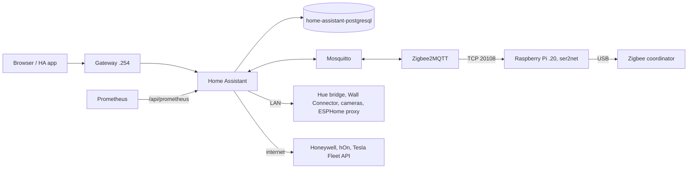

# Home automation

Namespace `home`, manifests in `apps/home/`, Argo CD Application `home`.

| Component | Where | Purpose |
|---|---|---|
| Home Assistant | https://home.lilalala.com, Service `home-assistant:8123` | The hub: integrations, automations, dashboards |
| PostgreSQL `home-assistant-postgresql` | CNPG cluster, `apps/home/database.yaml` | The recorder (history and statistics) |
| Mosquitto | Service `mosquitto.home:1883`, in-cluster only | MQTT broker for Zigbee2MQTT and ESPHome/MQTT devices |
| Zigbee2MQTT | Service `zigbee2mqtt:8080`, no route | Zigbee devices to MQTT; scaled to 0 until the coordinator is online |
| Grafana dashboard "Home" | uid `home` | House metrics, laid out for a phone |



## Configuration

- `apps/home/config/configuration.yaml` is copied over `/config/configuration.yaml`
  by the `config` init container on every start. Edits on the pod are lost.
- HTTP settings (reverse proxy, IP ban) are not YAML: Home Assistant 2026 keeps
  them in `/config/.storage/http`. `apps/home/config/http-store.json` is that
  file, written by the same init container. Trusted proxy: the pod CIDR
  `10.244.0.0/16` (Cilium's Envoy).
- Integrations, devices, areas, users and UI automations live in
  `/config/.storage` on PVC `home-assistant-config` (iscsi-retain, 5Gi).
- Location is set once in the UI (Settings, System, General), never in git:
  the repo is public.
- Pod network, no `hostNetwork`. Devices get a fixed address (DHCP reservation
  is not possible on the router, so a static IP on the device or a long
  lease) and are added by IP, so mDNS/SSDP discovery is not needed.

## Login

Keycloak, through the custom component
[hass-oidc-auth](https://github.com/christiaangoossens/hass-oidc-auth)
(`auth_oidc`), pinned by release tag in the `custom-components` init
container; Renovate bumps it and its one extra Python dependency (joserfc).
The same container installs `dreame_vacuum` (MOVA robot) and its one missing
dependency, mini-racer (V8, for the map). mini-racer is held at 0.12.4, the
last release whose musllinux aarch64 wheel is really musl, and needs
libatomic from Alpine's package (sha256-pinned, on `LD_LIBRARY_PATH`).

- Client `home-assistant` in realm `homelab`: public, PKCE S256, redirect URI
  `https://home.lilalala.com/auth/oidc/callback` (in
  `platform/keycloak/realm/clients.conf`).
- Keycloak group `HomeAssistantAdmins`: Home Assistant administrator. Other
  realm users get a normal user on first login.
- Break-glass: the local `owner` account at
  `https://home.lilalala.com/?skip_oidc_redirect=true`, password in the
  operator's password manager.
- Mobile app: server `https://home.lilalala.com`, then "Login with Keycloak".

## Metrics

ServiceMonitor `home/home-assistant` scrapes `/api/prometheus` every 60 s with
a long-lived token of `owner` (client name `prometheus`), SOPS Secret
`home-assistant-prometheus`, key `token`. The `prometheus:` filter in
`configuration.yaml` exports only domains that describe the house. To rotate:
HA profile, Security, Long-lived access tokens; create a new one, then
`task secrets:edit -- apps/secrets/home-assistant-prometheus.sops.yaml`, then
delete the old token.

## MQTT

No anonymous clients. Users and passwords are the keys of the SOPS Secret
`mosquitto-users` (`apps/secrets/mosquitto-users.sops.yaml`); the ACL is
`apps/home/config/mosquitto/acl`. Adding a user: a key in the Secret and a
block in the ACL. The Home Assistant MQTT integration is added once in the UI:
broker `mosquitto.home.svc.cluster.local`, port 1883, user `homeassistant`.

## Zigbee

The operator's USB coordinator sits on a Raspberry Pi outside the cluster
and is shared over TCP by ser2net, so no node needs USB passthrough. The Pi is
not managed by GitOps.

1. Flash Raspberry Pi OS Lite (64-bit) with Raspberry Pi Imager; set the
   hostname `zigbee`, a user, and an SSH key in the Imager settings.
2. Static IP `192.168.1.20` (outside the DHCP pool `.50`-`.199`):

   ```sh
   sudo nmcli con mod "Wired connection 1" ipv4.method manual \
     ipv4.addresses 192.168.1.20/24 ipv4.gateway 192.168.1.1 ipv4.dns 192.168.1.1
   sudo nmcli con up "Wired connection 1"
   ```

   Expected: `ip -4 addr show eth0` lists `192.168.1.20/24`.
3. Install ser2net and find the adapter:

   ```sh
   sudo apt update && sudo apt install -y ser2net
   ls -l /dev/serial/by-id/
   ```

   Expected: one entry such as `usb-ITead_Sonoff_Zigbee_3.0_USB_Dongle_Plus_...-if00-port0`.
4. `/etc/ser2net.yaml` (replace the device path):

   ```yaml
   connection: &zigbee
     accepter: tcp,20108
     enable: on
     options:
       kickolduser: true
     connector: serialdev,/dev/serial/by-id/<adapter>,115200n81,local
   ```

   | Coordinator | Chip | Zigbee2MQTT `adapter` | Baud |
   |---|---|---|---|
   | SONOFF ZBDongle-P, SLZB-06 | TI CC2652P | `zstack` | 115200 |
   | SONOFF ZBDongle-E, SLZB-06M/07 | Silicon Labs EFR32MG21/24 | `ember` | 115200 |
   | ConBee II / III | deCONZ | `deconz` | 115200 |

5. `sudo systemctl enable --now ser2net`, then from the Mac:
   `nc -vz 192.168.1.20 20108`. Expected: `succeeded`.
6. ser2net has no authentication: anyone on the LAN can open the port. Accept
   only the nodes (pods leave through their node's IP):

   ```sh
   sudo apt install -y nftables
   sudo nft add table inet zigbee
   sudo nft add chain inet zigbee in '{ type filter hook input priority 0; }'
   sudo nft add rule inet zigbee in tcp dport 20108 ip saddr '{ 192.168.1.238, 192.168.1.239, 192.168.1.240, 192.168.1.247 }' accept
   sudo nft add rule inet zigbee in tcp dport 20108 drop
   sudo sh -c 'nft list ruleset > /etc/nftables.conf' && sudo systemctl enable nftables
   ```

Then enable Zigbee2MQTT in one PR: set `ZIGBEE2MQTT_CONFIG_SERIAL_ADAPTER` in
`apps/home/zigbee2mqtt.yaml`, `replicas: 1`, and add `zigbee2mqtt-data`
(network key, coordinator backup, device list) to `apps/home/backup.yaml`.
Pairing is in the frontend: `kubectl -n home port-forward svc/zigbee2mqtt 8080`,
then http://localhost:8080, "Permit join".

Alternative: a network coordinator (SMLIGHT SLZB-06, Ethernet + PoE) speaks
the same TCP serial protocol on port 6638; only `serial.port` changes. It
removes the Pi but costs a new device.

## Devices

| Device | Integration | Local or cloud | Setup |
|---|---|---|---|
| Philips Hue lights | Philips Hue (bridge) | Local | Fixed IP on the bridge, add the integration by IP, press the bridge button |
| MOVA V70 robot vacuum | Dreame Vacuum, community (HACS) integration [dreame-vacuum](https://github.com/Tasshack/dreame-vacuum) | Cloud | Add the integration in the UI with the MOVAhome account (the robot's app login); vacuum, map, rooms and consumables show up as entities |
| Plant sensors (~10, Zigbee) | Zigbee2MQTT, MQTT discovery | Local | Pair in Zigbee2MQTT; moisture and battery show on the "Home" dashboard |
| Honeywell thermostat | Honeywell evohome or Honeywell Lyric (model decides) | Cloud | Add in the UI with the Honeywell/Resideo account; no local API |
| Smoke alarms (brand TBD) | Depends on the brand: Zigbee models through Zigbee2MQTT; gateway models through their cloud | Local if Zigbee | Pick a Zigbee model for new purchases |
| Wi-Fi cameras | ONVIF, streams by RTSP | Local | Enable RTSP/ONVIF in the camera's app, fixed IP; recordings later in Frigate |
| Video doorbell (to buy) | ONVIF/RTSP, or the vendor's local integration | Local | Buy a model with local RTSP/ONVIF (for example Reolink); avoid cloud-only doorbells |
| Geberit AquaClean | Bluetooth LE, community integration | Local | An ESP32 near the toilet running ESPHome `bluetooth_proxy`, added by IP; the AquaClean protocol needs a community (HACS) integration, check its state before relying on it |
| Fridge (hOn app) | hOn, community (HACS) integration | Cloud | hOn account login; no local API |
| Tesla Wall Connector (Gen 3) | Tesla Wall Connector | Local | Fixed IP on the connector, add by IP; read-only (power, energy, vehicle connected) |
| Tesla car | Tesla Fleet | Cloud | Fleet API app registration (developer.tesla.com) with a public key on a domain; or Teslemetry as a paid relay |

Custom (HACS) integrations go in like `auth_oidc`: a pinned release installed
by the `custom-components` init container, not through the HACS UI.

## Backups

- Recorder: WAL archiving and a daily base backup to S3 (Barman Cloud plugin,
  `apps/home/cnpg-backup.yaml`), plus a nightly `pg_dump`.
- CronJob `home-assistant-backup` (05:40) copies the dump and
  `home-assistant-config` to the restic repository `home/configs`; the PreSync
  hook runs it before a sync when the last one is older than 24 h. Details and
  restore in [backups.md](backups.md).
- Mosquitto: nothing to back up (config in git, users in SOPS, no persistence).

## Next

- Zigbee2MQTT scale-up once the Pi is online (above).
- Frigate NVR for the cameras and the doorbell (needs storage sizing and,
  ideally, the RK3588 NPU).
- The Home Assistant MCP server integration, for an assistant with read-only
  access.

## Why it is like this

- The coordinator is on a Pi over TCP, not on a node: USB passthrough would
  pin Zigbee2MQTT to one node and needs a privileged pod. The alternative, a
  network coordinator, is kept as the upgrade path.
- The recorder is on CloudNativePG, not SQLite on the config volume: WAL
  archiving and point-in-time recovery like every other database here.
- No `hostNetwork`: discovery is the only thing it buys, and every device here
  can be added by IP. Kept out so Home Assistant stays a normal pod under
  `restricted` Pod Security.
- SSO through hass-oidc-auth: Home Assistant has no built-in OIDC. The
  component has stable, tagged releases and asks for no client secret. The
  local `owner` account stays for when Keycloak is down.
