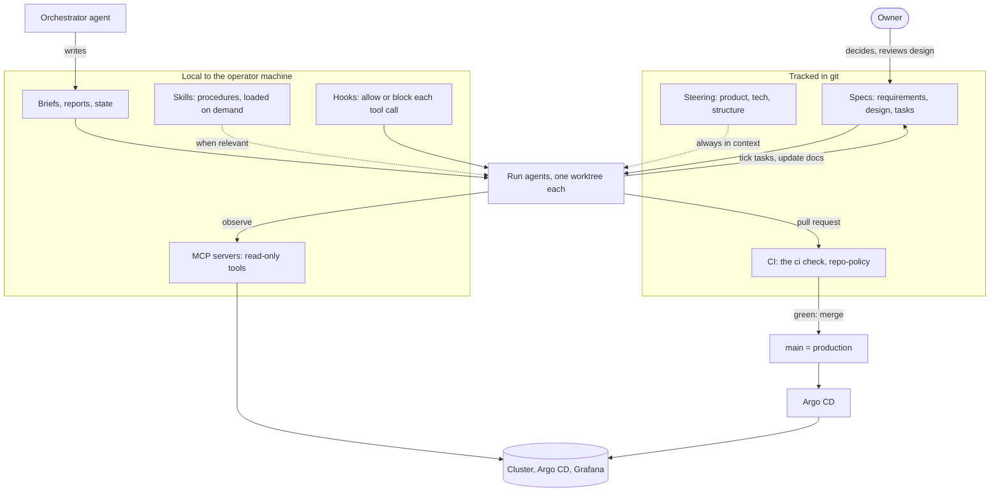
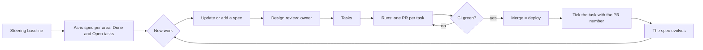

# Spec-driven development with AI agents

How this repository is planned, built and checked by AI agents (Kiro) working
from specs, what works, what does not, and how to start in your own repo.

Have you ever asked an agent for "a small change", gone for a coffee, and
come back to forty files touched, two of them in a directory you did not know
existed? And then wondered how you would even check whether it did what you
meant? If you have, you know the feeling. On a cluster that holds the
family photos, it gets uncomfortable quickly.

Most of this repository was written by agents. That only works because the
agents rarely start from a chat message. They start from a written spec, a
short set of always-true facts about the project, procedures they load when
relevant, and guardrails that block the worst mistakes before they happen. CI
decides what merges, not the agent and not me. By the end of this page you
should know what each of those pieces is, how they fit together, where they
live in this repo, and which ones I would set up first if I started again
tomorrow.

## What is tracked and what is local

| Piece | Path | In git |
| --- | --- | --- |
| Specs | [`.kiro/specs/<feature>/`](../.kiro/specs) | Yes |
| Steering | [`.kiro/steering/`](../.kiro/steering) | Yes |
| Skills | `.kiro/skills/<name>/SKILL.md` | No, local |
| Hooks | `.kiro/hooks/*.json`, scripts next to the operator's state files | No, local |
| MCP servers | `.kiro/settings/mcp.json`, wrappers under `~/.local/share/` | No, local |
| Briefs, run reports, orchestrator state | a git-ignored directory in the checkout | No, local |

`.gitignore` ignores `/.kiro/*` except `specs/` and `steering/`, and the
repo-policy rule `kiro-tracked` in
[`scripts/ci/repo_policy.py`](../scripts/ci/repo_policy.py) fails CI if
anything else under `.kiro/` is committed. The local pieces hold machine
paths, credential file locations and operator notes; they are described
below, with machine paths shown as `<home>`.

## Why spec-driven

Free-form prompting fails in three ways, and all three showed up here before
specs did:

- Drift. A long session slowly forgets the constraint from its first message
  ("never touch the photo volume") and optimises for the last one.
- Lost context. A restart, a context compaction or a second agent starts from
  zero. Whatever was agreed in the chat is gone.
- Unverifiable work. "Done" means the agent stopped. Without written
  acceptance criteria there is nothing to check the result against, so you
  re-read every diff yourself, which defeats the point.

A spec moves the agreement out of the conversation and into a file: what we
want (requirements), how we will do it and what we rejected (design), and
what is left (tasks). Any agent, or the owner a year later, can pick it up.
Every acceptance criterion names the check that proves it, so CI and a
read-only look at the cluster decide whether it is done.

Do not use a spec for:

- One-liners: a typo, a version bump, a missing label. The PR is the spec.
- Exploration: "what would SigNoz cost on this hardware?" is research. Write
  the spec once you know enough to state requirements.
- Incidents in progress. Fix forward or revert first; the spec change, if
  any, comes with the postmortem's action items.

## The building blocks



### Specs

One directory per feature or area under [`.kiro/specs/`](../.kiro/specs),
three files:

- `requirements.md`: an introduction, non-goals, a glossary, then numbered
  requirements, each a user story with acceptance criteria in EARS form.
- `design.md`: the architecture (often a diagram), a decisions table with the
  rejected alternatives, components, verification, error handling and open
  questions. Open questions are answered in the file, at the start of the run.
- `tasks.md`: checkboxes, each one PR or one recorded check, each mapped to
  requirement numbers, ticked with the PR number when it merges.

EARS (Easy Approach to Requirements Syntax) gives each criterion one of a few
fixed shapes, which keeps it testable. Examples from the
[Immich 3 spec](../.kiro/specs/immich-v3-migration/requirements.md):

| Pattern | Shape | Example |
| --- | --- | --- |
| Ubiquitous | THE system SHALL ... | THE migration SHALL NOT write to, resize, detach or delete the library volume. |
| Event | WHEN trigger, THE system SHALL ... | WHEN the migration finishes, THE system SHALL report image and video counts greater than or equal to the baseline. |
| State | WHILE state, THE system SHALL ... | WHILE the migration runs, THE alerts for namespace `immich` SHALL be silenced. |
| Unwanted | IF condition, THEN THE system SHALL ... | IF auto-rollback opens a revert of the database image change, THEN THE automation SHALL close it. |

### Steering

[`.kiro/steering/`](../.kiro/steering) holds what is always true about the
project, so no prompt has to repeat it:
[`product.md`](../.kiro/steering/product.md) (users, services, service
level, principles), [`tech.md`](../.kiro/steering/tech.md) (stack, checks,
hard constraints) and [`structure.md`](../.kiro/steering/structure.md)
(repository map, specs, naming, where secrets live).

Each file starts with front matter that sets its inclusion mode:

| Mode | Front matter | Loaded |
| --- | --- | --- |
| always | `inclusion: always` (or no front matter) | in every interaction |
| fileMatch | `inclusion: fileMatch` and `fileMatchPattern: "apps/**/*.yaml"` | when matching files are in context |
| manual | `inclusion: manual` | when referenced explicitly (`#name` or a slash command) |
| auto | `inclusion: auto` with `name` and `description` | when the request matches the description |

All three files here are `always`, so they must stay short: they cost
context on every turn. Versions are not repeated in steering; it links to
where they are pinned.

### Skills

A skill is a procedure or a reference the agent loads only when the task
needs it: a `SKILL.md` with a name and a description, which is what the agent
matches against. The ones used here:

| Skill | Holds |
| --- | --- |
| `homelab-context` | Facts and hard rules: what never to touch, tooling quirks of the operator machine, where read-only credentials live |
| `run-conventions` | Rules every delegated run follows: shell hygiene, signing, one topic per PR, `scripts/pr-merge.sh`, CI as the gate, backup freshness, the outage guard, "new work starts with a spec" |
| `safe-change` | Evidence first, dry run, diff against live, explicit rollback |
| `talos-ops` | `talosctl` paths, node and BMC slots, etcd snapshots, upgrades through `task talos:*` |
| `secrets-hygiene` | Scanning, SOPS, history rewrites, public-visibility checks |
| `tech-docs` | The documentation standard for this repo |
| `operator-voice` | The owner's writing style, for intros and narrative text only |

Until a skill is loaded, the agent sees only its frontmatter (`name`, and a
`description` listing what it covers), so a brief can say "follow
run-conventions" instead of pasting forty rules. Why not put all of this in
steering? Steering is paid for on every turn, including a one-line question.
Procedures matter only for some tasks, and some of them (credential
locations, machine quirks) do not belong in a public repo at all.

### Hooks

Hooks are commands the agent host runs on events, outside the model. They
are deterministic: the model cannot talk its way past them.

| Hook | Trigger | Does |
| --- | --- | --- |
| `guard-secrets` | PreToolUse on file reads, searches, shell and edits | Blocks a call that would display a secret file (the plaintext secrets working copy, kubeconfigs, the Talos client config, API keys, tokens). Counting and existence checks stay allowed; writes are never blocked |
| `guard-dangerous` | PreToolUse on shell | Blocks plain force pushes, pushes to `main`, anything touching the photo volume, deleting namespaces, PVs or CRDs, live `kubectl` writes, `talosctl reset` without `--system-labels-to-wipe`, `tofu destroy`, S3 deletes, recursive deletes of home or backups, deleting the repo or its branch protection, `git reset --hard`, `git clean -f` |
| `session-context` | SessionStart | Puts the last 40 lines of the orchestrator's state file and the pseudo-terminal count into the agent's context |
| `pty-warning` | UserPromptSubmit | Warns when more than 75% of the machine's pseudo-terminals are in use |

A hook file, with the machine path replaced:

```json
{
  "version": "v1",
  "hooks": [{
    "name": "Guard secret files",
    "trigger": "PreToolUse",
    "matcher": "read_file|read_code|grep_search|file_search|execute_bash|control_bash_process|fs_append|str_replace",
    "action": { "type": "command", "command": "python3 <home>/repos/homelab/<local-dir>/hooks/guard-secrets.py", "timeout": 10 }
  }]
}
```

Exit codes ([Kiro CLI reference](https://kiro.dev/docs/cli/2x-reference/)):

- `0`: allow. For SessionStart and UserPromptSubmit, stdout goes into the
  agent's context.
- `2` (PreToolUse): block the tool call; stderr goes back to the agent as the
  reason, so it can choose another way.
- Anything else: the hook failed; the host shows a warning and, for
  PreToolUse, the call still runs. A guard must exit 2 to block.

Why hooks beat instructions for safety: an instruction is a request the model
weighs against everything else in its context. A hook is a check that runs
every time. The rule "never search the secrets file" was written in prose
after the first time an agent displayed secret values, and the same thing
happened again the next day. The hook ended it (example (c) below).

### MCP servers

MCP servers give the agent tools to look at live systems. All three here are
read-only, with their own credentials:

| Server | Access | Limits |
| --- | --- | --- |
| Kubernetes (`kubernetes-mcp-server`) | a read-only ServiceAccount kubeconfig (#353) | `read_only = true`, toolsets `core` and `config`, Secrets denied in RBAC and in the server config |
| Argo CD (`argocd-mcp`) | the `readonly` local account (#353) | `MCP_READ_ONLY=true` |
| Grafana (`mcp-grafana`) | a Viewer service account | `--disable-write`, 6 tool groups instead of the default 22 |

`mcp.json` points each server at a binary or a small wrapper script under
`<home>/.local/share/homelab-mcp/`; the wrappers read tokens from files and
pin the flags:

```toml
# kubernetes.toml
read_only = true
kubeconfig = "<home>/<agent-credentials>/kubeconfig-readonly"
toolsets = ["core", "config"]
[[denied_resources]]
group = ""
version = "v1"
kind = "Secret"
```

```sh
# grafana.sh, last line: read-only, only the tool groups this repo uses
exec mcp-grafana -t stdio --disable-write \
  --enabled-tools search,datasource,prometheus,alerting,dashboard,annotations "$@"
```

Two reasons for the trimming. Least privilege: an agent that cannot write to
the cluster cannot "quickly fix" it outside git, so every change goes through
a PR and CI. And a tool budget: every tool's schema sits in the context of
every turn, and the Grafana server alone ships about 60 tools by default.
Fewer tools also means fewer wrong tool choices. Agents cannot edit the MCP
configuration; the owner does.

### Briefs, runs and workflows

Bigger work runs as workflows:

- One orchestrator session talks to the owner, keeps a local state file
  (what is running, what was decided, what broke), and writes a brief per run
  into a file.
- Each run is a workflow of one or more steps. A step is an agent session
  that reads its brief, loads `run-conventions`, works in its own worktree
  under `.worktrees/<name>` from `origin/main`, opens PRs, merges them with
  [`scripts/pr-merge.sh`](../scripts/pr-merge.sh), writes a short report file
  and signals success, a question (the workflow pauses) or failure.
- Independent topics run as parallel runs, never two on the same files.

A run sees its brief, the steering, the skills and the repo. It does not see
the orchestrator's conversation, and after a restart neither does the
orchestrator. So a brief is self-contained: the goal in the owner's words,
the spec to follow or write, what is allowed live and what is not, the
abort criteria, where the report goes, and when to stop.

### Who owns what

| Question | Where it lives |
| --- | --- |
| What are we building, for whom, what is out of scope? | `requirements.md` of the spec |
| How, and what did we reject? | `design.md`; cross-cutting decisions in [docs/decisions.md](decisions.md) |
| What is left, and which PR did each part? | `tasks.md` |
| What is this project, its stack, its layout? | [`.kiro/steering/`](../.kiro/steering) |
| How do I do X here safely? | a skill |
| What must never happen? | a hook, and a CI rule where git can check it |
| What is the cluster doing right now? | the read-only MCP servers |
| What should this run do now? | the brief |
| Is it safe to merge? | the `ci` check, nothing else |
| How do I operate it? | [docs/](.) and [docs/runbooks/](runbooks) |
| What happened, and why? | git history and [docs/postmortems/](postmortems) |

## The lifecycle



### Brownfield retrofit

This repo had several hundred merged PRs before its first spec, so it started
from what exists:

1. Steering baseline (#504): `product.md`, `tech.md` and `structure.md`,
   generated from the repo, the docs and the skills, then cut down to what is
   always true. The same PR made `.kiro/specs/` and `.kiro/steering/` tracked.
2. As-is specs (#506): one spec per area (`platform-talos`,
   `gitops-delivery`, `backups-dr`, `observability-alerting`,
   `access-identity`, `media-home`). Requirements describe what the system
   does today, each criterion naming its check. Tasks list Done items with
   their PRs and Open items from the backlog.
3. From then on, `run-conventions` says new work starts by updating or adding
   a spec.

Only areas expected to change need a spec. A directory nobody touches does
not need its behaviour written down twice.

### New work

1. Update the area's spec, or add one for a feature that spans areas (the
   Immich 3 migration, each wave 3 branch).
2. The owner reviews requirements and design, the cheapest place to change
   your mind. Open questions go in `design.md` and are answered from
   upstream docs and read-only checks at the start of the run.
3. Tasks: one PR or one recorded check each, mapped to requirement numbers,
   ordered so each PR is safe on its own.
4. Runs execute the tasks. CI is the gate; [`scripts/pr-merge.sh`](../scripts/pr-merge.sh)
   merges only on a green `ci`, signed commits and an up-to-date branch.
5. Each merged task is ticked with its PR number, in the same PR or the next.
6. When reality disagrees with the spec, the spec changes first, in the
   open, and the decision row keeps the rejected option.

### Mapped to GitOps

| Spec artefact | GitOps counterpart |
| --- | --- |
| A task | One pull request, one topic |
| An acceptance criterion | A CI check, a repo-policy rule, a promtool test, a smoke hook or an alert |
| Design decision with rejected alternatives | The decisions table, or [docs/decisions.md](decisions.md) for cross-cutting ones |
| "Done" | Merged to `main`, synced by Argo CD, and the check named in the criterion passes |
| Rollback path in the spec | A revert PR, or the restore runbook for one-way changes |
| Spec history | `git log .kiro/specs/<feature>/` |

## Best practices

- Requirements before solutions: agents build the wrong thing very quickly.
- Testable EARS criteria that name their check: CI or a query decides "done".
- Non-goals in every spec: agents expand scope with enthusiasm.
- One topic per PR: a revert undoes one thing, a review reads one thing.
- Deterministic first, AI for summaries and text: a script gives the same
  answer twice ([decisions](decisions.md#deterministic-first)).
- CI as the only gate: a human approval at 3 am is a rubber stamp
  ([decisions](decisions.md#no-human-gates)).
- Guardrails as hooks, not prose: prose is advice; a hook runs every time.
- Least-privilege agent access: read-only tools push every change into git.
- Never let agents display secrets: refer to them by file and key, pipe them
  from file to tool (`gh secret set` from stdin).
- Keep steering short: it is paid for on every turn.
- Specs evolve, never rot: a spec nobody ticks becomes fiction.
- Humans decide on one-way doors: a data format migration or flashing the
  last old node is the owner's call; everything reversible is CI's.
- Record decisions with rejected alternatives: the next agent will propose
  the rejected option again.

## Worked examples

### (a) The Immich 3 migration

Immich 3 needs the VectorChord extension; the database still ran pgvecto.rs,
and the change is one-way. [The spec](../.kiro/specs/immich-v3-migration/)
was the first one in the repo. It made "no data loss" testable and put the
way back in writing before anything changed:

```markdown
### Requirement 2: Recoverable at every step

1. BEFORE the database image changes, THE system SHALL hold a completed base backup and a
   `pg_dump` whose table of contents lists without error.
2. IF any verification in Requirement 1 or 3 fails and is not fixed within 30 minutes, THEN
   THE operator's automation SHALL restore the database on the old image and roll Immich back
   to 2.7.5.
3. IF auto-rollback opens a revert of the database image change, THEN THE automation SHALL
   close it, because reverting the image alone does not undo the data migration.
```

The design's open questions (which image, whether an intermediate 2.x is
required, what breaks in 3.x) were answered in
[`design.md`](../.kiro/specs/immich-v3-migration/design.md) by reading the
upstream docs at the start of the run. One answer changed the plan: the
chosen image has no pgvecto.rs, so the documented manual path applies. The
tasks ended up ticked like this:

```markdown
- [x] 5. PR: switch `immich-db` to the VectorChord image (digest-pinned), ... (#482; manual SQL before and after the restart)
- [x] 6. PR (only if required): Immich to the latest 2.x. ... (not required: 2.7.5 is the last 2.x; ...)
- [x] 7. PR: Immich to the latest 3.x (server, ML, chart values). ... (#485: v3.3.3, chart 0.13.4 OCI; ...)
- [x] 9. PR: remove the Renovate cap below 3. Expire the silence. [4.1, 5.1] (#488)
```

Task 6 is ticked with "not required" rather than deleted: the spec records
that the question was asked. Counts matched the baseline, the rollback path
was never used, and the owner gave the go for the window because the change
was one-way.

### (b) The as-is retrofit

#504 tracked the steering and the first spec; #506 added the six area specs
in one PR, one topic. The rule for the run was that each criterion names what
proves it, and anything that could not be verified against `main`, the cited
files or a read-only look at the cluster was left out. From
[`gitops-delivery`](../.kiro/specs/gitops-delivery/requirements.md):

```markdown
1. THE branch `main` SHALL require the strict status check `ci`, signed
   commits and linear history, for admins too, with no force push, no
   deletion and 0 required approvals. (`gh api
   repos/ned-si/homelab/branches/main/protection`)
```

Its [`tasks.md`](../.kiro/specs/gitops-delivery/tasks.md) turns the area's
history into sixteen ticked lines with their PRs (Renovate automerge #180,
automatic rollback #181, digest pinning #474, ...), with the open work
underneath, so a newcomer reads the area in a minute.

### (c) A guardrail born from an incident

Twice, on consecutive days, the orchestrator ran a content search on the
plaintext secrets working copy to check whether a variable was set. The
search tool printed the matching lines, values included, into the agent's
context. Nothing was committed or sent anywhere, but a value in a model's
context is a value you no longer control, so the owner was asked whether
to rotate the exposed credential.

After the first time, a prose rule was added ("never search that file for
values"). It did not prevent the second. The fix was the `guard-secrets`
PreToolUse hook: reads are judged by their target path, searches by their
include pattern, and shell commands only when a printing command (`cat`,
`sed`, `grep` without `-c` or `-q`, `sops -d`, ...) takes a secret file as
its argument or as a redirect. Presence checks that print a count
(`grep -c '^SOME_NAME=.' <file>`) stay allowed. The first version was too
broad; see "Over-broad hooks" below.

### (d) Wave 3, spec-first with parallel branches

Wave 3 of the best-practices work (runbooks and SLOs, Kyverno and Tetragon
in audit mode, Hubble and network-policy audit, a log store trial) was first
launched as free-form runs straight from a gap analysis. That launch was
"canceled" (see phantom runs below) and relaunched spec-first: the first step
wrote one spec per branch, and each branch committed its own spec in its
first PR:

- [`wave3-reliability`](../.kiro/specs/wave3-reliability/): a promtool test
  for every alert (#514), a runbook for every paging alert.
- `wave3-runtime-security`: Kyverno and Tetragon in audit mode, lands with
  its branch.
- [`wave3-network-logs`](../.kiro/specs/wave3-network-logs/): Hubble relay
  and UI (#515, #519), allow-lists from observed flows, the log trial.

The branches ran in parallel, in separate worktrees, on separate files. The
non-goals keep each one in its lane ("Enforcing any new policy: every
allow-list ships with `enableDefaultDeny` false"). The decisions table holds
what an agent would otherwise rediscover the hard way: cluster-wide policy
audit mode was rejected because it stops enforcing every existing policy and
restarts every Cilium agent. And the log store trial ends on a deterministic
gate, recorded thresholds computed by recording rules, not on taste.

Then the owner changed his mind about something the spec states: every admin
UI goes on the public Gateway behind SSO and group gating, and only `kubectl`
and `talosctl` stay on the tailnet, because a VPN is not more secure than SSO
with group gating. Requirement 1.2 of `wave3-network-logs` ("reachable only at
`https://hubble.<tailnet>.ts.net`") is now wrong, and the next PR on that
branch starts by editing it and the matching decision row. That is the whole
point: the spec is the place where the change of mind is written down.

## Lessons learned

None of this was smooth. Here is what went wrong, roughly in order of how
silly I felt afterwards.

### Phantom runs

I launched wave 3, the creation looked like it failed, I marked it canceled
and relaunched it spec-first. Fair enough. Except the "canceled" launch was
alive, invisible to the orchestrator, and politely opening PRs: one for
Kyverno, one for runbooks, both with green CI. Two agents were now working
on the same topic from two different plans.

The spec-first branches closed one phantom PR as superseded and adopted the
other, and the phantom runs were found and stopped one by one. Lesson:
"canceled" is a claim, not a fact. After a launch that looks failed, check
for new branches and PRs before relaunching, and make briefs say "if a PR
for this topic exists, adopt it".

### Running out of pseudo-terminals

Agents start shells. Shells that are not closed keep their pseudo-terminal,
and a Mac has a limit (511 by default). With several parallel runs, each
starting background processes, the machine ran out three times in three
days, and every agent session froze at once, including the one that would
have cleaned up. The leaked terminals were held by the agent host itself, so
only a restart freed them.

What helped: `run-conventions` makes every run close what it starts, the
`pty-warning` hook warns at 75% before the cliff, and parallel runs are
capped at three. Raising the limit bought headroom, not a fix.

### The emergency revert our own CI blocked

A PR moved seven single-instance database clusters to minimal images at
once. One of them could not start (its data carried a locale the minimal
image does not ship), and with it went single sign-on for every app. The
revert was a one-line change. CI refused it: the image-variant rule, added
the same day to stop variant drift, saw "minimal back to full" as exactly
the drift it was built to stop. The outage lasted about an hour, a good part
of it spent arguing with my own guardrail
([postmortem](postmortems/2026-10-15-keycloak-db-image.md)).

The fix (#427): reverts are exempt from the rule, by PR title or by the
auto-revert branch prefix. The broader lesson: every guard needs an answer
to "what does this do to the revert?". And stateful changes roll out one
cluster per PR, with a health gate between them, however tempting the batch.

### Stale state after restarts

After a restart, runs that were mid-step could not be resumed or stopped:
their state would not load, and some stayed as ghosts in the list. One night
the shell died, three runs stalled silently, and nothing moved until
morning. Meanwhile the orchestrator's state file kept growing, with some
lines confidently out of date ("these nodes are off and must stay off", well
after they had joined the cluster).

What helped: the `session-context` hook puts the tail of the state file into
every new session, corrections go in as new dated lines, every run is
checked on every turn (one nudge, then a relaunch from its brief), and
anything important lives in the spec, where a restart cannot touch it. The
state file is a diary; the spec is the contract.

### Over-broad hooks

The first `guard-secrets` blocked any call that mentioned a secret file,
including an append to the state file whose text happened to contain the file
name. An agent cannot write a note about the incident that created the hook.
Self-irony, delivered.

The rewrite judges reads by target path, searches by include pattern and
shell only when a printer takes the file, never writes, and comes with a
small test table. `guard-dangerous` has the opposite problem: it sees only
the command line, so a script file that runs `kubectl patch` walks past it.
Known and accepted: the hook catches accidents, not intent, and each brief
states whether a run may write live at all (the default is no).

### Parallelism costs tokens

Yeah, sure, run six agents at once. By the 6th of October about 80% of the
month's budget was gone. Parallel runs also collide on `main`: every merge
moves it, the other branches rebase, CI runs again. The emergency revert
above was rebased three times before it could merge.

What I do now: low effort by default, one review pass and then CI (no review
loops), at most three runs in parallel and never two on the same files, and
deterministic checks wherever a model would otherwise be asked to "verify".

## Start tomorrow

There is no need to copy all of it. A first week could look like this:

1. Write three steering files (product, tech, structure), under a page each.
2. Write a spec for the next change that matters, before any code: non-goals,
   one rejected alternative, tasks mapped to requirement numbers.
3. Make CI the gate: each acceptance criterion names a check in CI or a
   read-only command.
4. Add one PreToolUse hook that blocks reading your secret files and the
   commands you would hate to see run. Test it.
5. Give the agent read-only credentials for anything live.
6. Move your longest repeated prompt into a skill.
7. Tick tasks with PR numbers; when the plan changes, change the spec first.
8. After a month, write as-is specs for the areas you keep touching.

### Template: requirements.md

```markdown
# Requirements: <feature>

## Introduction

<Why this exists, the current state, what changes. Three to six sentences.>

Non-goals:
- <What this feature deliberately does not do.>

Glossary: **<Term>**: <definition used in the criteria below>.

## Requirements

### Requirement 1: <outcome>

**User story:** As <role>, I want <capability>, so that <benefit>.

#### Acceptance criteria

1. WHEN <trigger>, THE <system> SHALL <response>. (<the check that proves it>)
2. WHILE <state>, THE <system> SHALL <response>. (<check>)
3. IF <unwanted condition>, THEN THE <system> SHALL <response>. (<check>)
4. THE <system> SHALL NOT <forbidden effect>. (<check>)
```

### Template: design.md

```markdown
# Design: <feature>

## Overview

<The parts that change, in order. What does not change.>

## Decisions

| Decision | Choice | Alternatives rejected |
| --- | --- | --- |
| <topic> | <what we do> | <what we do not do, and why> |

## Verification and error handling

- <command or query, and the expected result>.
- <failure>: <stop, fix forward within N minutes, or roll back>.

## Open questions

1. <question> (answered here, with the source, before task 2 starts)
```

### Template: tasks.md

```markdown
# Tasks: <feature>

Each task is one PR or one recorded check. Requirement numbers in brackets.

- [ ] 1. Answer the open questions in design.md. [1.2, 2.1]
- [ ] 2. PR `<type>(<scope>): <title>`: <what>. [1.1, 1.3]
- [ ] 3. Verify <criteria> with <check>; record the result here. [1, 2]
- [ ] 4. PR `docs(<scope>): <title>`. [3.1]

Rollback path: <the steps, and the criterion that triggers them>. [2.2]
```

When a task merges: `- [x] 2. PR ... [1.1, 1.3] (#123)`.

### Template: a steering file

```markdown
---
inclusion: always
---
# Product

<One paragraph: what this is, for whom, and how they use it.>

## Principles

- <rule that holds for every change, one line each>

## Where to look

- <topic>: [<doc>](../../docs/<doc>.md)
```

For a file that matters only in part of the tree, use
`inclusion: fileMatch` with a `fileMatchPattern` instead.

### Template: a PreToolUse hook

The hook file has the shape of the `guard-secrets` excerpt above, with
`"matcher": "read_file|grep_search|execute_bash"` and
`"command": "python3 .kiro/hook-scripts/guard.py"` (adapt the schema to your
agent host). The script reads the event as JSON on stdin and answers with its
exit code:

```python
#!/usr/bin/env python3
"""PreToolUse guard: exit 2 blocks the call (reason on stderr), exit 0 allows it."""
from __future__ import annotations

import json
import re
import sys

SECRET_FILES = re.compile(r"(\.env\b|\.env\.local\b|kubeconfig|id_ed25519|\.pem\b)", re.I)
PRINTERS = re.compile(r"^\s*(sudo\s+)?(cat|less|more|head|tail|sed|awk|grep(?!\s+-[a-z]*[cq]\b))\b")
DANGEROUS = [
    (re.compile(r"\bgit\s+push\b(?!.*--force-with-lease).*(--force\b|\s-f\b)"), "plain force push"),
    (re.compile(r"\bgit\s+reset\s+--hard\b"), "git reset --hard"),
    (re.compile(r"\bgit\s+clean\s+-[a-z]*f"), "git clean -f"),
    (re.compile(r"\brm\s+-[a-z]*r[a-z]*\s+(/|~|\$HOME)/?(\s|$)"), "recursive delete of / or home"),
]

def reason(event: dict) -> str | None:
    tool = str(event.get("tool_name", ""))
    args = event.get("tool_input") or {}
    if tool == "read_file" and SECRET_FILES.search(str(args.get("path", ""))):
        return "it would display a secret file"
    if tool == "grep_search" and SECRET_FILES.search(str(args.get("includePattern", ""))):
        return "it would display lines of a secret file"
    if tool == "execute_bash":
        cmd = str(args.get("command", ""))
        for pattern, why in DANGEROUS:
            if pattern.search(cmd):
                return why
        for segment in re.split(r"[|;&\n]+", cmd):
            if SECRET_FILES.search(segment) and PRINTERS.search(segment):
                return "it would print a secret file"
    return None

def main() -> int:
    try:
        event = json.load(sys.stdin)
    except ValueError:
        return 0  # unknown event shape: allow rather than break every call
    why = reason(event)
    if why:
        print(f"Blocked by guard: {why}. Refer to secrets by file and key, "
              "or ask the user.", file=sys.stderr)
        return 2
    return 0

if __name__ == "__main__":
    sys.exit(main())
```

Test it before trusting it, with one allowed and one blocked case per rule:

```sh
echo '{"tool_name":"execute_bash","tool_input":{"command":"git reset --hard"}}' \
  | python3 .kiro/hook-scripts/guard.py; echo "exit $?"
echo '{"tool_name":"execute_bash","tool_input":{"command":"grep -c ^API_KEY= .env"}}' \
  | python3 .kiro/hook-scripts/guard.py; echo "exit $?"
```

Expected output: the reason on stderr and `exit 2` for the first, `exit 0`
for the second. Unparseable input is allowed on purpose here; fail closed
instead if a blocked call is cheaper for you than a missed one.

## Why it is like this

- Specs and steering are tracked, everything else under `.kiro/` is local.
  The specs are the contract and belong next to the code they describe;
  skills, hooks and MCP settings carry machine paths and credential
  locations. Rejected: tracking all of `.kiro/` (leaks the operator machine
  into a public repo) and tracking none of it (a restart or a second machine
  loses the plan).
- One spec per area plus one per cross-cutting feature. Rejected: one spec
  per PR, which turns specs into PR descriptions nobody rereads.
- CI is the only gate, for agents and humans alike
  ([decisions](decisions.md#no-human-gates)). Rejected: an approval step,
  which in a one-person repo is the same person clicking twice.

There is no right or wrong way to start. Pick one piece, make it yours, and
may your agents only ever force-push with a lease.
